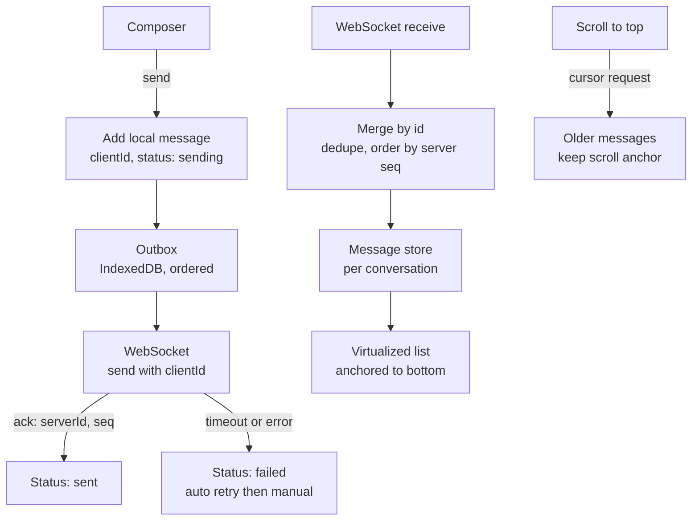
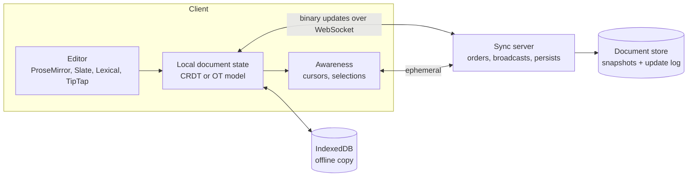
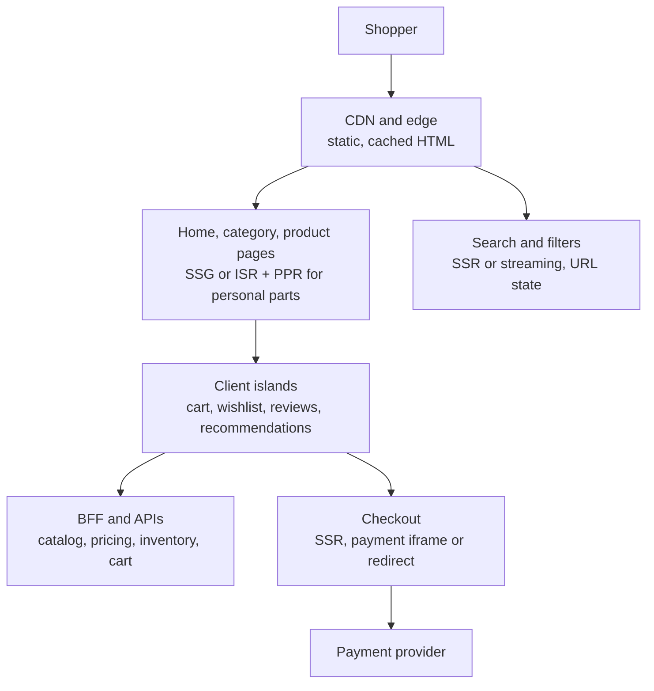
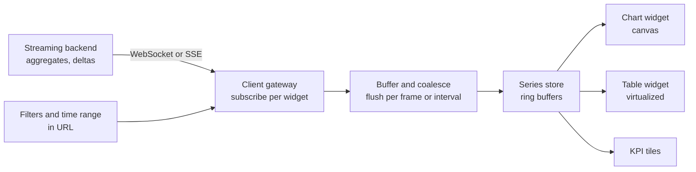
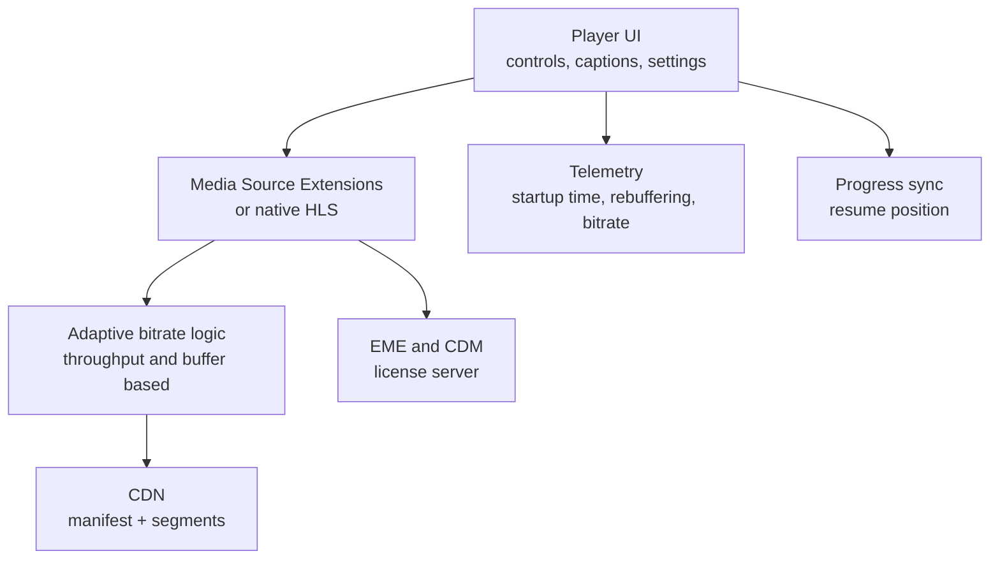
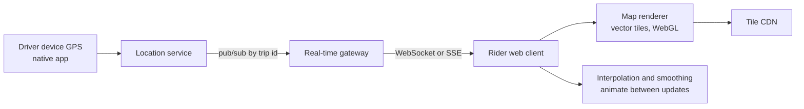

# 📘 Application Designs

These prompts combine everything: rendering strategy, state and caching, real-time transport, offline behavior, performance, accessibility, and team structure.
Use the same RADIO flow, and spend your time where the problem is hard (ordering in chat, conflict resolution in docs, SEO and checkout in commerce, rate of updates in dashboards).
Smaller widget prompts are in [UI Component Designs](/docs/frontend-system-design/ui-component-designs).

## Table of Contents

1. [Chat Application](#1-chat-application)
2. [Collaborative Document Editor](#2-collaborative-document-editor)
3. [E-commerce Storefront and Checkout](#3-e-commerce-storefront-and-checkout)
4. [Real-Time Analytics Dashboard](#4-real-time-analytics-dashboard)
5. [Video Streaming UI](#5-video-streaming-ui)
6. [Kanban Board](#6-kanban-board)
7. [Maps and Ride Tracking](#7-maps-and-ride-tracking)
8. [Photo Library](#8-photo-library)
9. [Comparison and Reuse](#9-comparison-and-reuse)
10. [Questions](#10-questions)

---

## 1. Chat Application

**Requirements:** conversation list, message thread, send with instant feedback, real-time receive, typing and presence, unread counts, history pagination, attachments, works on flaky networks and across tabs.



| Concern | Decision |
| --- | --- |
| **Data model** | `conversations`, `messagesById`, per conversation ordered ids, `lastReadSeq`, drafts. Normalize so a status change updates every view |
| **Send path** | Client generated id for optimistic render, server ack returns the canonical id and sequence, retry is idempotent by client id |
| **Ordering** | Server assigned sequence per conversation, the client sorts by sequence, pending messages sit at the bottom ordered by local time |
| **Transport** | WebSocket with heartbeat, reconnect with backoff and jitter, resume from the last sequence, one connection shared across tabs (SharedWorker or leader tab) |
| **Delivery state** | `sending`, `sent`, `delivered`, `read` with per message or per conversation receipts, throttled |
| **Unread and read receipts** | Last read pointer per conversation, update when the message is visible in the viewport and the tab is focused, badge counts from the server |
| **Typing and presence** | Ephemeral events throttled to one every few seconds, expire after a timeout, subscribe only to open conversations |
| **List behavior** | Stick to the bottom only if the user is at the bottom, otherwise show a "new messages" pill, when prepending history keep the visible message stable by adjusting scroll offset (scroll anchoring), virtualize with variable heights |
| **Rich content** | Safe rendering (sanitize or structured message blocks), link previews fetched by the server, emoji and reactions as small mutations, markdown subset |
| **Attachments** | Direct to storage uploads with progress, thumbnails, retry, message shows a placeholder until upload completes |
| **Search** | Server side full text, highlight results, jump to message in context |
| **Offline** | Cached recent conversations in IndexedDB, outbox replays on reconnect, banner shows connection state |
| **Notifications** | Web Push when closed, in-app sound and title badge when open and not focused |
| **Security** | End to end encryption changes the design (search and previews move to the client, key management UI), otherwise TLS and server side controls |
| **Accessibility** | `role="log"` with `aria-live="polite"` for new messages, keyboard navigation of the list, focus management in composer, no focus theft on incoming messages |

```js
// runnable
// Merge incoming server messages with optimistic local ones: dedupe by clientId, order by server sequence.
function mergeMessages(local, incoming) {
  const byClient = new Map(local.map((m) => [m.clientId, m]));
  for (const m of incoming) byClient.set(m.clientId, { ...byClient.get(m.clientId), ...m, status: 'sent' });
  return [...byClient.values()].sort((a, b) => (a.seq ?? Infinity) - (b.seq ?? Infinity) || a.localTime - b.localTime);
}

let msgs = [
  { clientId: 'c1', text: 'hi', seq: 1, status: 'sent', localTime: 1 },
  { clientId: 'c2', text: 'how are you?', status: 'sending', localTime: 2 },   // optimistic
];
msgs = mergeMessages(msgs, [
  { clientId: 'x9', text: 'hello from Sam', seq: 2, localTime: 0 },             // someone else's message
  { clientId: 'c2', text: 'how are you?', seq: 3, localTime: 2 },               // ack for ours (same clientId)
]);
console.log(msgs.map((m) => `${m.seq}:${m.text}:${m.status}`).join(' | '));
```

---

## 2. Collaborative Document Editor

**Requirements:** rich text editing by many users at once, live cursors, comments, version history, offline editing, large documents, permissions.



| Concern | Decision |
| --- | --- |
| **Editor engine** | Do not build from scratch: use a framework with a schema based document model (ProseMirror family, Lexical, Slate) and controlled commands, `contenteditable` is full of browser inconsistencies |
| **Concurrency model** | **OT** (central server transforms operations, used by Google Docs) or **CRDT** (Yjs, Automerge, Loro: merge anywhere, great for offline). CRDTs trade metadata size for simpler servers and offline support |
| **Transport** | WebSocket with small binary updates, batching a few ms of typing, resume from a state vector after reconnect |
| **Local first** | Apply edits immediately (zero latency), persist to IndexedDB, sync in the background, show "saved" and "offline" status |
| **Awareness** | Cursors, selections, and user colors are ephemeral, broadcast throttled, rendered as decorations, removed on disconnect |
| **Large documents** | Paginate or virtualize blocks, lazy load images and embeds, keep the document tree efficient, offload parsing and export to workers |
| **Undo and redo** | Per user undo stack that only undoes your own operations |
| **Comments and suggestions** | Anchors tracked through edits (relative positions in the CRDT), thread UI, resolved state, mentions |
| **Version history** | Periodic snapshots plus the update log, named versions, restore as a new revision, diff view |
| **Permissions** | Viewer, commenter, editor roles enforced on the server, the editor switches to read only mode on role change, link sharing settings |
| **Rich blocks** | Tables, embeds, code blocks as schema nodes with their own views, slash menu for insertion |
| **Paste and import** | Sanitize pasted HTML into the schema, import and export docx or Markdown on the server |
| **Performance** | Typing latency under 16 ms, avoid whole document re-render, split heavy decorations (spellcheck) into idle work |
| **Accessibility** | Proper roles for the editing surface, keyboard shortcuts documented and customizable, announce collaborator joins and comment changes, high contrast cursors |
| **Failure modes** | Divergence detection and resync, snapshot corruption recovery, "reload to resync" as a last resort |

Say out loud: **OT needs a central ordering server and complex transform functions, CRDTs converge without one but keep identifiers for every character, so compaction and garbage collection matter**.
See the CRDT example in [Real-Time, Offline, and Sync](/docs/frontend-system-design/real-time-offline-and-sync).

---

## 3. E-commerce Storefront and Checkout

**Requirements:** SEO for categories and products, fast on mobile, search and filters, personalized recommendations, cart and checkout with payments, promotions, i18n and currencies, high traffic events (sales).



| Area | Decision |
| --- | --- |
| **Rendering** | Product and category pages are ISR or SSG with on-demand revalidation when price or stock changes, personalized parts (price for a member, recommendations, stock by location) stream in or load client side, checkout is server rendered and not cached |
| **SEO** | Clean URLs, canonical for filter combinations, structured data (`Product`, `Offer`, `BreadcrumbList`, ratings), sitemap, fast LCP |
| **Product page** | The hero image is the LCP (priority, right size, AVIF), gallery loads lazily, variant selector updates price and images without full reload and updates the URL, reviews and recommendations lazy below the fold |
| **Search and filters** | Server side search (Elasticsearch or similar), facets, filters live in the URL, debounced, previous results kept visible during refetch, keyboard accessible, typeahead with recents |
| **Cart** | Server is the source of truth for logged in users, anonymous cart in a cookie or local storage merged on login, optimistic add to cart with a mini cart drawer, quantity changes debounced, stock and price re-validated before checkout |
| **Checkout** | Few steps, address autocomplete, saved payment methods, guest checkout, inline validation, preserve state on refresh, idempotency key on order submit to prevent double charge, clear error recovery |
| **Payments** | Use the provider's hosted fields or redirect (the card data never touches your servers, reduces PCI scope), 3-D Secure handling, wallets (Apple Pay, Google Pay), webhooks confirm the order |
| **Pricing and promotions** | Computed on the server, the client displays and re-fetches on change, never trust client totals |
| **Inventory** | Show availability from a cached source and confirm at checkout, handle "sold out" races with clear messages |
| **Performance** | Budget per page type, image CDN, route prefetch on hover, limit third party tags (analytics, ads, chat), stable layout for banners and carousels |
| **Peak traffic** | Cache HTML at the CDN, static fallbacks, queue or waiting room for drops, degrade nonessential features (recommendations) under load |
| **i18n and currency** | Locale in URL, `Intl` formatting, localized taxes and shipping, RTL, translated metadata and `hreflang` |
| **Accessibility** | Accessible variant pickers and galleries, focus management in the cart drawer and checkout errors, form labels and autocomplete tokens |
| **Experimentation** | A/B tests evaluated at the edge with stable bucketing, exposure logging, guardrails on conversion and errors |
| **Analytics** | Funnel events (view item, add to cart, begin checkout, purchase) with dedupe on purchase |

---

## 4. Real-Time Analytics Dashboard

**Requirements:** many charts and tables updating live, filters and time ranges, drill down, saved layouts, large data, responsive under bursts of updates.



| Concern | Decision |
| --- | --- |
| **Data volume** | Aggregate on the server (rollups by time bucket), send only what a widget can display, downsample for the visible width (for example largest-triangle-three-buckets) |
| **Updates** | Deltas not snapshots, batch per animation frame or 250 to 1000 ms, coalesce by series, drop intermediate points when behind |
| **State** | A store of bounded ring buffers per series, widgets subscribe to their slice only so one update re-renders one chart |
| **Rendering** | Canvas or WebGL for dense charts (thousands of points), SVG for small ones, `OffscreenCanvas` in a worker for heavy ones, avoid animating everything |
| **Heavy compute** | Parse, aggregate, and transform in a Web Worker, transfer typed arrays with transferable objects |
| **Layout** | Grid layout with drag and resize (persist per user, validate saved layouts against schema versions), lazy mount widgets when they scroll into view, pause hidden ones |
| **Interactions** | Crosshair and tooltips with nearest point lookup (binary search or quadtree), brush to zoom with debounced refetch of higher resolution data, synchronized time ranges across widgets |
| **Time handling** | Store UTC, display in the user's zone, align buckets on server, clearly label the range and refresh time |
| **Freshness and failure** | Show "last updated", connection status, stale styling, fall back to polling, retry per widget with isolated errors |
| **Filters** | In the URL, one query per widget keyed by filters, cancel in-flight requests when filters change |
| **Access control** | Row level and widget level permissions enforced on the server |
| **Export and share** | Server generated reports or CSV, shareable URLs with filters |
| **Accessibility** | Charts need text alternatives: data tables, summaries, keyboard focusable data points, patterns in addition to color, announce live updates sparingly |
| **Testing** | Deterministic data fixtures, visual regression on charts, performance tests with synthetic streams |

---

## 5. Video Streaming UI

**Requirements:** browse catalog, start playback fast, adaptive quality, resume position, subtitles and audio tracks, works on TV, mobile, and desktop, handles bad networks, DRM for premium content.



| Concern | Decision |
| --- | --- |
| **Delivery** | HLS or DASH adaptive streaming: video split into short segments at several bitrates and a manifest, the player picks the quality from measured throughput and buffer level. Players: hls.js, dash.js, Shaka, or native `video` where HLS is supported |
| **Startup time** | Preconnect to the CDN, start at a lower quality, small initial segments, preload metadata, prefetch the first segment for likely titles on hover, show a poster instantly |
| **Buffering policy** | Target a buffer (for example 30 seconds ahead), avoid stalls over peak quality, switch down quickly and up slowly to prevent flapping |
| **Metrics** | Time to first frame, rebuffer ratio, average bitrate, playback errors, and exit before video start, as RUM events with device and network info |
| **Controls** | Play, seek (with thumbnails from a sprite sheet), volume, speed, captions, audio track, quality, picture in picture, fullscreen, casting, keyboard shortcuts (`Space`, `K`, `J`, `L`, arrows, `F`, `M`) |
| **Captions and a11y** | WebVTT tracks, styling options, transcripts, labeled controls, focus management, no keyboard traps in the player, respect reduced motion for previews |
| **Resume and sync** | Save position every few seconds and on pause, restore on any device, handle the "continue watching" row from a server list |
| **Browse UI** | Horizontal carousels with virtualization, lazy images, hover previews that start video on intent, lightweight cards, personalized rows with skeletons, cached for fast back navigation |
| **Autoplay rules** | Browsers require muted autoplay or a user gesture, handle rejection of `play()` promises |
| **DRM** | EME with Widevine, FairPlay, PlayReady, license request through your server, platform specific rules, output restrictions |
| **Live** | Low latency HLS or DASH, DVR window, live edge, chat and reactions through WebSocket, graceful end of stream |
| **TV and low-end devices** | Spatial navigation (D-pad focus management), simpler DOM, smaller JS, 10 foot UI sizing |
| **Offline** | Download manager with encrypted storage (mostly native apps, limited on web) |
| **Resilience** | Retry with alternate CDN hosts, fallback to a lower bitrate rendition, clear error codes and messages |

---

## 6. Kanban Board

**Requirements:** columns of cards, drag and drop between and within columns, real-time collaboration, card detail modal, filters, keyboard accessible, many cards.

| Concern | Decision |
| --- | --- |
| **Data model** | `boardsById`, `columnsById`, `cardsById`, each column has ordered `cardIds` or each card has an `order` key. Normalize so moving a card changes minimal data |
| **Ordering** | Use **fractional indexing** (a lexicographic key between neighbors) so inserting a card needs one update, not renumbering the column, rebalance occasionally |
| **Drag and drop** | Pointer events or a library (dnd-kit, Pragmatic drag and drop), drag overlay rendered in a portal, placeholder gap, auto scroll near edges, drop target highlighting, cancel with `Esc` |
| **Optimistic move** | Apply the new position immediately, send `{ cardId, columnId, beforeKey, afterKey }`, reconcile with server order, roll back on failure |
| **Collaboration** | Broadcast moves over WebSocket, apply remote moves unless the local user is dragging that card, resolve concurrent moves by server order, show who is editing a card |
| **Performance** | Virtualize long columns, memoize cards, drag updates only transform of the dragged element (no re-render of the board), avoid layout thrash during drag |
| **Keyboard and a11y** | Keyboard drag (focus a card, `Space` to pick up, arrows to move, `Space` to drop) with live region announcements ("moved to In Progress, position 2 of 5"), alternative "move to" menu, visible focus |
| **Touch** | Long press to start drag to avoid conflicts with scroll, larger handles |
| **Card details** | Route based modal (deep link `/board/12/card/88`), lazy loaded rich editor, comments and attachments |
| **Filters and search** | Client side for loaded cards, server side for big boards, filters in the URL, dim non-matching cards |
| **Offline** | Local board copy, outbox of moves and edits, conflict handling on reconnect |

```js
// runnable
// Fractional indexing: generate a key that sorts between two neighbors without renumbering.
const DIGITS = 'abcdefghijklmnopqrstuvwxyz';
function between(a = '', b = '') {
  // returns a string strictly between a and b (a < b, either may be empty meaning open end), keys never end in 'a'
  let result = '';
  for (let i = 0; ; i += 1) {
    const lo = a[i] ? DIGITS.indexOf(a[i]) : 0;
    const hi = b[i] !== undefined ? DIGITS.indexOf(b[i]) : DIGITS.length;
    if (hi - lo > 1) return result + DIGITS[Math.floor((lo + hi) / 2)];
    result += DIGITS[lo];
    if (b[i] !== undefined && hi - lo === 1) b = '';       // after matching a's digit, b no longer constrains
  }
}

let keys = ['m'];                                           // one card
keys.push(between('m', ''));                                // append
keys.unshift(between('', 'm'));                             // prepend
keys.splice(1, 0, between(keys[0], keys[1]));               // insert in the middle
console.log(keys.join(' < '), '| sorted:', JSON.stringify(keys) === JSON.stringify([...keys].sort()));
```

---

## 7. Maps and Ride Tracking

**Requirements:** map with a moving vehicle, pickup and drop-off selection, ETA, route line, real-time updates, works on mobile with spotty GPS and network, battery friendly.



| Concern | Decision |
| --- | --- |
| **Map rendering** | Vector tiles with WebGL (MapLibre GL, Mapbox GL, Google Maps) for smooth zoom and rotation, raster tiles for simple cases, lazy load the map library (it is heavy), static map image as a placeholder |
| **Updates** | Location pings every 1 to 4 seconds, push over WebSocket or SSE subscribed by trip id, **interpolate and animate** the marker between points with `requestAnimationFrame` and dead reckoning, snap to road server side |
| **Smoothing** | Ignore out of order pings (by timestamp), cap implausible jumps, ease the bearing, show a stale indicator if no update for N seconds |
| **Route and ETA** | Route polyline from the routing service (encoded polyline decoded in a worker if long), ETA updated by the server, shown with confidence and last updated time |
| **Marker scale** | Many drivers on screen: cluster markers, render as a WebGL layer rather than DOM markers, limit by viewport bounds (subscribe to a geohash or tile region and resubscribe on pan) |
| **Search and selection** | Debounced places autocomplete, reverse geocoding on pin drop, recents and saved places, session tokens to cut cost |
| **Battery and data** | Pause updates when hidden, reduce frequency on low battery or saver mode, reuse tile cache, limit animation frame rate when idle |
| **Offline and poor GPS** | Show last known location, queue requests, permission flows for location with clear explanation and fallback to manual address |
| **Privacy** | Request location permission in context, share precision only as needed, drop detailed history, clear policy on retention |
| **Accessibility** | Text alternative for the map state ("driver is 3 minutes away, 0.8 km"), keyboard controls for zoom and pan, announce important status changes, do not rely on color alone for route status |
| **Failure** | Tile load failures retry, fallback basemap, handle API quota limits |

---

## 8. Photo Library

**Requirements:** a grid of thousands of photos, smooth scrolling, fast thumbnails, albums, search, select and bulk actions, upload and backup, full screen viewer.

| Concern | Decision |
| --- | --- |
| **Grid layout** | Justified rows (like Flickr) computed from aspect ratios provided by the API so layout is known before images load, no layout shift, windowed by row |
| **Thumbnails** | Server generated multiple sizes, serve by `srcset` and CDN transforms, small blurred placeholder or dominant color, `decoding="async"`, request only visible sizes, cancel offscreen loads when scrolling fast |
| **Virtualization** | Row based windowing, a scrubber on the side with date labels for jump scrolling (Google Photos style), group by day with sticky headers |
| **Pagination** | Time based cursors, prefetch ahead in the scroll direction, keep a bounded window in memory |
| **Viewer** | Open as a route with transition (shared element or View Transitions), preload the neighbors' full images, pinch zoom and pan, keyboard arrows and `Esc`, swipe gestures, metadata panel |
| **Selection** | Click to select, shift range, drag select on desktop, long press on mobile, bulk actions with optimistic updates and undo |
| **Upload and backup** | Chunked resumable uploads with a queue, dedupe by content hash computed in a worker, background upload on installed apps, progress UI, retry on reconnect |
| **Search** | Server side (labels, people, places) with filters in the URL, typeahead for categories |
| **Memory** | Release decoded bitmaps for offscreen items, limit concurrent image decodes, avoid keeping full size images in state |
| **Caching** | Browser and CDN cache with immutable URLs per size and version, service worker for offline recents |
| **Accessibility** | Alt text from captions or generated descriptions, grid navigation with arrow keys, selection announced, focus preserved on close of viewer |
| **Privacy and permissions** | Shared albums with access control, signed URLs with expiry for private images |

---

## 9. Comparison and Reuse

The same building blocks recur, so name them.

| Building block | Chat | Docs | Commerce | Dashboard | Video | Kanban | Maps | Photos |
| --- | --- | --- | --- | --- | --- | --- | --- | --- |
| Normalized store | Yes | Document model | Cache | Series store | Light | Yes | Light | Light |
| Virtualization | Yes | Blocks | Lists | Tables | Rows | Columns | Markers | Yes |
| WebSocket or SSE | Yes | Yes | Rare | Yes | Live | Yes | Yes | Rare |
| Optimistic updates | Yes | Local first | Cart | No | No | Yes | No | Bulk actions |
| Offline | Outbox | CRDT | Light | No | Downloads | Outbox | Last known | Uploads |
| SEO needed | No | No | Yes | No | Some | No | No | No |
| Hardest problem | Ordering and delivery | Concurrent edits | Fast SEO pages plus checkout | Update rate | Startup and buffering | Ordering and DnD | Smooth movement | Memory and scrolling |

---

## 10. Questions

**Q: How do you order messages in a chat client?**
Use a server assigned sequence per conversation as the canonical order, show pending messages at the bottom by local time, and replace the temporary client id with the server id and sequence on ack.

**Q: OT or CRDT for a collaborative editor?**
OT with a central server is proven and compact but complex to implement and needs connectivity to the server.
CRDTs converge without a coordinator and support offline well, at the cost of metadata and garbage collection.
In practice use a library (Yjs, Automerge) rather than writing either.

**Q: How would you design the product page for SEO and personalization?**
Statically generate or ISR the page, revalidate on catalog changes, stream or fetch personalized parts (price, stock, recommendations) after the shell, and keep structured data and the LCP image in the server HTML.

**Q: How do you keep a dashboard responsive with a fast stream?**
Aggregate and send deltas from the server, batch to a frame or interval, coalesce by series, keep ring buffers, render dense charts on canvas, subscribe per visible widget, and do heavy work in a worker.

**Q: How does adaptive bitrate streaming work?**
Video is encoded at several bitrates and split into segments listed in a manifest, the player measures throughput and buffer, and picks the next segment's quality, switching down fast when the buffer is low and up carefully.

**Q: How do you persist card order in a kanban board without renumbering?**
Fractional indexing: each card has a sortable key, and inserting between two cards creates a key between theirs, with occasional rebalancing.

**Q: How do you animate a vehicle that updates every 3 seconds?**
Interpolate between the last two points over the update interval with `requestAnimationFrame`, snap to roads, ignore out of order updates, and show staleness if updates stop.

**Q: How do you render thousands of photos smoothly?**
Known aspect ratios for a layout without shifts, row virtualization, small responsive thumbnails with placeholders, bounded memory by releasing offscreen bitmaps, and prefetching in the scroll direction.

**Q: What would you design differently for a low-end device or a TV?**
Fewer DOM nodes and less JavaScript, simpler animations, spatial navigation for remote controls, larger text and targets, and measuring on real hardware.

Next: [Frontend System Design Interview Playbook](/docs/frontend-system-design/frontend-system-design-interview-playbook).
