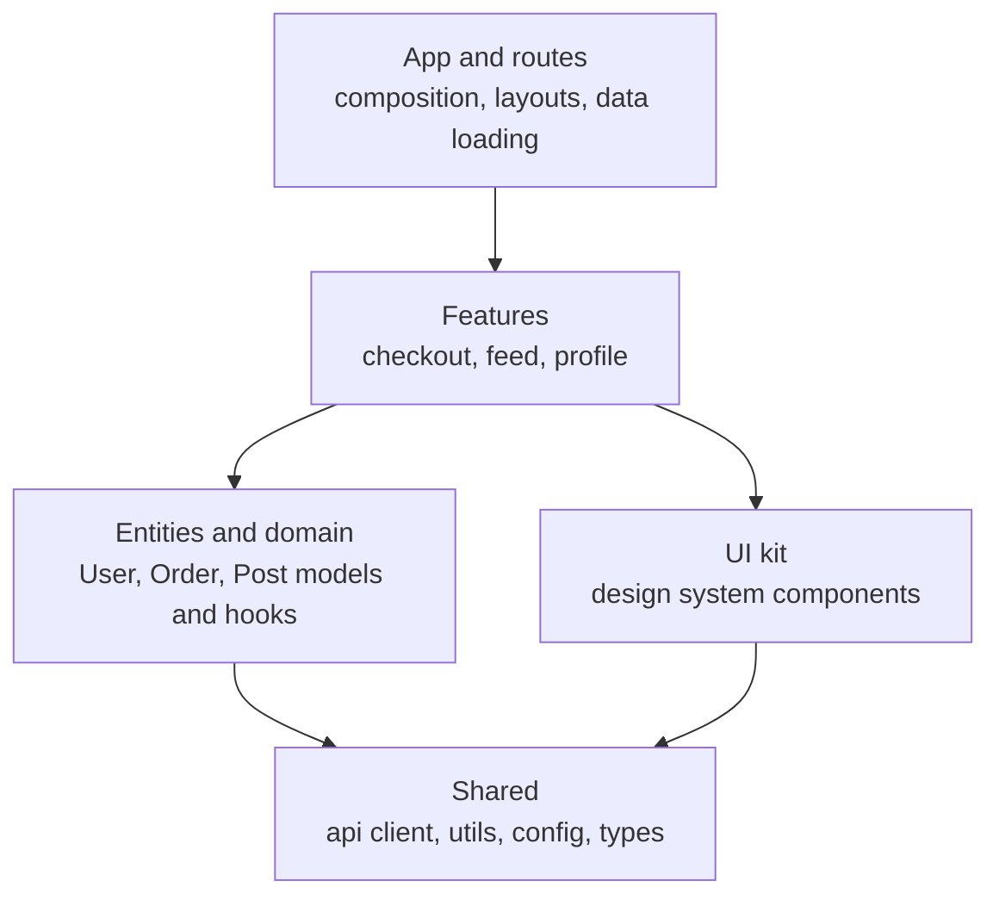
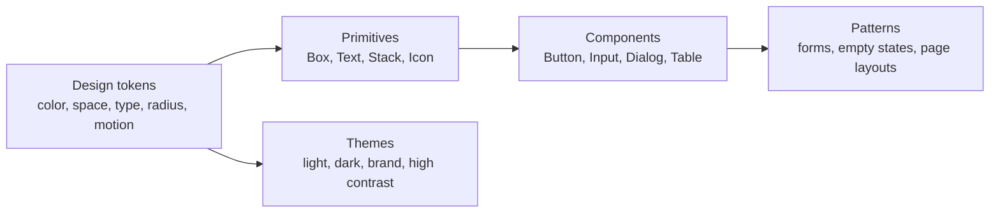
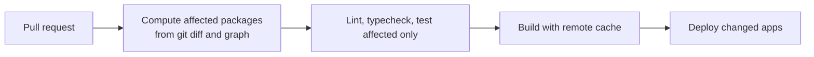
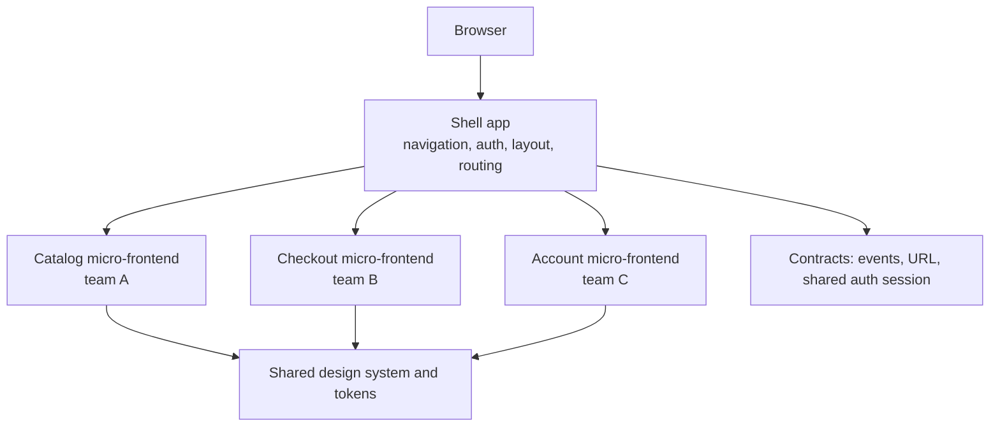
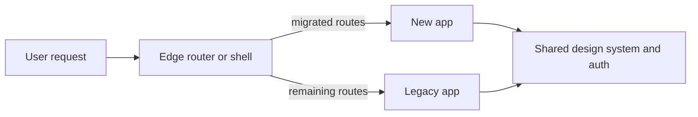

# 📘 Architecture and Scalability

"Scale" in frontend usually means **people and code**, not requests per second.
A large frontend has many teams, hundreds of routes, a shared design language, long lived dependencies, and a need to ship daily without breaking each other.
This page covers how to structure the code, share what should be shared, isolate what should be isolated, and release safely.

## Table of Contents

1. [Layers and Folder Structure](#1-layers-and-folder-structure)
2. [Module Boundaries](#2-module-boundaries)
3. [Design Systems](#3-design-systems)
4. [Styling Strategy](#4-styling-strategy)
5. [Monorepos and Build Systems](#5-monorepos-and-build-systems)
6. [Micro-Frontends](#6-micro-frontends)
7. [Feature Flags and Experiments](#7-feature-flags-and-experiments)
8. [Error Containment](#8-error-containment)
9. [Migrations and Upgrades](#9-migrations-and-upgrades)
10. [Server-Driven UI](#10-server-driven-ui)
11. [Questions](#11-questions)

---

## 1. Layers and Folder Structure



Group by **feature (domain)**, not by technical type.
Keeping a feature's components, hooks, tests, styles, and API calls together means one team can change it without touching ten folders.

```
src/
  app/                 routing, providers, layouts, global config
  features/
    checkout/
      components/
      hooks/
      api.ts
      index.ts         public API of the feature, nothing else is imported from outside
    feed/
  entities/
    user/              types, selectors, small shared UI like UserAvatar
  shared/
    ui/                design system primitives
    api/               HTTP client, auth, error mapping
    lib/               pure utilities
```

Rules of thumb:

- **Dependencies point downward:** routes depend on features, features on entities and shared, never the reverse.
- **No cross-feature imports** except through a feature's public `index.ts`, or by lifting shared code down.
- **Colocate** until something is used by three places, then extract (avoid premature `common` folders that become dumping grounds).
- **Feature-Sliced Design**, Nx module boundaries, and "bulletproof react" are named versions of this idea.

---

## 2. Module Boundaries

Boundaries are only real if tooling **enforces** them.

| Tool | What it enforces |
| --- | --- |
| **ESLint** (`no-restricted-imports`, `import/no-cycle`, boundary plugins) | Layer rules and no deep imports |
| **Nx tags or Turborepo packages** | A package may depend only on allowed tags or packages |
| **TypeScript project references and path aliases** | Explicit package surfaces and faster incremental builds |
| **`exports` in `package.json`** | Only declared entry points can be imported |
| **CODEOWNERS** | Review by the owning team for each folder |
| **Dependency graph checks** (madge, dependency-cruiser) | Cycles and forbidden dependencies in CI |

Benefits: you can change a feature's internals freely, onboarding is faster, tests can be scoped, and a package can later be extracted into its own deployable unit.

---

## 3. Design Systems

A design system is **tokens, primitives, components, documentation, and governance**.



| Layer | Details |
| --- | --- |
| **Tokens** | Named values (`color.text.primary`, `space.4`) stored as JSON, compiled to CSS variables, platform files, and design tool variables so design and code share a source of truth |
| **Theming** | CSS custom properties switch themes at runtime with no re-render, `prefers-color-scheme` and `prefers-contrast` respected |
| **Headless primitives** | Behavior and accessibility without styles (Radix UI, React Aria, Headless UI, Ark) so teams style freely and focus handling is correct once |
| **Component library** | Documented, tested, accessible components with a stable API (Storybook or similar) |
| **Distribution** | Versioned npm packages with ESM, tree shaking friendly exports, `sideEffects` flags, and types |
| **Governance** | Contribution process, deprecation policy, changelog, visual regression tests, accessibility checks in CI |
| **Adoption metrics** | Percentage of UI using the system, number of one-off components |

Key interview points:

- **Composition over configuration:** components accept `children` and slots, not 30 props.
- **Versioning:** semver with codemods for breaking changes, support one previous major while teams migrate.
- **Bundle impact:** deep imports or per component entry points so using one button does not pull the whole library.
- **Cross-framework:** if multiple frameworks must share it, build tokens plus **Web Components**, or generate wrappers.

---

## 4. Styling Strategy

| Approach | Strengths | Trade-offs |
| --- | --- | --- |
| **CSS Modules** | Scoped by default, zero runtime, simple | Dynamic theming needs variables |
| **Utility CSS** (Tailwind) | Fast, consistent, small CSS output, no naming | Long class lists, discipline needed for design tokens |
| **Build-time CSS-in-JS** (vanilla-extract, Panda, StyleX, Linaria) | Type safe tokens, static output, no runtime cost | Build tooling complexity |
| **Runtime CSS-in-JS** (styled-components, Emotion) | Dynamic styles from props, ergonomic | Runtime cost, server rendering and concurrent rendering complications, bundle size |
| **Plain CSS with variables, nesting, layers** | Native, fast, portable | Needs conventions for scale |
| **CSS `@layer`** | Controls cascade order between reset, library, and app styles | Browser baseline is good today |

Modern CSS lets you do much without JavaScript: container queries for component level responsiveness, `:has()`, nesting, `color-mix()`, logical properties for RTL, and view transitions.
Say **"I prefer build-time or static styling for performance, and CSS variables for runtime theming"**.

---

## 5. Monorepos and Build Systems

A **monorepo** holds many apps and packages in one repository, with shared tooling.

| Benefit | Detail |
| --- | --- |
| Atomic changes | One pull request updates a library and all consumers |
| Shared code | Design system, API client, and config as internal packages |
| Consistent tooling | One lint, TypeScript, and test setup |
| Easier refactors | Search and codemod everything at once |

Costs: CI time grows, access control is coarser, and tooling must understand the graph.

| Capability | Tools and practice |
| --- | --- |
| **Task orchestration with caching** | Turborepo, Nx, Bazel: build and test only **affected** packages, share a remote cache so CI and laptops reuse results |
| **Package management** | pnpm workspaces (strict, fast), npm and Yarn workspaces |
| **Internal packages** | Source only packages compiled by the app bundler, or built packages with `exports` |
| **Versioning and releases** | Changesets for published packages, trunk based development with deploys per app |
| **Bundlers** | Vite (esbuild and Rollup, Rolldown coming), Turbopack, Webpack, Rspack (Rust, Webpack compatible), esbuild |
| **Compile speed** | SWC or esbuild for transpile, `tsc` for type checking only (`noEmit`), incremental builds |
| **Dependency hygiene** | Single version policy, Renovate or Dependabot, `pnpm dedupe`, audit and license checks |



---

## 6. Micro-Frontends

Split a large frontend into **independently built, tested, and deployed** pieces owned by separate teams, composed into one product.

### 6.1 Composition Approaches

| Approach | How | Pros | Cons |
| --- | --- | --- | --- |
| **Build-time packages** | Teams publish npm packages, a shell app installs them | Simple, shared dependency resolution, one deploy | Deploy coupling, shell must rebuild for any change |
| **Runtime module loading** (Module Federation, import maps, SystemJS, native ESM) | Shell loads remote bundles at runtime by URL | Independent deploys, share libraries at runtime | Version skew of shared deps, runtime failures, tooling complexity |
| **iframes** | Each app in its own frame | Strong isolation (CSS, JS, crashes), security boundary | Hard routing, sizing, accessibility, shared auth, performance |
| **Web Components** | Custom elements as the contract | Framework agnostic, encapsulation with Shadow DOM | SSR and styling caveats, event and state contracts needed |
| **Server or edge composition** (SSI, ESI, Podium, Next.js multi-zones) | Server stitches fragments or routes paths to different apps | Good SEO and first paint, simple client | Infra complexity, fragment caching |
| **Route based split** | Different apps own different URL prefixes behind one domain and router | Very simple, clean isolation | Full page loads between apps, shared chrome must be duplicated or fetched |



### 6.2 What Must Be Decided

| Topic | Guidance |
| --- | --- |
| **Shell responsibilities** | Authentication, global navigation, routing between apps, error boundaries, shared observability, and nothing else |
| **Communication** | Prefer the URL and a small set of custom events or a typed event bus, avoid shared mutable global stores |
| **Shared dependencies** | Share the framework runtime and the design system as singletons, pin compatible ranges, accept duplicates for the rest |
| **Styling isolation** | Namespaced CSS, CSS Modules, Shadow DOM, or strict token usage, avoid global selectors |
| **Design consistency** | One design system, visual regression tests across apps |
| **Performance** | Budget per micro-frontend, avoid duplicate framework copies, preload remotes on intent, server render the shell |
| **Resilience** | A failing remote shows a fallback, never blanks the page, timeouts for remote loading |
| **Testing** | Contract tests between shell and remotes, end-to-end tests of the composed app, per app unit tests |
| **Deployment** | Independent pipelines, versioned manifests, canary per micro-frontend, rollback by pointing to the previous remote |
| **Local development** | Run one micro-frontend inside a stubbed shell or against deployed remotes |

### 6.3 When to Use Them

Use them when **many teams (often more than 5 to 10) must release independently** and organizational coupling is the bottleneck.
Do not use them to fix a messy codebase: the costs are duplicated dependencies, inconsistent UX, harder performance, harder debugging, and cross-app state and routing.
A **well-structured monorepo with enforced module boundaries** is usually the better first step, and it keeps the option to split later.

---

## 7. Feature Flags and Experiments

Feature flags **decouple deploy from release**.

| Use | Example |
| --- | --- |
| **Release flags** | Hide an unfinished feature in production, enable for staff first |
| **Gradual rollout** | 1 percent, 10 percent, 50 percent, 100 percent with automatic rollback on errors |
| **Kill switch** | Instantly disable a risky feature or third-party dependency |
| **Experiments (A/B tests)** | Random assignment, exposure logging, metric comparison |
| **Entitlements** | Plan or permission based features |

Design points:

- **Stable bucketing:** hash a user or device id with the flag key so a user always sees the same variant, and rollouts are monotonic (raising 10 percent to 20 percent keeps the first 10).
- **Evaluate on the server** (or edge) for rendering decisions to avoid **flicker** and layout shift, bootstrap evaluated flags into the page.
- **Exposure logging** only when the user actually sees the variant, otherwise analysis is diluted.
- **Clean up** flags quickly, because stale flags multiply test combinations and become tech debt.
- **Do not put secrets** in client side flag payloads, and keep flag defaults safe if the flag service is down.
- **Test both paths** in CI for important flags.

```js
// runnable
// Deterministic percentage rollout: same user always lands in the same bucket, and raising the percentage only adds users.
function hash(str) {
  let h = 2166136261;                                  // FNV-1a
  for (let i = 0; i < str.length; i += 1) {
    h ^= str.charCodeAt(i);
    h = Math.imul(h, 16777619) >>> 0;
  }
  return h >>> 0;
}
const bucket = (userId, flag) => hash(`${flag}:${userId}`) % 100;
const enabled = (userId, flag, percent) => bucket(userId, flag) < percent;

const users = Array.from({ length: 10000 }, (_, i) => `user-${i}`);
const at10 = users.filter((u) => enabled(u, 'new-checkout', 10));
const at20 = users.filter((u) => enabled(u, 'new-checkout', 20));
console.log('10% ->', at10.length, '| 20% ->', at20.length);
console.log('monotonic:', at10.every((u) => at20.includes(u)));
console.log('stable:', enabled('user-7', 'new-checkout', 50) === enabled('user-7', 'new-checkout', 50));
```

---

## 8. Error Containment

A failure in one widget must not take down the page.

- **Error boundaries** at route level and around independent widgets, with a fallback UI and a retry, and error reporting with component stack and release.
- Boundaries do not catch event handler errors, async errors, or server rendering errors, so also use `window.onerror` and `unhandledrejection` handlers.
- **Suspense** boundaries structure loading, and **error plus Suspense** pairs per widget make partial rendering the default.
- **Timeouts and fallbacks** for remote modules and third-party widgets.
- **Graceful degradation:** if recommendations fail, hide the section rather than show an error page.
- **Chunk load errors** after a deploy: catch the failed dynamic import and reload once or prompt the user.
- **Circuit breaking in the client:** stop retrying a failing endpoint for a period and show cached data.

```tsx
// Contain failures per widget
<ErrorBoundary fallback={<WidgetError onRetry={reset} />} onError={report}>
  <Suspense fallback={<WidgetSkeleton />}>
    <Recommendations />
  </Suspense>
</ErrorBoundary>
```

---

## 9. Migrations and Upgrades

Large frontends live for years, so **migration strategy** is part of architecture.

| Migration | Strategy |
| --- | --- |
| **Framework or router change** (Pages to App Router, Angular to React) | Strangler fig: run old and new side by side, migrate route by route, share the design system, route at the edge or shell |
| **JavaScript to TypeScript** | `allowJs`, convert leaf modules first, strict mode per package, ratchet lint rules |
| **Library upgrades** | Codemods, compatibility shims, upgrade in a branch with full test coverage, canary |
| **Design system major version** | Codemods, support two majors, deprecation warnings in dev, adoption dashboards |
| **Rewrite** | Avoid big bang rewrites, they stall feature work and reintroduce old bugs, prefer incremental replacement with measurable milestones |



Practices: test coverage and visual regression first, feature flags per migrated route, dual run and compare for critical flows, and a clear **end date for deleting the legacy path**.

---

## 10. Server-Driven UI

In **server-driven UI**, the server sends a description of the screen (component types, props, layout, actions), and the client renders it from a **component registry**.
It lets teams change screens without an app store release, run fast experiments, and keep web and native consistent.
Costs: schema versioning, limited client side flexibility, harder testing, and debugging across the boundary.
The full architecture, versioning, and React Native details are in [Server-Driven UI](/docs/sdui).

---

## 11. Questions

**Q: How do you structure a large React codebase?**
Feature-based modules with a small shared layer and a design system, dependencies pointing downward, public entry points per feature, and lint plus CI checks that enforce the boundaries.

**Q: Monorepo or polyrepo?**
Monorepo when teams share code and need atomic changes and consistent tooling, with caching and affected-only builds to keep CI fast.
Polyrepo when ownership is strictly separate and sharing is minimal.

**Q: When would you pick micro-frontends?**
When several autonomous teams need independent deploy cycles in one product, and the organization accepts the cost of shared dependency management and UX consistency work.
Otherwise a modular monorepo is simpler and faster.

**Q: How do micro-frontends communicate?**
Through the URL and well defined contracts: custom events or a typed event bus, shared auth session, and props at mount time.
Avoid sharing a global mutable store.

**Q: How do you keep a design system consistent and adoptable?**
Tokens as the source of truth, headless accessible primitives, documented components, semver with codemods, visual regression tests, and clear contribution and deprecation processes.

**Q: How do feature flags help and what are the risks?**
They decouple deploy from release and allow gradual rollout and instant kill switches.
Risks are flag debt, flicker from client side evaluation, untested combinations, and leaking flag configuration.

**Q: How would you migrate a legacy app to a new framework?**
Incrementally, with the strangler pattern: route level migration behind an edge or shell router, shared design system and auth, feature flags, tests first, and a deadline to retire the old path.

**Q: How do you make sure one team's bug does not break the whole app?**
Error boundaries around widgets, timeouts and fallbacks for remote modules, isolation of styles and globals, per area budgets and alerts, and independent rollbacks.

**Q: CSS-in-JS, Tailwind, or CSS Modules?**
Prefer static approaches (CSS Modules, utility CSS, build-time CSS-in-JS) for performance and server rendering compatibility, use CSS variables for runtime theming, and pick one convention for the whole org.

Next: [Security, Accessibility, and i18n](/docs/frontend-system-design/security-accessibility-and-i18n).
