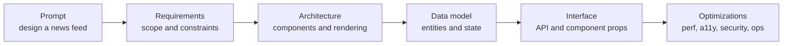
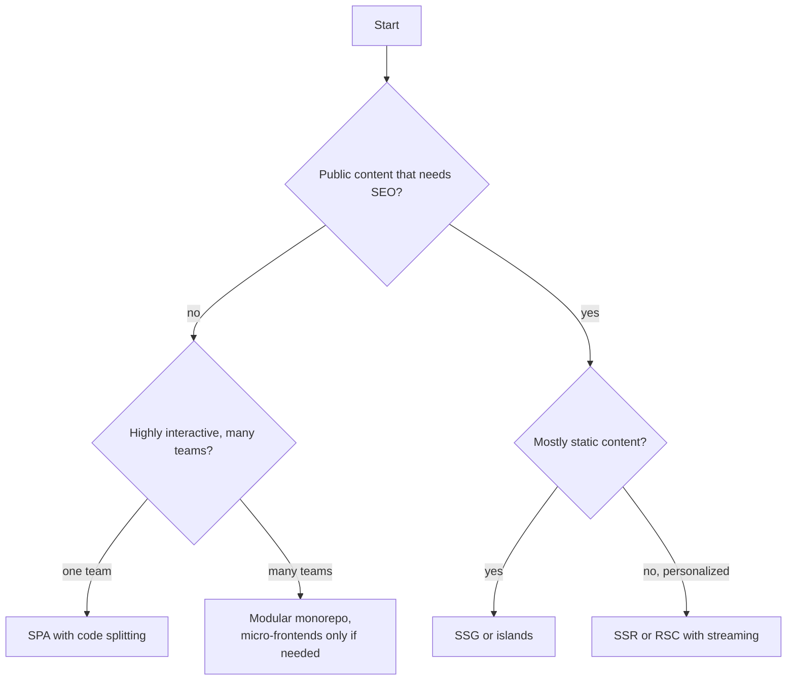
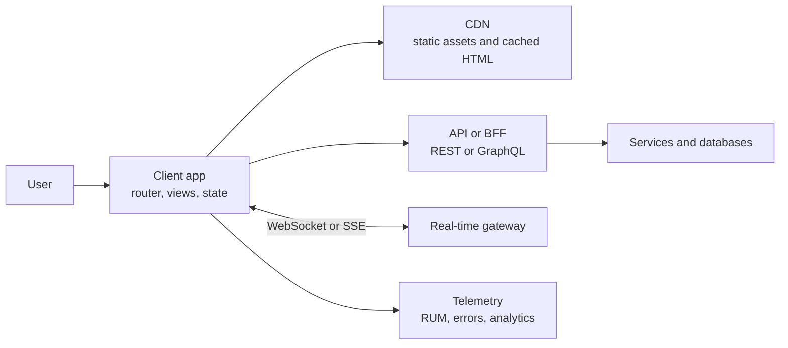

# 📘 Frontend System Design Fundamentals

Frontend system design asks you to design a **client application** or a **UI component** that survives real conditions: slow phones, flaky networks, large data, many teams, and users who rely on a keyboard or a screen reader.
The server is usually a black box with an API you negotiate.
The interesting parts are **rendering, state, data flow, performance, resilience, accessibility, and how the code is organized so a team can ship it**.

This page gives you the frame.
The other pages fill in the technical depth, and [UI Component Designs](/docs/frontend-system-design/ui-component-designs) and [Application Designs](/docs/frontend-system-design/application-designs) apply it to concrete prompts.

## Table of Contents

1. [What the Interview Tests](#1-what-the-interview-tests)
2. [The RADIO Framework](#2-the-radio-framework)
3. [Requirements and Clarifying Questions](#3-requirements-and-clarifying-questions)
4. [Estimation for Frontend](#4-estimation-for-frontend)
5. [Architecture Styles](#5-architecture-styles)
6. [Component API Design](#6-component-api-design)
7. [Data Model and API Contract](#7-data-model-and-api-contract)
8. [Trade-off Vocabulary](#8-trade-off-vocabulary)
9. [Communicating the Design](#9-communicating-the-design)
10. [Common Mistakes](#10-common-mistakes)
11. [Questions](#11-questions)

---

## 1. What the Interview Tests

| Format | What you do | Main signal |
| --- | --- | --- |
| **Frontend system design** | Whiteboard architecture for an app or widget, 45 to 60 minutes, little or no code | Breadth, trade-offs, ownership of the full client stack |
| **UI machine coding** | Build a working component in 60 to 90 minutes | Code quality, state handling, accessibility, edge cases |
| **Backend system design** | Design services, storage, and scale | Distributed systems depth (see [System Design](/docs/system-design)) |
| **Full-stack design** | Both sides, with a rendering strategy in the middle | Where to draw the client and server boundary |

What a strong answer shows:

- **Structure:** you drive the conversation with a framework instead of jumping into libraries.
- **Depth on the client:** rendering, state ownership, caching, networking, and the browser event loop, not only "use React and Redux".
- **Trade-offs:** every choice has a cost, and you name it (SSR costs server time and hydration, optimistic updates cost rollback logic).
- **User centricity:** perceived performance, accessibility, error and empty states, low-end devices.
- **Scale in the frontend sense:** large data sets, large codebases, many contributors, and many deployments.



---

## 2. The RADIO Framework

**RADIO** is a checklist for the whole conversation.

| Letter | Step | What you cover | Minutes of 45 |
| --- | --- | --- | --- |
| **R** | Requirements | Features, users, devices, network, SEO, offline, accessibility, i18n, scale of data | 5 to 7 |
| **A** | Architecture | Major components, rendering strategy, routing, state ownership, module boundaries | 8 to 10 |
| **D** | Data model | Entities, normalized store, server state vs UI state, cache shape | 5 to 7 |
| **I** | Interface | REST or GraphQL endpoints, pagination, error contract, real-time channel, component props and events | 7 to 10 |
| **O** | Optimizations | Performance, accessibility, security, observability, release strategy | 10 to 12 |

Rules that keep the interview on track:

- **Write the requirements down.** A visible list of in scope and out of scope items stops scope creep and shows discipline.
- **Draw before you talk.** One boxes-and-arrows diagram of components and data flow anchors the discussion.
- **Go broad, then deep.** Cover every letter at a high level first, then let the interviewer pick where to dive.
- **State a default and move on.** "I will assume read heavy and mobile first, tell me if that is wrong" beats an open ended question.
- **Reserve the last minutes for optimizations.** Candidates who spend the whole hour on the component tree miss the senior signals.

### 2.1 The Opening Move

A good first three minutes:

1. Restate the problem in one sentence.
2. Ask 5 to 8 clarifying questions (next section).
3. Summarize the scope and the non-functional targets: "public pages so SEO matters, mobile first, p75 LCP under 2.5 s, works on a 4G connection".
4. Name the framework you will follow, so the interviewer knows the plan.

---

## 3. Requirements and Clarifying Questions

Group your questions so they cover the decision space.

| Group | Questions to ask | Why it matters |
| --- | --- | --- |
| **Users and scope** | Who uses it, how many, anonymous or logged in, which core flows? | Decides SEO, personalization, auth |
| **Platforms** | Desktop, mobile web, native wrapper, which browsers, how old? | Decides APIs you can use and bundle targets |
| **Network and device** | Low-end phones? 3G? Offline? | Decides budgets, caching, offline strategy |
| **Content** | Public or private, how often it changes, how big? | Decides SSG, SSR, ISR, or CSR |
| **Data** | Volume per screen, update frequency, real-time, ordering, consistency | Decides pagination, virtualization, transport |
| **Interaction** | Drag and drop, rich text, keyboard shortcuts, undo, collaboration? | Decides state design and conflict handling |
| **Quality bars** | Accessibility level (WCAG AA), i18n and RTL, analytics, experiments | Decides component foundations |
| **Org** | How many teams, existing design system, existing stack, release cadence | Decides modularity and deploy model |

### 3.1 Functional vs Non-functional

| Functional | Non-functional |
| --- | --- |
| Post, like, comment, search, upload | Load time, interaction latency, bundle budget |
| Infinite scroll, filters, sort | Availability on bad networks, offline behavior |
| Notifications, presence | Accessibility, i18n, browser support |
| Roles and permissions in the UI | Security, privacy, consent, observability |

State **out of scope** explicitly: "I will not design the recommendation algorithm or the media transcoding pipeline, I will treat them as APIs."

---

## 4. Estimation for Frontend

Frontend estimation is about **bytes, requests, memory, and main thread time**, not QPS and disks.
Rough numbers are enough, the point is to show you reason with them.

### 4.1 Network Budgets

| Profile | Typical bandwidth | Round trip | Notes |
| --- | --- | --- | --- |
| Slow 4G (Lighthouse mobile default) | about 1.6 Mbps down | 150 ms | The common test target |
| Fast 4G | 9 to 12 Mbps | 70 ms | Typical urban mobile |
| Wi-Fi or fiber | 50 Mbps and up | 10 to 30 ms | Desktop baseline |

A practical budget for an interactive mobile page is about **150 to 200 KB of compressed critical JavaScript** and **under 1 MB total for the first view** on a mid-range phone.
JavaScript costs more than its byte size: after download it is parsed, compiled, and executed on a slow CPU, and images only cost network and decode time.

```js
// runnable
// Rough load time = round trips + bytes / bandwidth.
const profiles = {
  slow4g: { mbps: 1.6, rttMs: 150 },
  fast4g: { mbps: 10, rttMs: 70 },
  wifi: { mbps: 50, rttMs: 20 },
};

function transferMs(bytes, profile, roundTrips = 3) {
  const bitsPerMs = (profile.mbps * 1_000_000) / 1000;
  return Math.round(roundTrips * profile.rttMs + (bytes * 8) / bitsPerMs);
}

const kb = (n) => n * 1024;
for (const [name, p] of Object.entries(profiles)) {
  console.log(name, '200 KB bundle:', transferMs(kb(200), p), 'ms', '| 2 MB bundle:', transferMs(kb(2000), p), 'ms');
}
```

The output shows why a 2 MB bundle is a problem on slow 4G even before parse and execute time: it spends about 10 seconds on the wire.

### 4.2 Data and DOM Estimation

| Estimate | Example reasoning |
| --- | --- |
| **Items per screen** | A phone shows about 5 feed posts at once, so a page size of 10 to 20 covers scrolling without waste |
| **Payload per item** | A post JSON is 1 to 3 KB, 20 posts is up to 60 KB uncompressed (about 10 to 15 KB gzipped) |
| **DOM nodes** | Aim under 1500 nodes on a page. A feed with 30 nodes per post at 1000 posts is 30,000 nodes, so it needs virtualization |
| **Memory** | 1000 posts of 3 KB is only 3 MB of JSON, but images and DOM dominate, so cap what stays in memory |
| **Update rate** | 500 messages per second cannot be rendered one by one, so batch to the frame rate |
| **Request count** | Prefer fewer than about 10 critical requests, HTTP/2 or HTTP/3 multiplexing removes the old 6 connection limit but each request still costs latency |

Use the numbers to justify choices: "the data fits in memory, so I do not need a database in the browser" or "the list can exceed 10,000 rows, so virtualization is mandatory".

### 4.3 Main Thread Budget

- A frame is **16.7 ms at 60 Hz** (8.3 ms at 120 Hz), and the browser needs part of it for style, layout, paint, and compositing, so your JavaScript gets roughly 10 ms.
- A **long task** is any task over 50 ms.
  It blocks input, and many long tasks produce poor INP.
- INP target is **200 ms or less** at the 75th percentile, which means all interactions, not only the first.

---

## 5. Architecture Styles

| Style | What it is | Pick when |
| --- | --- | --- |
| **SPA** (single page app) | One HTML shell, client-side routing, data over APIs | Logged-in apps, rich interactivity, SEO not needed |
| **MPA** (multi page app) | Server renders each page, full navigations | Content sites, simple flows, strong SEO, minimal JS |
| **SSR + hydration** | Server renders first HTML, client takes over | Public, personalized, interactive pages |
| **Static + islands** | Static HTML with small interactive parts | Content heavy sites (docs, blogs, marketing) |
| **RSC-based** | Server Components for data and layout, Client Components for interactivity | Full-stack React apps wanting less client JS |
| **Micro-frontends** | Independently deployed slices composed into one product | Many teams that must ship independently |
| **Native wrapper** | Web app in a WebView or PWA | Reuse web code on devices, with caveats |

Pick a style from the requirements, not from fashion.
The deeper comparison is in [Rendering and Delivery](/docs/frontend-system-design/rendering-and-delivery).



---

## 6. Component API Design

Many prompts are really a **component** (typeahead, modal, carousel, data table).
The public API is part of the answer.

### 6.1 Principles

| Principle | Meaning |
| --- | --- |
| **Composition over configuration** | Accept `children` and slots instead of 30 boolean props |
| **Controlled and uncontrolled** | Support both: `value` + `onChange` for control, `defaultValue` for convenience |
| **Headless core** | Separate behavior and accessibility (hooks, state machines) from styles so it can be themed |
| **Sensible defaults, escape hatches** | Work with zero config, allow overriding render, class names, and refs |
| **Accessible by default** | Roles, keyboard handling, and focus management built in, not left to the caller |
| **Stable events** | Event names and payloads are a contract: `onSelect(item, reason)` |
| **Pure rendering** | Render output depends on props and state, side effects live in hooks |

### 6.2 Example: Tabs API Sketch

```tsx
// Compound components share state through context.
<Tabs defaultValue="overview" onValueChange={track}>
  <Tabs.List aria-label="Account sections">
    <Tabs.Trigger value="overview">Overview</Tabs.Trigger>
    <Tabs.Trigger value="billing">Billing</Tabs.Trigger>
  </Tabs.List>
  <Tabs.Panel value="overview">...</Tabs.Panel>
  <Tabs.Panel value="billing" forceMount>...</Tabs.Panel>
</Tabs>
```

What to say about it:

- **State** (`value`) lives in `Tabs`, children read it from context, so layout is the caller's choice.
- **Accessibility:** `tablist`, `tab`, and `tabpanel` roles, arrow keys move focus, Home and End jump, only the active tab is in the tab order.
- **Performance:** panels render lazily by default, `forceMount` keeps one alive when state must persist.
- **Extension points:** `asChild` or a render prop for custom triggers, `orientation`, `activationMode` (on focus or on click).

### 6.3 Component Design Checklist

1. What are the inputs (props), outputs (events), and imperative handles (ref methods such as `focus()`)?
2. Which state is internal and which is owned by the caller?
3. What are the states: loading, empty, error, partial, disabled, read-only?
4. Keyboard map and ARIA pattern (see [Security, Accessibility, and i18n](/docs/frontend-system-design/security-accessibility-and-i18n)).
5. Performance at scale: how many items, how often it re-renders?
6. Styling: tokens, theming, RTL, dark mode, reduced motion.
7. Testing: unit, interaction, visual, accessibility.

---

## 7. Data Model and API Contract

### 7.1 Model the Client Data

Separate three kinds of data:

| Kind | Examples | Where it lives |
| --- | --- | --- |
| **Server data** (remote, shared) | Posts, users, orders | A cache keyed by query (TanStack Query, RTK Query, SWR, Apollo) |
| **UI state** (local) | Open modal, draft text, selected tab | Component state, context, small store |
| **URL state** (shareable) | Filters, page, sort, selected id | The URL, so links and back button work |

Normalize relational data by id so one update changes every view:

```ts
type State = {
  postsById: Record<string, Post>;
  usersById: Record<string, User>;
  feedIds: string[];            // ordered ids, not copies of posts
  nextCursor: string | null;
};
```

### 7.2 Choosing the API Style

| Style | Strength | Weakness | Fits |
| --- | --- | --- | --- |
| **REST** | Simple, cacheable with HTTP, widely understood | Over and under fetching, many round trips | Most CRUD apps |
| **GraphQL** | Ask for exactly the fields, one round trip, typed schema | Caching and N+1 complexity, query cost control | Many clients with different needs, nested data |
| **BFF** (backend for frontend) | Server shaped for one client, aggregates services | Another service to own | Mobile and web with different needs |
| **tRPC or typed RPC** | End to end types in a TypeScript monorepo | Couples client and server versions | Internal full-stack apps |
| **gRPC-web or protobuf** | Compact, typed | Tooling, debugging | Internal, performance sensitive |
| **WebSocket or SSE** | Push updates | Stateful connections to scale | Real-time (see [Real-Time, Offline, and Sync](/docs/frontend-system-design/real-time-offline-and-sync)) |

### 7.3 A Good Contract

- **Pagination:** cursor based for feeds (`?after=cursor&limit=20`), response has `items`, `nextCursor`, `hasMore`.
- **Errors:** HTTP status plus `{ code, message, fieldErrors, requestId }`, so UI can map codes to copy and forms to fields.
- **Idempotency:** mutations carry an `Idempotency-Key` so retries are safe.
- **Versioning:** additive changes, tolerate unknown fields, version breaking changes.
- **Conditional requests:** `ETag` and `If-None-Match` for cheap revalidation.
- **Partial responses:** field selection or separate summary and detail endpoints for list and detail views.
- **Time:** ISO 8601 UTC timestamps, localize on the client.

---

## 8. Trade-off Vocabulary

Naming trade-offs precisely is what separates senior answers.

| Decision | Option A | Option B | Deciding factor |
| --- | --- | --- | --- |
| Rendering | SSR (fast first paint, server cost, hydration) | CSR (cheap server, slow first paint) | SEO, first paint, personalization |
| Freshness | Cache aggressively (fast, stale) | Always fetch (fresh, slow) | Cost of stale data |
| Updates | Optimistic (snappy, rollback logic) | Pessimistic (simple, laggy) | Risk and failure rate |
| Transport | Polling (simple, wasteful) | WebSocket (efficient, stateful) | Update frequency and scale |
| Lists | Pagination (simple, steppy) | Infinite scroll (smooth, memory and a11y cost) | Browsing vs goal driven use |
| State | Global store (shared, boilerplate) | Local state (simple, prop drilling) | How many consumers |
| Bundling | One bundle (simple) | Route splitting (fast first load, extra requests) | App size |
| Teams | Monolith (consistent) | Micro-frontends (independent, heavy) | Team count and release independence |
| Styling | CSS Modules or utility CSS (static, fast) | CSS-in-JS runtime (dynamic, runtime cost) | Theming needs vs performance |
| Storage | Cookie (sent to server, HttpOnly) | localStorage (script readable) | Security |

A reusable sentence pattern: **"I choose X because requirement Y, the cost is Z, and I mitigate it with W."**

---

## 9. Communicating the Design

- **Start with a diagram** of client, CDN, API, and real-time channel, then a component tree of the main screens.
- **Name data flows** with arrows: "user action, optimistic update, request, reconcile".
- **Show states**: a small table of loading, empty, error, offline, and stale for the main view.
- **Use numbers** from your estimation when justifying a choice.
- **Check in**: "Do you want me to go deeper on the data layer or the performance plan?"
- **Say what you would measure** (LCP, INP, error rate, cache hit rate) and what would make you change the design.



---

## 10. Common Mistakes

| Mistake | Better |
| --- | --- |
| Starting with "I will use React and Redux" | Start with requirements, justify tools afterward |
| Designing only the happy path | Show loading, empty, error, offline, and permission states |
| Ignoring performance numbers | Give a budget and how you would enforce it |
| Putting server data in a global store by hand | Use a server-state cache with invalidation |
| Forgetting accessibility until the end | Fold keyboard and ARIA into the component design |
| Over-engineering (micro-frontends for 3 developers) | Choose the simplest architecture that meets the requirements |
| Treating the API as fixed | Negotiate the contract: pagination, errors, field selection |
| No plan to measure | Name RUM metrics, error tracking, and a release strategy |
| Rambling without a diagram | Draw early, refer back to it |
| Not stating trade-offs | Every decision gets a cost and a mitigation |

---

## 11. Questions

**Q: What is the first thing you do in a frontend system design interview?**
Clarify requirements: users, devices, network conditions, SEO, offline, accessibility, data volume, and team context.
Then state the scope and the non-functional targets before drawing anything.

**Q: How does frontend system design differ from backend system design?**
The constraints are the browser and the user's device: bytes over the wire, main thread time, memory, rendering strategy, accessibility, and many deployments of one client.
Backend design focuses on throughput, storage, and distributed consistency.

**Q: What is RADIO?**
Requirements, Architecture, Data model, Interface, Optimizations.
It is a checklist so the conversation covers requirements through to performance, security, and observability.

**Q: How do you decide between SSR and CSR?**
If the content is public and SEO or fast first paint matters, render on the server or at build time.
If the app is behind login and highly interactive, CSR with code splitting is simpler and cheaper.
Many products mix both per route.

**Q: How do you estimate whether a page will be fast enough?**
Add the critical bytes (HTML, CSS, JavaScript, LCP image), divide by the target network speed, add round trips, then add JavaScript parse and execute time on a mid-range phone.
Compare with the 2.5 s LCP target and set a bundle budget.

**Q: What makes a good component API?**
Composition, controlled and uncontrolled modes, accessibility built in, stable events, sensible defaults, and escape hatches such as render props or `asChild`.

**Q: Where do you store filters and pagination state?**
In the URL, so links are shareable, the back button works, and server rendering can read them.

**Q: What would make you change your design?**
Measured field data (LCP, INP, error rate) or a requirement change such as a new real-time feature or an offline requirement.

Next: [Rendering and Delivery](/docs/frontend-system-design/rendering-and-delivery).
