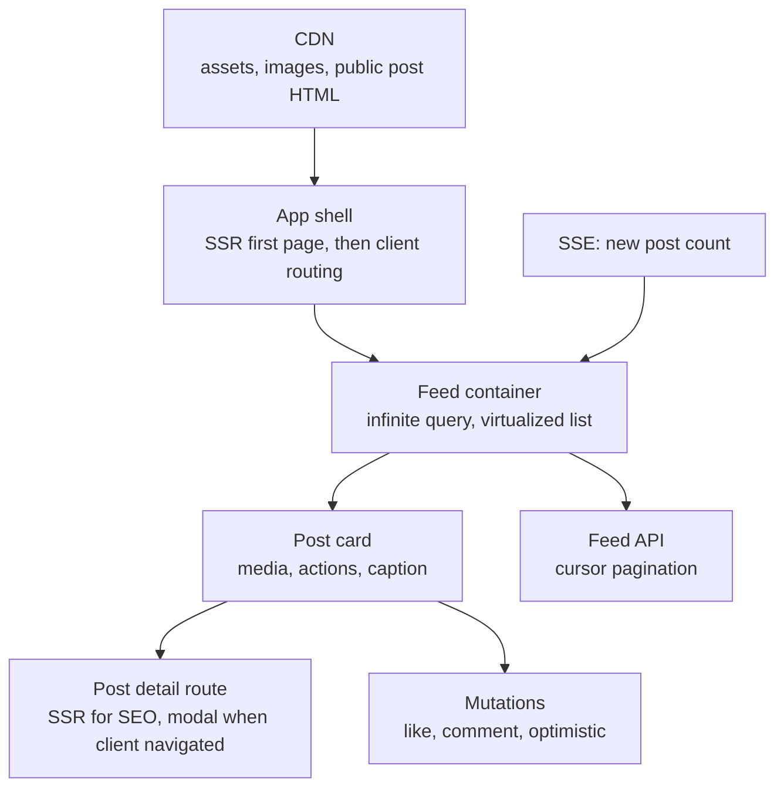

# 📘 Frontend System Design Interview Playbook

The other pages teach the material.
This page is for rehearsal: what interviewers expect by level, a question bank with what a strong answer contains, a full mock walkthrough, a list of design prompts with the points to hit, production scenarios, cheat sheets, and a study plan.

## Table of Contents

1. [What Interviewers Look For](#1-what-interviewers-look-for)
2. [Question Bank](#2-question-bank)
3. [Mock Walkthrough: Design an Image Sharing Feed](#3-mock-walkthrough-design-an-image-sharing-feed)
4. [Design Prompts](#4-design-prompts)
5. [Diagnose the Problem](#5-diagnose-the-problem)
6. [Cheat Sheets](#6-cheat-sheets)
7. [Common Mistakes](#7-common-mistakes)
8. [Study Plan](#8-study-plan)

---

## 1. What Interviewers Look For

| Level | Expected |
| --- | --- |
| **Junior and early mid** | Component thinking, state and props, basic data fetching, loading and error states, responsive layout, basic performance (lazy loading, memoization), accessibility basics |
| **Mid** | Rendering strategies, server vs client state, pagination, optimistic updates, caching, Core Web Vitals and fixes, keyboard accessibility, testing approach, reasonable API design |
| **Senior** | Whole system trade-offs, real-time and offline design, performance budgets and measurement, security model, observability, release safety, design system and module boundaries, driving the discussion |
| **Staff and principal** | Multi team architecture (monorepo, micro-frontends, platform), migrations and governance, org level performance and quality programs, cost and risk trade-offs, mentoring through the design |

Signals that raise your rating:

- You **clarify requirements** and state assumptions before designing.
- You **structure the answer** (RADIO) and keep time for optimizations.
- You **quantify**: bytes, request counts, DOM nodes, frame budget, p75 targets.
- You name **trade-offs and alternatives**, and say when you would choose the other one.
- You cover **non-happy paths**: loading, empty, error, offline, race conditions.
- You bring up **accessibility, security, and observability** without being asked.
- You say how you would **measure and verify** the result (RUM, budgets, canary).
- You stay **pragmatic**: simplest architecture that meets the requirements.

---

## 2. Question Bank

### 2.1 Framework and Architecture (10)

| # | Question | Strong answer includes | Read |
| --- | --- | --- | --- |
| 1 | How do you approach a frontend system design problem? | RADIO, requirements first, diagram, depth on the hard part, optimizations | [Fundamentals](/docs/frontend-system-design/frontend-system-design-fundamentals) |
| 2 | SPA vs MPA vs SSR app? | SEO, interactivity, first paint, cost, complexity, mixed per route | [Rendering](/docs/frontend-system-design/rendering-and-delivery) |
| 3 | How do you decide where state lives? | Derive, local, lift, URL, server cache, small global store | [State](/docs/frontend-system-design/state-and-data-management) |
| 4 | How do you structure a large React codebase? | Feature modules, shared layer, public APIs, enforced boundaries | [Architecture](/docs/frontend-system-design/architecture-and-scalability) |
| 5 | What makes a good component API? | Composition, controlled and uncontrolled, defaults, a11y, stable events | [Fundamentals](/docs/frontend-system-design/frontend-system-design-fundamentals) |
| 6 | Monorepo vs polyrepo? | Atomic changes, shared tooling, caching, affected builds, ownership | [Architecture](/docs/frontend-system-design/architecture-and-scalability) |
| 7 | When do you use micro-frontends? | Many teams, independent deploys, costs, alternatives, composition options | [Architecture](/docs/frontend-system-design/architecture-and-scalability) |
| 8 | How do you build and govern a design system? | Tokens, headless primitives, docs, versioning, codemods, adoption | [Architecture](/docs/frontend-system-design/architecture-and-scalability) |
| 9 | How do you use feature flags safely? | Decouple deploy and release, stable bucketing, cleanup, no flicker | [Architecture](/docs/frontend-system-design/architecture-and-scalability) |
| 10 | How do you migrate a legacy frontend? | Strangler pattern, route level, shared auth and design system, retire date | [Architecture](/docs/frontend-system-design/architecture-and-scalability) |

### 2.2 Rendering and Delivery (10)

| # | Question | Strong answer includes | Read |
| --- | --- | --- | --- |
| 11 | CSR vs SSR vs SSG vs ISR? | Where and when HTML is built, SEO, freshness, cost | [Rendering](/docs/frontend-system-design/rendering-and-delivery) |
| 12 | What is hydration and why is it costly? | Re-run components, interactivity delay, reduce JS, islands, RSC | [Rendering](/docs/frontend-system-design/rendering-and-delivery) |
| 13 | RSC vs SSR? | Different problems, zero client JS for server components, used together | [Rendering](/docs/frontend-system-design/rendering-and-delivery) |
| 14 | How does streaming help? | Shell first, Suspense boundaries, independent slow parts | [Rendering](/docs/frontend-system-design/rendering-and-delivery) |
| 15 | How do you cache a SPA at the CDN? | Hashed assets immutable, HTML revalidated, API policies, keep old assets | [Rendering](/docs/frontend-system-design/rendering-and-delivery) |
| 16 | What is critical rendering path? | HTML, CSS blocking, JS parser blocking, defer, preload scanner | [Rendering](/docs/frontend-system-design/rendering-and-delivery) |
| 17 | `preload` vs `prefetch` vs `preconnect`? | Now vs next navigation vs connection warmup, over-preloading risk | [Rendering](/docs/frontend-system-design/rendering-and-delivery) |
| 18 | How do you make navigations instant? | Prefetch on intent, speculation rules, transitions, skeletons | [Rendering](/docs/frontend-system-design/rendering-and-delivery) |
| 19 | How do you handle SEO in a JavaScript app? | SSR or SSG, meaningful HTML, metadata, real links, status codes | [Rendering](/docs/frontend-system-design/rendering-and-delivery) |
| 20 | What breaks when you cache HTML at the CDN? | Personalization leaks, stale prices, query string fragmentation, purge | [Rendering](/docs/frontend-system-design/rendering-and-delivery) |

### 2.3 Performance (10)

| # | Question | Strong answer includes | Read |
| --- | --- | --- | --- |
| 21 | What are Core Web Vitals? | LCP, INP, CLS, thresholds, p75 field data | [Performance](/docs/frontend-system-design/performance-engineering) |
| 22 | How do you improve LCP? | Four part breakdown, discoverable and prioritized resource, format, TTFB | [Performance](/docs/frontend-system-design/performance-engineering) |
| 23 | How do you improve INP? | Long tasks, yielding, render scope, transitions, workers, third parties | [Performance](/docs/frontend-system-design/performance-engineering) |
| 24 | How do you avoid CLS? | Reserved space, font metrics, no late inserts, transforms | [Performance](/docs/frontend-system-design/performance-engineering) |
| 25 | How do you reduce a huge bundle? | Analyze, split, replace libraries, server components, budgets | [Performance](/docs/frontend-system-design/performance-engineering) |
| 26 | How do you render a huge list? | Pagination, virtualization, `content-visibility`, measured heights, a11y | [Performance](/docs/frontend-system-design/performance-engineering) |
| 27 | Lab vs field data? | Lighthouse vs RUM and CrUX, percentiles, diagnose vs decide | [Performance](/docs/frontend-system-design/performance-engineering) |
| 28 | How do you handle third-party scripts? | Inventory, defer, facades, isolate, monitor, remove | [Performance](/docs/frontend-system-design/performance-engineering) |
| 29 | How do you find a memory leak? | Heap snapshots, detached nodes, listeners, caches, cleanup | [Performance](/docs/frontend-system-design/performance-engineering) |
| 30 | How do you enforce performance over time? | Budgets in CI, RUM alerts, canary compare, ownership | [Performance](/docs/frontend-system-design/performance-engineering) |

### 2.4 State, Data, Real-Time, and Offline (15)

| # | Question | Strong answer includes | Read |
| --- | --- | --- | --- |
| 31 | Server state vs client state? | Cache of remote data vs owned UI state, tools, mixing problems | [State](/docs/frontend-system-design/state-and-data-management) |
| 32 | Explain stale-while-revalidate | Instant stale render, background refetch, update, staleness window | [State](/docs/frontend-system-design/state-and-data-management) |
| 33 | Optimistic updates: how and when? | Snapshot, apply, request, rollback, cancel refetch, avoid for payments | [State](/docs/frontend-system-design/state-and-data-management) |
| 34 | Cursor vs offset pagination? | Stability, performance, random access, infinite scroll | [State](/docs/frontend-system-design/state-and-data-management) |
| 35 | When normalize a client cache? | Many views per entity, instant consistency, complexity cost | [State](/docs/frontend-system-design/state-and-data-management) |
| 36 | How do you fix fetch race conditions? | Abort, latest id wins, query keys, cancel before optimistic write | [State](/docs/frontend-system-design/state-and-data-management) |
| 37 | How do you design token refresh? | Single flight, retry once, rotate, logout on failure | [State](/docs/frontend-system-design/state-and-data-management) |
| 38 | Polling vs SSE vs WebSocket? | Direction, latency, complexity, infra, fallbacks | [Real-Time](/docs/frontend-system-design/real-time-offline-and-sync) |
| 39 | How do you make a socket client reliable? | Heartbeat, backoff with jitter, resume, dedupe, snapshot plus deltas | [Real-Time](/docs/frontend-system-design/real-time-offline-and-sync) |
| 40 | How do you avoid missing events at startup? | Subscribe, buffer, snapshot version, apply newer buffered events | [Real-Time](/docs/frontend-system-design/real-time-offline-and-sync) |
| 41 | How do you handle 500 updates per second? | Server aggregation, batching, coalescing, bounded buffers, workers | [Real-Time](/docs/frontend-system-design/real-time-offline-and-sync) |
| 42 | How do you build offline support? | Service worker, local DB, outbox, sync cursor, conflict policy, status UI | [Offline](/docs/frontend-system-design/real-time-offline-and-sync) |
| 43 | Service worker caching strategies? | Cache first, network first, SWR, per resource choices, pitfalls | [Offline](/docs/frontend-system-design/real-time-offline-and-sync) |
| 44 | LWW vs OT vs CRDT? | Simplicity vs intent preservation vs convergence, costs | [Offline](/docs/frontend-system-design/real-time-offline-and-sync) |
| 45 | How do you share one connection across tabs? | SharedWorker or leader election with Web Locks, BroadcastChannel | [Real-Time](/docs/frontend-system-design/real-time-offline-and-sync) |

### 2.5 Security, Accessibility, i18n, and Operations (15)

| # | Question | Strong answer includes | Read |
| --- | --- | --- | --- |
| 46 | How do you prevent XSS? | Escaping, sanitize, avoid raw HTML, CSP nonce, Trusted Types | [Security](/docs/frontend-system-design/security-accessibility-and-i18n) |
| 47 | Where do you store tokens? | HttpOnly SameSite cookie, memory plus refresh cookie, not localStorage | [Security](/docs/frontend-system-design/security-accessibility-and-i18n) |
| 48 | CSRF defense? | SameSite, tokens, Origin check, custom headers | [Security](/docs/frontend-system-design/security-accessibility-and-i18n) |
| 49 | What does CORS protect? | Browser reads only, not the API, credentials rules | [Security](/docs/frontend-system-design/security-accessibility-and-i18n) |
| 50 | OAuth for a SPA? | Code flow with PKCE, state and nonce, no secrets in bundle, BFF option | [Security](/docs/frontend-system-design/security-accessibility-and-i18n) |
| 51 | Accessibility checklist? | Semantics, keyboard, focus, names, contrast, live regions, testing | [Accessibility](/docs/frontend-system-design/security-accessibility-and-i18n) |
| 52 | Make a modal or combobox accessible | Native dialog or ARIA pattern, focus trap and return, keys | [Accessibility](/docs/frontend-system-design/security-accessibility-and-i18n) |
| 53 | How do you do i18n well? | ICU messages, Intl, RTL logical CSS, expansion, locale loading | [i18n](/docs/frontend-system-design/security-accessibility-and-i18n) |
| 54 | What is your testing strategy? | Trophy, behavior tests, MSW, few E2E, visual and a11y, budgets | [Testing](/docs/frontend-system-design/testing-observability-and-release) |
| 55 | How do you reduce flaky tests? | Auto wait, isolation, mocks, stable selectors, prod build | [Testing](/docs/frontend-system-design/testing-observability-and-release) |
| 56 | What do you monitor in production? | Vitals, errors, API client metrics, funnels, release tags, traces | [Observability](/docs/frontend-system-design/testing-observability-and-release) |
| 57 | How do you release safely? | Previews, flags, canary, rollback, version skew handling | [Release](/docs/frontend-system-design/testing-observability-and-release) |
| 58 | What is version skew? | Old client vs new server or assets, hashed assets, additive APIs | [Release](/docs/frontend-system-design/testing-observability-and-release) |
| 59 | How do you debug "the site is slow for some users"? | Field data segmentation, device, geo, release, RUM traces | [Performance](/docs/frontend-system-design/performance-engineering) |
| 60 | How do you handle consent and privacy? | Consent gating, minimization, masking, partitioned storage | [Security](/docs/frontend-system-design/security-accessibility-and-i18n) |

---

## 3. Mock Walkthrough: Design an Image Sharing Feed

A compact model answer for "design the web feed for an image sharing app" (45 minutes).

**Requirements (5 min).**
I will ask: public or logged in only, SEO needed for post pages, mobile web first, how many posts per user per day, video or images only, real-time needs, accessibility and languages.
Assumptions I state: mobile first, images and short videos, a public post page for sharing (SEO), a logged-in feed, likes and comments, p75 LCP under 2.5 s on 4G, WCAG 2.2 AA, 20 posts per page.
Out of scope: ranking algorithm, upload pipeline, moderation tools.

**Architecture (8 min).**

- **Rendering:** public post pages are SSR or ISR with Open Graph tags, the feed's first page is server rendered or streamed for LCP, then hydrated, with later pages fetched on the client.
- **Routing:** feed to post detail opens as a modal route (intercepted) with a real URL, deep linking renders the full page.
- **Boundaries:** feed, post, composer, and notifications as features owned by separate teams, sharing a design system.

**Data model (6 min).**
Normalized store: `postsById`, `usersById`, `commentsById`, and `feed:home` holding ordered ids with `nextCursor`.
Server state in a query cache (infinite query), UI state local, filters and open post in the URL.

**Interface (8 min).**
`GET /feed?after=<cursor>&limit=20` returns `{ items, nextCursor }` where each item carries the media variants, aspect ratio, counts, and `viewerHasLiked`.
`POST /posts/:id/like` with an idempotency key, `DELETE` to unlike.
Error contract: `{ code, message, requestId }`.
Component API: `Feed` takes a data source and a `renderPost` slot, `PostCard` takes a `post` and callbacks, `MediaView` takes sources and an aspect ratio.

**Optimizations (15 min).**
- **Performance:** the first image is the LCP (server rendered `img` with `fetchpriority="high"`, AVIF, responsive `srcset`, reserved aspect ratio), others lazy, blur placeholders, prefetch the next page near the end, virtualization with measured heights, memoized cards, comments loaded on open, JS budget per route.
- **Media:** one video plays at a time when more than half visible, muted autoplay, paused when out of view, adaptive streaming for long video.
- **Resilience:** per page error row with retry, skeletons, cached feed shown offline with a banner, scroll restoration through the cache and an anchor.
- **Real-time:** SSE sends a count of new posts, a "new posts" button instead of inserting above the viewport.
- **Optimistic like:** snapshot, update counts and state, send with idempotency key, rollback with a toast on failure.
- **Accessibility:** `role="feed"` and `article` with `aria-posinset`, keyboard shortcuts, alt text, focus kept stable when loading more, "load more" button option, captions for video.
- **Security:** sanitize captions and comments, strict CSP, cookies for session with CSRF protection, validate media URLs.
- **Observability:** RUM for LCP and INP by route and device, impression and dwell events with sampling, errors with release tags, canary rollout with automatic rollback.
- **Testing and release:** component tests with MSW, Playwright for the feed journey, visual regression on `PostCard`, feature flags for new media player.

**Close (3 min).**
Summarize the trade-offs: SSR for the first page costs server time, virtualization complicates accessibility and find in page, optimistic updates need rollback logic.
Say what I would measure first: LCP, INP, scroll jank, and error rate per release.

---

## 4. Design Prompts

Frame each with RADIO and pick two or three hard problems to go deep on.

| Prompt | Key points to hit |
| --- | --- |
| **News feed** | Cursor pagination, virtualization, media lazy loading, optimistic like, new posts banner, scroll restore, a11y feed pattern |
| **Typeahead** | Debounce, abort, prefix cache, ARIA combobox, IME, highlight safely, ranking on server |
| **Chat** | Client ids, server sequence, outbox, reconnect and resume, scroll anchoring, read receipts, multi-tab |
| **Collaborative docs** | Editor engine, CRDT or OT, awareness, offline, version history, permissions |
| **E-commerce** | ISR product pages, PPR, SEO structured data, cart, checkout idempotency, payments, peak traffic |
| **Real-time dashboard** | Aggregation, batching, ring buffers, canvas, worker, layout persistence, staleness |
| **Video player and browse** | ABR, startup time, buffering policy, captions, resume, spatial navigation, DRM |
| **Image carousel** | Scroll snap, neighbor loading, autoplay a11y, looping math, responsive images |
| **Modal and toast system** | Top layer or portal, stack, focus trap, queue, imperative API, reduced motion |
| **Data table** | Server vs client ops, virtualization, URL state, selection model, grid a11y, export |
| **File uploader** | Chunked resumable upload, presigned URLs, concurrency, progress, previews, validation |
| **Nested comments** | Flat to tree, lazy replies, depth cap, optimistic post, real-time, flatten and virtualize |
| **Kanban** | Fractional indexing, drag and drop, optimistic moves, keyboard DnD, collaboration |
| **Maps and ride tracking** | Vector tiles, interpolation, subscriptions by region, battery, privacy |
| **Photo gallery** | Justified layout, thumbnails, virtualization, selection, resumable upload, memory |
| **Notification system** | Transport choice, unread counts, grouping, push permission in context, preferences |
| **Search results page** | SSR for SEO, URL filters, facets, cancel stale queries, skeletons, analytics |
| **Autocomplete address form** | Provider session tokens, validation, mobile keyboards, a11y, fallbacks |
| **Online code editor / IDE** | Web workers for language services, virtualized text, WASM, file tree, offline |
| **Spreadsheet** | Virtual grid, dependency graph, incremental recalculation, formulas in a worker, copy paste, collaboration |
| **Social login and session management** | PKCE, cookies, refresh rotation, multi-tab logout, step up auth |
| **Design system** | Tokens, headless primitives, versioning, codemods, docs, adoption metrics |
| **Micro-frontend platform** | Shell, composition, shared deps, contracts, independent deploy, observability |
| **Frontend observability platform** | RUM SDK, sampling, source maps, privacy, backend traces correlation, alerts |
| **A/B testing framework** | Stable bucketing, edge evaluation, no flicker, exposure logs, guardrail metrics |
| **Offline-first notes app** | Local DB, outbox, sync cursor, conflict policy, service worker, status UI |
| **Live streaming chat overlay** | High message rate, batching, moderation, virtualization, backpressure |
| **Form builder** | Schema driven forms, validation engine, drag and drop, versioning, preview |
| **Image editor** | Canvas or WebGL, worker processing, undo history, memory, export |
| **Multi-language public site** | i18n routing, hreflang, locale bundles, RTL, translated metadata, CDN keys |

---

## 5. Diagnose the Problem

| Scenario | Strong answer |
| --- | --- |
| **LCP is 5 s on mobile for product pages** | Check what the LCP element is, whether it is in the initial HTML, its size and format, priority, TTFB, render blocking CSS and JS, and fix in that order. Verify with field data |
| **INP regressed after adding a chat widget** | Profile the interaction, look for long tasks from the third party, lazy load on interaction, isolate in an iframe or worker, compare RUM before and after |
| **Users see a blank page after deploy** | Chunk load errors from deleted assets, cached HTML pointing to old chunks, service worker serving a stale shell. Keep old assets, hashed names, reload on chunk error, fix SW update flow |
| **Feed scroll is janky on mid-range Android** | Performance panel for long frames, too many DOM nodes, heavy images decode, scroll handlers. Virtualize, `content-visibility`, passive listeners, smaller images, lighter cards |
| **Search shows results for an old query** | Race condition. Abort previous requests or ignore non-latest responses, key the query cache by query string |
| **Double charges on checkout** | Missing idempotency key and double submit. Disable button while pending, send idempotency key, server dedupes, handle timeouts by checking order status |
| **Memory grows during a long dashboard session** | Unbounded series arrays, listeners not removed, detached DOM. Ring buffers, cleanup, heap snapshot comparison |
| **Hydration mismatch warnings in production** | Time, locale, random ids, `window` checks, extension modified DOM, invalid HTML nesting. Render stable output first, use effects for client only values |
| **Accessibility audit fails on a custom dropdown** | Missing roles and keys, focus not managed, no names. Use a headless primitive or native `select`, follow the ARIA pattern, test with a screen reader |
| **Conversion dropped 8 percent after a release** | Compare funnel steps by version and device, error rate, vitals, and flags. Roll back or disable the flag first, then investigate |
| **WebSocket disconnects every few minutes on corporate networks** | Proxy idle timeouts or blocking. Heartbeats, fallback to SSE or long polling, reconnect with resume, secure WebSocket |
| **Bundle size doubled this quarter** | Bundle analyzer diff, duplicate dependencies, accidental import of a whole library, new feature without lazy loading. Add budgets and per route limits |
| **A/B test shows flicker** | Client side assignment after render. Evaluate at edge or server, bootstrap variant into HTML, hide with a short anti-flicker only as a last resort |
| **Stale data after mutation** | Cache not invalidated or optimistic value overwritten by an old refetch. Invalidate or update the right keys, cancel in-flight queries first |
| **Mobile Safari bug others do not see** | Verify engine specific behavior (100vh, date inputs, storage limits, `position: sticky`), test on WebKit in CI, use feature detection |

---

## 6. Cheat Sheets

### 6.1 Which Rendering Strategy?

| Situation | Choice |
| --- | --- |
| Marketing, docs, blog | SSG |
| Catalog that changes sometimes | ISR or on-demand revalidation |
| Personalized and SEO important | SSR, streaming, or PPR |
| Behind login, highly interactive | CSR with code splitting |
| Content site with small widgets | Islands |
| React app wanting less client JS | Server Components |

### 6.2 Which Transport?

| Situation | Choice |
| --- | --- |
| Rare updates | Polling or refetch on focus |
| Server push only | SSE |
| Two-way frequent | WebSocket |
| App closed | Web Push |
| Peer to peer media | WebRTC |

### 6.3 Which Cache or Storage?

| Data | Where |
| --- | --- |
| Hashed assets | HTTP cache, immutable |
| App shell offline | Service worker Cache Storage |
| Remote data | Query cache (memory) plus HTTP cache |
| Large offline data | IndexedDB or OPFS |
| Session | HttpOnly cookie |
| Small preferences | `localStorage` |
| Shareable UI state | URL |

### 6.4 Performance Quick Fixes

| Problem | First thing to try |
| --- | --- |
| Slow LCP | Prioritize and preload the hero image, SSR or static HTML |
| Poor INP | Break long tasks, reduce render scope, remove third parties |
| CLS | Dimensions on media, font metric overrides |
| Large bundle | Split by route, analyze, replace libraries |
| Long list | Virtualize |
| Slow API | Cache, dedupe, prefetch, paginate, BFF |

### 6.5 Numbers to Remember

| Fact | Value |
| --- | --- |
| LCP good | 2.5 s or less (p75) |
| INP good | 200 ms or less (p75) |
| CLS good | 0.1 or less |
| Long task | Over 50 ms |
| Frame budget | 16.7 ms at 60 Hz |
| Initial JS budget (mobile) | About 150 to 200 KB compressed |
| Contrast (normal text) | 4.5:1 |
| Touch target | 24 px minimum (WCAG 2.2), 44 px recommended |
| Typeahead debounce | 100 to 300 ms |
| Long asset cache | `max-age=31536000, immutable` |
| Toast duration | About 4 to 6 s |

---

## 7. Common Mistakes

| Mistake | Better |
| --- | --- |
| Jumping to libraries before requirements | Clarify and write scope first |
| One giant global store | Server cache plus small UI store plus URL |
| No numbers | Budgets, estimates, percentiles |
| Only happy path | States for loading, empty, error, offline, race |
| Ignoring accessibility and i18n | Include keyboard, ARIA pattern, RTL, Intl |
| Over-engineering | Pick the simplest architecture that fits |
| Treating the backend as fixed | Negotiate pagination, errors, fields, real-time |
| Not discussing failure and rollout | Flags, canary, rollback, monitoring |
| Hand-waving security | Name XSS, CSRF, token storage, CSP |
| Talking without drawing | Diagram early and refer to it |
| Not stating trade-offs | Every choice gets a cost and a mitigation |
| Memorized answers | Tie each decision to the stated requirements |

---

## 8. Study Plan

| Day | Focus | Do |
| --- | --- | --- |
| 1 | [Fundamentals](/docs/frontend-system-design/frontend-system-design-fundamentals) and [Rendering and Delivery](/docs/frontend-system-design/rendering-and-delivery) | Explain RADIO and each rendering strategy aloud in 3 minutes, draw the decision flow from memory |
| 2 | [Performance Engineering](/docs/frontend-system-design/performance-engineering) | Run Lighthouse on a real site, write a fix list for LCP, INP, CLS, set a budget |
| 3 | [State and Data Management](/docs/frontend-system-design/state-and-data-management) | Implement an optimistic update with rollback and a request race fix, design the cache for a feed |
| 4 | [Real-Time, Offline, and Sync](/docs/frontend-system-design/real-time-offline-and-sync) | Sketch the snapshot plus delta flow, a service worker strategy table, an outbox sync |
| 5 | [Architecture](/docs/frontend-system-design/architecture-and-scalability) and [Security, Accessibility, and i18n](/docs/frontend-system-design/security-accessibility-and-i18n) | Define module boundaries for a sample app, make a combobox accessible, write a CSP |
| 6 | [UI Component Designs](/docs/frontend-system-design/ui-component-designs) and [Application Designs](/docs/frontend-system-design/application-designs) | Do two designs on paper in 45 minutes each, record yourself and review |
| 7 | This playbook and [Testing, Observability, and Release](/docs/frontend-system-design/testing-observability-and-release) | Answer 20 questions aloud, do one full mock with a timer, list the weak spots |

Related:

- [Frontend System Design overview in HLD](/docs/system-design/hld/frontend-system-design) is a one page summary.
- [System Design Interview Playbook](/docs/system-design/interview-playbook) covers backend and full design rounds.
- [React](/docs/react), [Next.js](/docs/nextjs), and [Redux](/docs/redux) cover the frameworks behind the designs.
