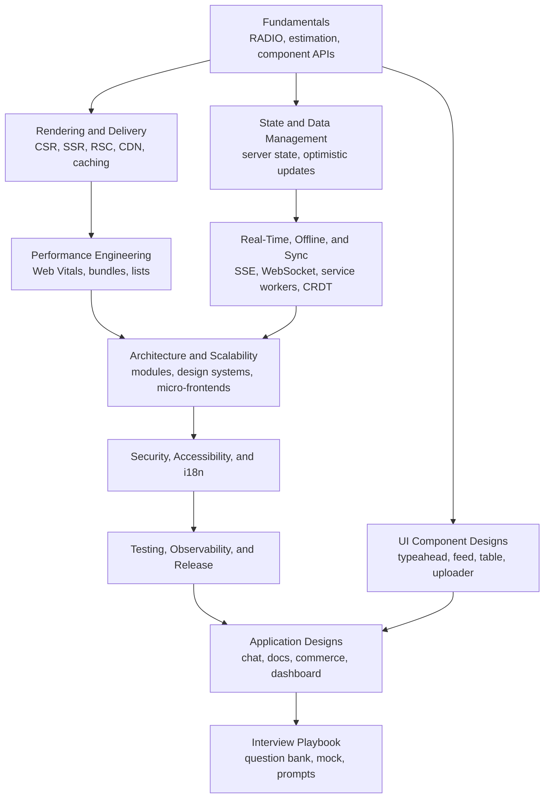

Start here for frontend and full-stack design rounds, from "design a typeahead" to "design the web client for a collaborative editor used by 20 teams".
Each page teaches the topic the way interviews probe it: the requirement, the architecture, the data flow, the trade-off, and how you would measure and defend the result.
Every runnable snippet was executed, and current facts are folded in: INP as a Core Web Vital, React Server Components and streaming, speculation rules, the Popover and `dialog` top layer, passkeys, Trusted Types, and CRDT libraries.

<SectionHub
  path="frontend-system-design"
  levels={{
    "frontend-system-design-fundamentals": "Beginner",
    "rendering-and-delivery": "Beginner to mid",
    "performance-engineering": "Mid to advanced",
    "state-and-data-management": "Mid",
    "real-time-offline-and-sync": "Mid to advanced",
    "architecture-and-scalability": "Senior",
    "security-accessibility-and-i18n": "Mid to advanced",
    "testing-observability-and-release": "Mid to senior",
    "ui-component-designs": "All levels",
    "application-designs": "Mid to senior",
    "frontend-system-design-interview-playbook": "All levels"
  }}
/>

## Reading Path

## Pick Your Level

| You are | Read in this order |
| --- | --- |
| New to design rounds | [Fundamentals](/docs/frontend-system-design/frontend-system-design-fundamentals), [Rendering and Delivery](/docs/frontend-system-design/rendering-and-delivery), [UI Component Designs](/docs/frontend-system-design/ui-component-designs) |
| Preparing for a mid-level loop | Add [State and Data Management](/docs/frontend-system-design/state-and-data-management), [Performance Engineering](/docs/frontend-system-design/performance-engineering), and [Security, Accessibility, and i18n](/docs/frontend-system-design/security-accessibility-and-i18n) |
| Preparing for senior or staff | Add [Real-Time, Offline, and Sync](/docs/frontend-system-design/real-time-offline-and-sync), [Architecture and Scalability](/docs/frontend-system-design/architecture-and-scalability), [Testing, Observability, and Release](/docs/frontend-system-design/testing-observability-and-release), and [Application Designs](/docs/frontend-system-design/application-designs) |
| One week left | The [Interview Playbook](/docs/frontend-system-design/frontend-system-design-interview-playbook) study plan |
| Short on time (one page) | The [Frontend System Design summary in HLD](/docs/system-design/hld/frontend-system-design) |

## Related Sections

- [System Design](/docs/system-design) covers backend HLD and LLD, which frontend designs lean on for APIs and real-time infrastructure.
- [React](/docs/react) and [Next.js](/docs/nextjs) cover the rendering model and the framework behind many designs.
- [Redux](/docs/redux) covers Redux Toolkit and RTK Query for client and server state.
- [JavaScript](/docs/javascript) and [TypeScript](/docs/typescript) cover the language, event loop, and async patterns used throughout.
- [Server-Driven UI](/docs/sdui) is a full frontend architecture case study.
- [Networking](/docs/networking) covers HTTP, TLS, DNS, and QUIC behind delivery and caching.
- [Backend](/docs/backend) covers auth, caching, queues, and API design behind the contracts you negotiate.
