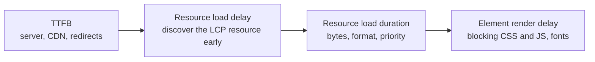
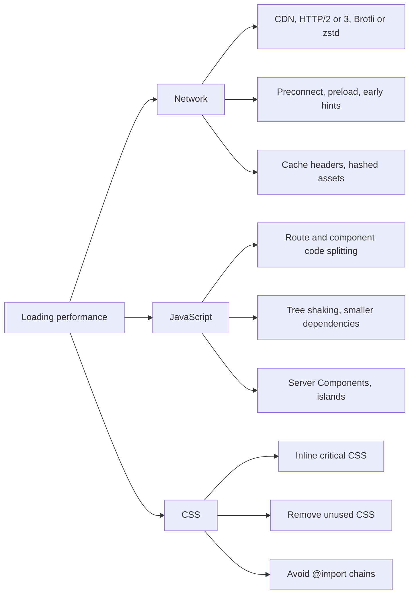
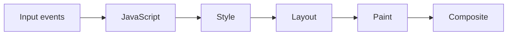

# 📘 Performance Engineering

Performance is a feature, a ranking signal, and a conversion lever.
In a design interview it is rarely a single trick: it is a **budget, a set of techniques per layer, and a way to measure and defend the result**.

## Table of Contents

1. [Measuring Performance](#1-measuring-performance)
2. [Core Web Vitals](#2-core-web-vitals)
3. [Loading Performance](#3-loading-performance)
4. [Images, Fonts, and Media](#4-images-fonts-and-media)
5. [Third-Party Code](#5-third-party-code)
6. [Runtime Performance](#6-runtime-performance)
7. [Rendering Large Lists](#7-rendering-large-lists)
8. [Memory](#8-memory)
9. [Performance Budgets](#9-performance-budgets)
10. [Debugging Playbook](#10-debugging-playbook)
11. [Questions](#11-questions)

---

## 1. Measuring Performance

| Kind | Tools | Use for |
| --- | --- | --- |
| **Field data** (real users) | CrUX, RUM libraries (`web-vitals`), your own telemetry | The truth: p75 and p95 per device and country |
| **Lab data** (synthetic) | Lighthouse, WebPageTest, DevTools Performance panel | Reproducing and diagnosing, regression checks in CI |

- Report metrics at the **75th percentile** of page loads, split by mobile and desktop, because averages hide the slow tail.
- Lab scores can be 95 while real users on low-end phones suffer, so decisions come from field data and diagnosis from lab data.
- The **Performance Timeline** APIs (`PerformanceObserver` for `largest-contentful-paint`, `layout-shift`, `event`, `longtask`, `long-animation-frame`, `navigation`, `resource`) feed RUM.

```js
// Browser: collect Core Web Vitals in the field (conceptual).
import { onLCP, onINP, onCLS } from 'web-vitals';

function send(metric) {
  navigator.sendBeacon('/rum', JSON.stringify({
    name: metric.name,
    value: metric.value,
    id: metric.id,
    route: location.pathname,
  }));
}
onLCP(send); onINP(send); onCLS(send);
```

---

## 2. Core Web Vitals

| Metric | Measures | Good (p75) | Needs work | Poor |
| --- | --- | --- | --- | --- |
| **LCP** Largest Contentful Paint | When the largest visible element renders | 2.5 s or less | up to 4 s | over 4 s |
| **INP** Interaction to Next Paint | Latency of interactions across the whole visit (input delay, processing, presentation) | 200 ms or less | up to 500 ms | over 500 ms |
| **CLS** Cumulative Layout Shift | Unexpected layout movement | 0.1 or less | up to 0.25 | over 0.25 |

INP replaced FID as a Core Web Vital in March 2024.
Supporting metrics: **TTFB** (server and network), **FCP** (first content), **TBT** (lab proxy for responsiveness), and long tasks (over 50 ms).

### 2.1 LCP Breakdown

LCP time is the sum of four parts, and each has its own fix.



| Part | Fixes |
| --- | --- |
| TTFB | CDN or static HTML, cache, fewer redirects, faster origin, streaming |
| Load delay | Put the LCP image in the HTML (not injected by JS or CSS), `preload` plus `fetchpriority="high"`, never `loading="lazy"` on it |
| Load duration | AVIF or WebP, correct size via `srcset`, image CDN, compression |
| Render delay | Inline critical CSS, defer non-critical CSS and JS, avoid client-only rendering of the hero, `font-display` strategy |

### 2.2 INP Breakdown

Each interaction has **input delay** (main thread busy), **processing time** (your handlers), and **presentation delay** (rendering after the handler).

| Cause | Fix |
| --- | --- |
| Long tasks on the main thread | Break up work, yield (`scheduler.yield()` or `setTimeout`), move to a worker |
| Heavy handlers | Do the minimum synchronously, defer the rest, debounce expensive handlers |
| Large re-renders | Narrow state scope, memoize, virtualize, `startTransition` for non-urgent updates |
| Large DOM | Fewer nodes, `content-visibility: auto`, virtualization |
| Hydration still running | Ship less JS, lazy hydrate, server components |
| Third-party scripts | Delay, sandbox, or remove them |
| Layout thrash | Batch DOM reads and writes |

### 2.3 CLS Causes

- Images, videos, ads, and embeds without reserved space (set `width` and `height` or `aspect-ratio`).
- Web fonts swapping with different metrics (use `size-adjust` and metric overrides on the fallback).
- Content injected above existing content (banners, late loaded components).
- Animations that change layout (`top`, `height`) instead of `transform`.
- Shifts caused by user input within 500 ms are excluded, so animate in response to clicks rather than on load.

---

## 3. Loading Performance



### 3.1 JavaScript Cost

JavaScript costs download, **parse and compile**, and **execute**, and low-end CPUs can be 4 to 6 times slower than a laptop.
That is why 300 KB of JavaScript hurts more than 300 KB of images.

| Technique | Detail |
| --- | --- |
| **Code splitting** | Dynamic `import()` per route and for heavy, rarely used components (editors, charts, maps, modals) |
| **Tree shaking** | ES modules and `sideEffects: false` so unused exports are dropped |
| **Dependency diet** | Audit with a bundle analyzer, replace heavy libraries (date, lodash, charting) with lighter ones or native APIs |
| **Modern target** | Ship modern syntax to modern browsers, avoid unnecessary polyfills and transpilation |
| **Compression** | Brotli for text assets (zstd where supported) |
| **Server Components or islands** | Remove non-interactive code from the client entirely |
| **Defer non-critical work** | Analytics, chat widgets, below-the-fold features load on idle or interaction |
| **Preload on intent** | Start fetching the chunk for a route or modal on hover, focus, or when it enters the viewport |

```tsx
// Lazy load a heavy component and prefetch it on intent.
const Editor = lazy(() => import('./Editor'));

function EditButton({ onOpen }: { onOpen: () => void }) {
  return (
    <button
      onMouseEnter={() => import('./Editor')}   // warm the chunk
      onFocus={() => import('./Editor')}
      onClick={onOpen}
    >
      Edit
    </button>
  );
}
```

### 3.2 CSS

- **Critical CSS** inlined in the head for above the fold, the rest loaded without blocking.
- Prefer **build-time CSS** (CSS Modules, utility CSS, compiled CSS-in-JS) over runtime style injection, which costs scripting time on every render.
- Remove unused CSS, avoid deep selector chains, and use **CSS containment** (`contain`, `content-visibility`) to limit work.
- Avoid `@import` chains because each import is a serial request.

### 3.3 Navigation Performance

- **Prefetch** next routes and data on intent, with limits for slow or metered connections.
- **bfcache** (back/forward cache): do not break it with `unload` handlers or `Cache-Control: no-store` on pages that do not need it, because restored pages are instant.
- **Speculation rules** for prerender of likely next pages (see [Rendering and Delivery](/docs/frontend-system-design/rendering-and-delivery)).

---

## 4. Images, Fonts, and Media

### 4.1 Images

Images are usually the largest bytes on a page.

| Technique | Detail |
| --- | --- |
| **Format** | AVIF or WebP over JPEG and PNG, SVG for icons and logos |
| **Responsive sizes** | `srcset` with width descriptors and `sizes` so a phone does not download a 2400 px image |
| **Dimensions** | `width` and `height` attributes (or `aspect-ratio`) to reserve space and stop layout shift |
| **Lazy loading** | `loading="lazy"` below the fold, never for the LCP image |
| **Decoding** | `decoding="async"` so decode does not block the main thread |
| **Placeholders** | Blur hash, dominant color, or low quality placeholder for perceived speed |
| **Image CDN** | Resize, crop, and format on the fly keyed by width and quality |
| **Priority** | `fetchpriority="high"` on the hero, `low` on carousel off-screen slides |

```html

```

### 4.2 Fonts

- **Self-host** WOFF2 and subset to the characters you need.
- `font-display: swap` or `optional`, with a **fallback font adjusted** (`size-adjust`, `ascent-override`) to match metrics and avoid shifts.
- **Preload** only the one or two critical font files (with `crossorigin`).
- Use **variable fonts** to replace many weight files with one.
- Limit families and weights, because every file competes with other critical resources.

### 4.3 Video and Animation

- Use `preload="metadata"` and a **poster image**, autoplay only muted and when in view.
- Use adaptive streaming (HLS or DASH) for long videos, not one large MP4.
- Prefer **CSS animations on `transform` and `opacity`**, which run on the compositor, over JavaScript driven layout animation.
- Replace animated GIFs with muted looping video or animated WebP and AVIF.
- Respect `prefers-reduced-motion`.

---

## 5. Third-Party Code

Analytics, tag managers, chat, ads, A/B tools, and embeds often account for a big share of main thread time and layout shift.

| Strategy | Detail |
| --- | --- |
| **Inventory and ownership** | Every script has an owner and a business reason, review regularly |
| **Load late** | `async` or `defer`, load after interaction or on idle, not in the critical path |
| **Facades** | Show a static preview (video thumbnail, chat button) and load the real widget on click |
| **Isolate** | Run in a worker (Partytown style) or an iframe with `sandbox` |
| **Budget and monitor** | Track their long tasks and bytes in RUM, alert on regressions |
| **Server-side tagging** | Move vendor calls to the server to cut client work |
| **Security** | Subresource Integrity where possible, CSP allowlist, no tag manager free-for-all |

---

## 6. Runtime Performance

### 6.1 The Frame Pipeline



- Changing `width`, `top`, or reading `offsetHeight` after a write triggers **layout**, changing `color` triggers paint, changing `transform` and `opacity` only composites.
- **Layout thrashing:** interleaving DOM reads and writes in a loop forces repeated synchronous layout.
  Batch reads first, then writes, or use `requestAnimationFrame`.
- Use `will-change` sparingly because every promoted layer costs memory.
- **`content-visibility: auto`** skips rendering work for offscreen sections (give it `contain-intrinsic-size`).

### 6.2 Keeping the Main Thread Free

| Technique | Use |
| --- | --- |
| **Chunk and yield** | Process big arrays in slices, yield between them with `scheduler.yield()` (fallback `setTimeout` or `MessageChannel`) |
| **`requestIdleCallback`** | Low priority work such as analytics flush and prefetch bookkeeping |
| **Web Workers** | Parsing, search indexing, diffing, image processing, heavy data transforms |
| **OffscreenCanvas** | Render canvas content in a worker |
| **Debounce and throttle** | Scroll, resize, input handlers |
| **Passive listeners** | `{ passive: true }` for scroll and touch so the browser does not wait on `preventDefault` |
| **`IntersectionObserver` and `ResizeObserver`** | Replace scroll handlers and polling |

```js
// runnable
// Process a big array in slices so the thread can handle input between chunks.
const yieldToMain = () => new Promise((resolve) => setTimeout(resolve, 0));

async function processInChunks(items, work, budgetMs = 8) {
  let chunks = 0;
  let start = Date.now();
  for (const item of items) {
    work(item);
    if (Date.now() - start > budgetMs) {
      chunks += 1;
      await yieldToMain();
      start = Date.now();
    }
  }
  return chunks;
}

const data = Array.from({ length: 200000 }, (_, i) => i);
let sum = 0;
processInChunks(data, (n) => { sum += Math.sqrt(n); }, 5).then((chunks) => {
  console.log('done, yielded', chunks > 0 ? 'at least once' : 'never', '| sum ok:', sum > 0);
});
```

### 6.3 Rendering Cost in Component Frameworks

- **Re-render scope:** state should live as low as possible, and context values should be split so unrelated consumers do not re-render.
- **Memoization** (`memo`, `useMemo`, `useCallback`) helps only when props are stable and the child is expensive, and the **React Compiler** can add much of this automatically.
- **Transitions** (`startTransition`, `useDeferredValue`) keep typing responsive while a heavy list updates.
- **Stable keys** and no index keys for reorderable lists.
- **Selectors with equality checks** for store subscriptions, so a component re-renders only when its slice changes.
- Avoid creating **new object or function props** inline on memoized children in hot paths.
- **Signals-based** frameworks update the exact DOM node, trading the virtual DOM diff for fine grained subscriptions.

---

## 7. Rendering Large Lists

| Approach | Idea | Notes |
| --- | --- | --- |
| **Pagination** | Fixed pages | Simple, accessible, good for goal oriented browsing |
| **Infinite scroll** | Append pages when a sentinel appears | Needs memory limits, footer access, and scroll restoration |
| **Virtualization (windowing)** | Render only visible rows plus an overscan buffer, absolutely positioned or padded | Constant DOM size, needs row heights (fixed or measured) |
| **`content-visibility: auto`** | Browser skips offscreen rendering | Cheap, keeps all nodes in the DOM |
| **Incremental rendering** | Render in chunks across frames | Good for one-off large tables |

Virtualization details worth saying out loud:

- Visible range from `scrollTop`: `start = floor(scrollTop / rowHeight)`, `end = start + ceil(viewportHeight / rowHeight)`, plus overscan on both sides.
- Variable heights: measure with `ResizeObserver`, cache heights, and use an estimated height for unmeasured rows (use a prefix sum or tree to find offsets quickly).
- Trade-offs: browser find (Ctrl+F) and some screen reader behaviors do not see unrendered rows, so expose row counts with `aria-rowcount` and `aria-setsize` and provide search in the UI.
- Libraries: TanStack Virtual, react-window.

```js
// runnable
// Fixed-height virtual window: which rows are rendered for a scroll position?
function visibleRange({ scrollTop, viewportHeight, rowHeight, total, overscan = 3 }) {
  const first = Math.floor(scrollTop / rowHeight);
  const count = Math.ceil(viewportHeight / rowHeight);
  const start = Math.max(0, first - overscan);
  const end = Math.min(total - 1, first + count + overscan);
  return { start, end, rendered: end - start + 1, offsetTop: start * rowHeight, totalHeight: total * rowHeight };
}

console.log(visibleRange({ scrollTop: 0, viewportHeight: 600, rowHeight: 40, total: 100000 }));
console.log(visibleRange({ scrollTop: 400000, viewportHeight: 600, rowHeight: 40, total: 100000 }));
```

---

## 8. Memory

- **Leaks come from:** listeners and timers never removed, subscriptions without cleanup, detached DOM nodes held by closures, unbounded caches and arrays, global stores holding old data.
- **Fixes:** cleanup in `useEffect`, `AbortController` for fetches and listeners, bounded caches (LRU, TTL), `WeakMap` and `WeakRef` for caches keyed by objects.
- **Find them** with heap snapshots (compare before and after repeating an action), the Memory panel allocation timeline, and checking that DOM node counts return to baseline.
- Long lived apps (dashboards, chat) need **bounded buffers**: keep the last N points and messages, drop or paginate the rest.
- Images and canvases dominate memory on mobile, so release large bitmaps when off screen.

---

## 9. Performance Budgets

A budget turns performance from a wish into a gate.

| Budget type | Example |
| --- | --- |
| Metric | LCP p75 under 2.5 s, INP p75 under 200 ms, CLS under 0.1 |
| Size | Initial JS under 170 KB gzipped, total page weight under 1 MB, per route chunk under 50 KB |
| Count | Under 10 critical requests, under 5 third-party scripts |
| Timing | TBT under 200 ms in lab on a throttled mobile profile |

Enforcement:

1. **CI check:** bundle size limit (size-limit, bundlewatch) and Lighthouse CI on key pages, fail the pull request on regression.
2. **Per-route ownership:** teams own their route's budget.
3. **RUM alerts:** a dashboard and alerts on p75 per route and release.
4. **Release gating:** canary and rollback on vitals regression (see [Testing, Observability, and Release](/docs/frontend-system-design/testing-observability-and-release)).

---

## 10. Debugging Playbook

| Symptom | Investigate | Typical fix |
| --- | --- | --- |
| Slow LCP | Which element is the LCP, when is it discovered, how many bytes | Put it in HTML, preload with high priority, right format and size, cut blocking resources |
| High TTFB | Redirects, origin time, cache misses | CDN, caching, streaming, faster API |
| Poor INP | Performance panel, long animation frames, which interaction | Split tasks, reduce render scope, worker, remove third-party work |
| High CLS | Layout shift regions in DevTools | Reserve space, fix font metrics, avoid late inserts |
| Big bundle | Bundle analyzer, duplicate packages | Split, replace libraries, server components |
| Janky scroll | Frames, forced reflow, scroll handlers | Passive listeners, `IntersectionObserver`, virtualization |
| Slow only for some users | Field data by device, country, connection | Adaptive loading, lighter experiences for slow devices |
| Memory growth | Heap snapshots over time | Remove leaked listeners and caches |

Method: **measure, locate the bottleneck, change one thing, re-measure, guard with a budget**.

---

## 11. Questions

**Q: How do you improve LCP?**
Make the LCP resource discoverable in the HTML, preload it with `fetchpriority="high"`, serve a right sized AVIF or WebP from a CDN, cut render blocking CSS and JavaScript, and lower TTFB with static or cached HTML.

**Q: How do you improve INP?**
Find the interaction in the Performance panel, shorten long tasks by splitting and yielding, shrink re-render scope, use transitions, move heavy work to a worker, and remove or delay third-party scripts.

**Q: What is the difference between lab and field data?**
Lab data is a controlled, repeatable test (Lighthouse) used to diagnose.
Field data is real users on real devices (CrUX, RUM) and is what Core Web Vitals and decisions are based on, reported at the 75th percentile.

**Q: How would you render a table with a million rows?**
Do not render them all: virtualize rows, load data in pages or via a streaming or server-side query, sort and filter on the server, and keep a bounded cache.
Add keyboard navigation and `aria` row counts.

**Q: Why is JavaScript more expensive than images of the same size?**
It must be parsed, compiled, and executed on the main thread, which competes with input handling, while an image only costs network and off main thread decode.

**Q: How do you stop a performance regression from shipping?**
Budgets in CI (bundle size, Lighthouse CI), RUM alerts per route, canary releases with automatic rollback on vitals regression, and code owners for each route.

**Q: How do you handle a heavy third-party script?**
Load it late or on interaction, use a facade, isolate it in an iframe or worker, measure its main thread cost in RUM, and challenge whether it is needed.

**Q: Your page is fast on desktop but slow on low-end Android. What now?**
Measure with CPU throttling on a mid-tier profile, cut JavaScript and hydration work, reduce DOM size, serve smaller images, and consider adaptive loading using `navigator.deviceMemory`, `hardwareConcurrency`, and `saveData` hints for lighter experiences.

Next: [State and Data Management](/docs/frontend-system-design/state-and-data-management).
