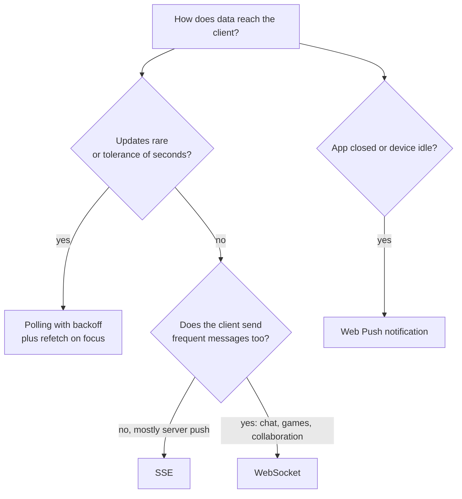
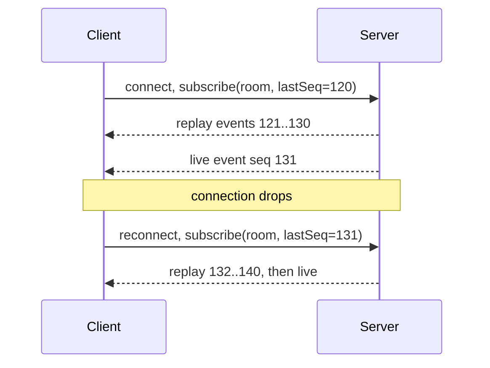
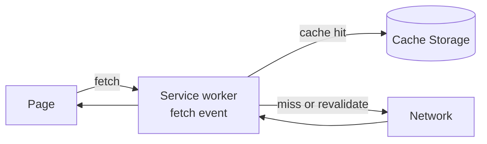
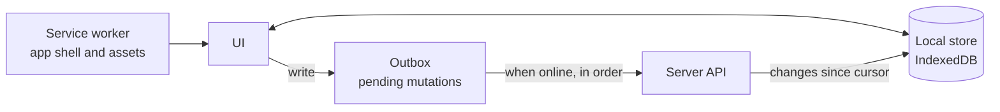

# 📘 Real-Time, Offline, and Sync

Two opposite network problems show up in frontend designs.
**Real-time:** data changes on the server and the UI must reflect it within moments.
**Offline and flaky networks:** the user keeps working while the connection is slow, intermittent, or gone, and changes must sync later without loss.
Both come down to the same ideas: a durable local copy, an ordered stream of changes, idempotent messages, and a clear way to merge.

## Table of Contents

1. [Choosing a Transport](#1-choosing-a-transport)
2. [WebSockets in Practice](#2-websockets-in-practice)
3. [Server-Sent Events](#3-server-sent-events)
4. [Reconnection, Resume, and Ordering](#4-reconnection-resume-and-ordering)
5. [Backpressure and Update Batching](#5-backpressure-and-update-batching)
6. [Multi-Tab and Multi-Device](#6-multi-tab-and-multi-device)
7. [Service Workers and Caching Strategies](#7-service-workers-and-caching-strategies)
8. [Offline-First Architecture](#8-offline-first-architecture)
9. [Conflict Resolution and CRDTs](#9-conflict-resolution-and-crdts)
10. [Push Notifications and Background Work](#10-push-notifications-and-background-work)
11. [Questions](#11-questions)

---

## 1. Choosing a Transport

| Transport | Direction | How | Strengths | Limits |
| --- | --- | --- | --- | --- |
| **Polling** | Client pulls | Repeated requests at an interval | Simple, cacheable, works everywhere | Wasteful, latency up to the interval |
| **Long polling** | Client pulls, server holds | Request stays open until data or timeout | Works through old proxies | One request per message cycle, server holds connections |
| **SSE** (Server-Sent Events) | Server to client | One long lived HTTP response, text events | Automatic reconnect with `Last-Event-ID`, plain HTTP, simple | One direction, limited connections per origin on HTTP/1.1, text only |
| **WebSocket** | Both ways | Upgrade to a persistent full duplex socket | Low latency, binary, many small messages | Stateful, needs your own reconnect, auth, and heartbeats, proxies can interfere |
| **WebTransport** | Both ways | HTTP/3 streams and datagrams | Multiple streams, unreliable datagrams, no head of line blocking | Newer, server support still growing |
| **Push (Web Push)** | Server to device | Browser push service wakes the service worker | Works when the app is closed | Permission needed, payload limits, not guaranteed instant |
| **WebRTC data channel** | Peer to peer | Direct connection | Lowest latency, offloads servers | Signaling, NAT traversal, complexity |



Rule of thumb: **start with the simplest thing that meets the latency requirement**.
SSE covers notifications, live scores, progress, and streaming LLM tokens.
Reach for WebSocket when the client also sends a stream of messages.

---

## 2. WebSockets in Practice

A raw WebSocket is a pipe.
Production use needs a layer on top.

| Concern | Approach |
| --- | --- |
| **Auth** | Authenticate on connect with a short lived token (query string tokens leak into logs, so prefer a first message, a cookie on the same origin, or a ticket endpoint that returns a one-time URL) |
| **Protocol** | Typed messages: `{ type, id, seq, payload }`, versioned |
| **Heartbeat** | Ping and pong at an interval, close and reconnect if no pong, because half open TCP connections are common on mobile |
| **Reconnect** | Exponential backoff with jitter, reset on success |
| **Resume** | Send the last received sequence or cursor so the server replays missed events |
| **Subscriptions** | Subscribe and unsubscribe per topic or screen, never receive what is not visible |
| **Acks** | Client messages carry an id, the server acknowledges, unacked messages are retried (idempotent) |
| **Fallback** | Degrade to polling if the socket cannot connect (corporate proxies) |
| **Visibility** | Pause or slow down when the tab is hidden, reconnect on focus |

```js
// runnable
// Reconnect delay with exponential backoff and full jitter, capped.
function backoffMs(attempt, { base = 500, cap = 30000 } = {}) {
  const exp = Math.min(cap, base * 2 ** attempt);
  return Math.floor(Math.random() * exp);          // full jitter spreads a thundering herd
}

for (let attempt = 0; attempt < 6; attempt += 1) {
  const max = Math.min(30000, 500 * 2 ** attempt);
  const d = backoffMs(attempt);
  console.log(`attempt ${attempt}: window 0-${max} ms, picked ${d} ms`, d <= max ? 'ok' : 'BAD');
}
```

Jitter matters: if a server restarts and 100,000 clients reconnect on the same schedule, they hammer it together.

---

## 3. Server-Sent Events

```js
// Browser
const es = new EventSource('/api/stream');          // reconnects automatically
es.addEventListener('order-updated', (e) => update(JSON.parse(e.data)));
es.onerror = () => { /* browser retries; show a "reconnecting" state */ };
```

```text
// Server response (text/event-stream)
id: 1042
event: order-updated
data: {"id":7,"status":"shipped"}
```

- The browser resends the **`Last-Event-ID`** header after reconnect, so the server can replay missed events.
- Over HTTP/2 or HTTP/3 the per origin connection limit stops being a problem.
- The built-in `EventSource` cannot set custom headers, so authenticate with cookies, or use `fetch` with a streamed body for header based auth.
- Same pattern for **streaming LLM responses**: read tokens as they arrive and append to the UI.
- Proxies and CDNs may **buffer** the stream, so disable buffering and send periodic comments (`: keepalive`) to hold the connection open.

---

## 4. Reconnection, Resume, and Ordering

Networks drop messages, duplicate them, and deliver them late, so a real-time client must handle all three.



| Problem | Solution |
| --- | --- |
| **Missed events during a gap** | Per stream sequence numbers or cursors, resume from `lastSeq`, fall back to a full refetch if the gap is too large (the server no longer has the events) |
| **Duplicates** | Dedupe by event id or `seq` (apply each once), make handlers idempotent |
| **Out of order** | Buffer and apply in `seq` order, or last write wins by version number |
| **Gap detection** | If `seq` jumps (131 then 135), request the missing range or refetch the snapshot |
| **Initial state race** | Subscribe first, then fetch the snapshot, then apply buffered events newer than the snapshot version |
| **Server restarts** | Clients treat reconnect as normal, resync to snapshot plus deltas |

The **snapshot plus deltas** pattern:

1. Open the stream and start buffering events.
2. Fetch the snapshot (with its version).
3. Drop buffered events at or below the snapshot version, apply the rest, then apply live events in order.

```js
// runnable
// Apply events exactly once and in order, even when they arrive duplicated or shuffled.
function createOrderedApplier(apply, startSeq = 0) {
  let next = startSeq + 1;
  const pending = new Map();
  return function receive(event) {
    if (event.seq < next || pending.has(event.seq)) return;  // duplicate
    pending.set(event.seq, event);
    while (pending.has(next)) {                                // drain in order
      apply(pending.get(next));
      pending.delete(next);
      next += 1;
    }
  };
}

const log = [];
const receive = createOrderedApplier((e) => log.push(e.seq));
[2, 1, 2, 4, 3, 1, 5].forEach((seq) => receive({ seq }));
console.log(log.join(','));   // 1,2,3,4,5
```

---

## 5. Backpressure and Update Batching

A fast stream can freeze the UI if every message triggers a render.

| Technique | Detail |
| --- | --- |
| **Frame batching** | Collect messages in a buffer and flush once per animation frame (`requestAnimationFrame`) |
| **Interval batching** | Flush every 250 to 1000 ms for dashboards, humans cannot read faster |
| **Coalescing** | Keep only the latest value per key (price per symbol), drop intermediate ones |
| **Deltas, not snapshots** | Send only changes, server side aggregation reduces rate |
| **Bounded buffers** | Ring buffer of the last N points per series |
| **Subscription scope** | Subscribe only to visible widgets and symbols |
| **Drop policy** | When behind, drop old frames and keep the latest, and show staleness |
| **Off main thread** | Parse and aggregate in a worker, post results in batches |
| **Visibility pause** | Stop rendering for hidden tabs, catch up with a snapshot when visible |

```js
// runnable
// Coalesce a burst of messages to one render per flush, keeping the latest value per key.
function createBatcher(flush, scheduler = (fn) => setTimeout(fn, 16)) {
  let latest = new Map();
  let scheduled = false;
  return (key, value) => {
    latest.set(key, value);                 // later messages for the same key replace earlier ones
    if (scheduled) return;
    scheduled = true;
    scheduler(() => {
      scheduled = false;
      const batch = latest;
      latest = new Map();
      flush(Object.fromEntries(batch));
    });
  };
}

let renders = 0;
const push = createBatcher((batch) => { renders += 1; console.log('render', batch); });
for (let i = 0; i < 1000; i += 1) push(i % 2 ? 'AAPL' : 'MSFT', i);   // 1000 messages
setTimeout(() => console.log('renders for 1000 messages:', renders), 50);
```

---

## 6. Multi-Tab and Multi-Device

- **One connection per browser, not per tab:** a `SharedWorker` owns the WebSocket and broadcasts to tabs, or use a **leader election** with Web Locks (`navigator.locks.request`) so one tab holds the socket and relays via `BroadcastChannel`.
- **Share state** across tabs with `BroadcastChannel` (or the `storage` event) so logout and theme changes propagate.
- **Logout everywhere:** broadcast a logout event, invalidate tokens on the server.
- **Multi-device:** the server is the source of truth, devices sync through the same event stream, and read state or drafts sync with versioning.
- **Presence and typing:** ephemeral, throttled, expire by timeout (no durable storage).

---

## 7. Service Workers and Caching Strategies

A **service worker** is a script that sits between the page and the network.
It enables offline support, cache control, background sync, and push.



| Strategy | Behavior | Use for |
| --- | --- | --- |
| **Cache first** | Serve cache, fall back to network | Hashed static assets, fonts |
| **Network first** | Try network, fall back to cache on failure or timeout | HTML documents, frequently updated data you want fresh |
| **Stale-while-revalidate** | Serve cache now, update cache from network | Avatars, API GETs where slight staleness is fine |
| **Network only** | Always network | Non-cacheable calls, payments |
| **Cache only** | Only cache | Precached app shell in offline mode |

```js
// Service worker: stale-while-revalidate for API GETs, cache-first for hashed assets.
self.addEventListener('fetch', (event) => {
  const { request } = event;
  if (request.method !== 'GET') return;
  const url = new URL(request.url);

  if (url.pathname.startsWith('/assets/')) {
    event.respondWith(caches.match(request).then((hit) => hit ?? fetch(request).then((res) => put(request, res))));
  } else if (url.pathname.startsWith('/api/')) {
    event.respondWith(
      caches.open('api').then(async (cache) => {
        const cached = await cache.match(request);
        const network = fetch(request).then((res) => { cache.put(request, res.clone()); return res; });
        return cached ?? network;
      }),
    );
  }
});

async function put(request, response) {
  const cache = await caches.open('assets-v1');
  cache.put(request, response.clone());
  return response;
}
```

Lifecycle and pitfalls:

- **Install, waiting, activate:** a new worker waits until old tabs close, so decide whether to `skipWaiting` and show an "update available" prompt.
- **Versioned caches** and cleanup of old ones on activate.
- **Do not cache authenticated or private responses** under shared keys, and never cache `POST`.
- **Updating the shell:** the service worker file itself should be served with `no-cache` so updates are detected.
- **Debugging:** the Application panel, "Update on reload", and bypass for network.
- **Workbox** provides routing, strategies, precaching, and background sync so you do not hand write all of this.

---

## 8. Offline-First Architecture

**Offline-first** means the UI reads from and writes to a **local store first**, and the network syncs in the background.
The app is usable with no connection and becomes consistent when it returns.



### 8.1 Building Blocks

| Piece | Role |
| --- | --- |
| **App shell** | Precached HTML, CSS, JS so the app opens offline |
| **Local database** | IndexedDB (Dexie, idb), SQLite in WASM on OPFS, or a sync engine (RxDB, PouchDB, WatermelonDB for React Native, Replicache style) |
| **Read path** | UI queries the local store, a sync process updates it |
| **Outbox** | Durable queue of mutations with ids, retried with idempotency keys |
| **Sync cursor** | `since` token for fetching only changes after the last sync |
| **Tombstones** | Deleted records are marked, not removed, so deletes sync |
| **Status UI** | Saved, saving, offline, sync failed, with a retry and a visible pending count |
| **Reachability** | `navigator.onLine` is unreliable (true on a captive portal), confirm with a real request or heartbeat |

### 8.2 Sync Algorithm

1. **Push:** send outbox mutations in order, each with a client id and idempotency key.
   The server applies and returns results.
2. **Pull:** request changes since the cursor, apply them to the local store, advance the cursor.
3. **Reconcile:** if a pulled change conflicts with a pending local mutation, apply the conflict policy.
4. **Repeat** on reconnect, on an interval, on focus, and after each local write (debounced).

### 8.3 Background Sync

- The **Background Sync API** (`registration.sync.register('outbox')`) lets the service worker flush the outbox when connectivity returns, even after the tab closes (Chromium based browsers).
- **Periodic Background Sync** can refresh content occasionally on installed PWAs.
- For browsers without it, flush on `online`, focus, and app start.

### 8.4 Offline Product Decisions

- Which features work offline (read, create, edit) and which are disabled with an explanation.
- **Quota management:** request persistent storage (`navigator.storage.persist()`), evict least recently used data, cap media.
- **Security:** encrypt sensitive data at rest if the threat model requires, clear on logout.
- **Schema migrations** for the local database.

---

## 9. Conflict Resolution and CRDTs

Conflicts happen when two clients change the same data before syncing.

| Strategy | How | Good for | Cost |
| --- | --- | --- | --- |
| **Last write wins** | Latest timestamp or version wins | Settings, simple profiles | Silent data loss, clock skew |
| **Server authoritative with version check** | `If-Match: version`, reject stale writes, client refetches and retries | Business records | Needs conflict UI or retry logic |
| **Per-field merge** | Merge non-overlapping field changes | Forms, records | Same field still conflicts |
| **Operational Transform (OT)** | Transform concurrent operations against each other via a central server | Collaborative text (Google Docs style) | Complex, needs a server to order operations |
| **CRDT** | Data structure that merges deterministically in any order (Yjs, Automerge, Loro) | Local first, collaborative editing, offline | Memory and metadata overhead, history growth |
| **Manual resolution** | Show both versions, user chooses | High value documents | Interrupts the user |

**CRDT in one paragraph:** each replica applies operations locally, shares them, and merging is commutative, associative, and idempotent, so all replicas converge without a coordinator.
A **G-counter** (sum of per replica counts), **LWW-register**, **OR-set**, and sequence CRDTs for text are the building blocks.

```js
// runnable
// Grow-only counter CRDT: merge takes the max per replica, so merge order never matters.
const merge = (a, b) => {
  const out = { ...a };
  for (const [id, n] of Object.entries(b)) out[id] = Math.max(out[id] ?? 0, n);
  return out;
};
const value = (c) => Object.values(c).reduce((s, n) => s + n, 0);

let phone = { phone: 0 }, laptop = { laptop: 0 };
phone = { ...phone, phone: phone.phone + 3 };       // offline increments
laptop = { ...laptop, laptop: laptop.laptop + 2 };

const a = merge(phone, laptop);
const b = merge(laptop, phone);
const same = (x, y) => JSON.stringify(Object.entries(x).sort()) === JSON.stringify(Object.entries(y).sort());
console.log(value(a), value(b), same(a, b));                                // 5 5 true
console.log(value(merge(a, a)));                                            // 5 (idempotent)
```

For collaborative editing, say: awareness (cursors and presence) is separate ephemeral state, updates are sent as small binary diffs over WebSocket, and the document is persisted server side with snapshots plus an update log.

---

## 10. Push Notifications and Background Work

- **Web Push** needs a service worker, user permission, a VAPID key, and a push subscription sent to your server.
  Ask for permission **in context** (after a relevant action), not on load.
- **Payload:** send a small payload or a signal, then fetch details when the worker wakes, and show the notification with `registration.showNotification`.
- **Click handling:** `notificationclick` focuses or opens the app at the right route.
- **Badging API** shows unread counts on installed apps.
- **Delivery is best effort**, so the app must still sync state on open.
- **In-app notifications** use the open real-time channel, and unread counts come from the server or from a last-read pointer.
- **Respect user control:** categories, quiet hours, easy unsubscribe.

---

## 11. Questions

**Q: SSE or WebSocket?**
SSE for server to client streams over plain HTTP with automatic reconnect and resume.
WebSocket when the client also sends frequent messages or needs binary and the lowest latency.

**Q: How do you make a WebSocket client reliable?**
Heartbeats, reconnect with exponential backoff and jitter, resume from the last sequence, idempotent message handling, snapshot plus delta resync, and a visible connection state.

**Q: How do you avoid missing events between the initial load and the stream?**
Subscribe first and buffer, fetch the snapshot with its version, discard buffered events not newer than the snapshot, apply the rest in order.

**Q: A dashboard receives 500 messages per second. What do you do?**
Aggregate on the server, send deltas, batch updates per frame or per interval, coalesce by key, keep bounded buffers, render only visible widgets, and parse in a worker.

**Q: How would you make an app work offline?**
A service worker for the app shell and assets, a local database as the read source, an outbox for mutations with idempotency keys, a sync cursor for pulling changes, a conflict policy, and clear sync status in the UI.

**Q: Last write wins or CRDT?**
Last write wins is fine for low stakes single value data.
Use CRDTs or OT when concurrent edits to the same content must merge without losing intent, such as collaborative text.

**Q: How do you handle conflicts in a form that was edited offline?**
Send the base version with the mutation, the server rejects if it moved, the client fetches the latest and shows a merge or choose UI, or auto merges non-overlapping fields.

**Q: Why not rely on `navigator.onLine`?**
It only says there is a network interface, not that your server is reachable.
Confirm with a lightweight request or heartbeat, and treat failed requests as the signal.

**Q: How do you share one WebSocket among many tabs?**
A `SharedWorker`, or elect a leader tab with Web Locks, and broadcast messages to other tabs through `BroadcastChannel`.

**Q: When would you use polling?**
When updates are rare, data is cacheable, you need the simplest infrastructure, or real-time infrastructure is not justified.
Use backoff, pause when hidden, and refetch on focus.

Next: [Architecture and Scalability](/docs/frontend-system-design/architecture-and-scalability).
