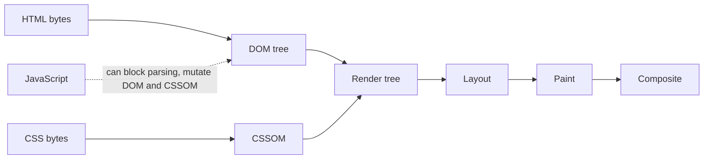
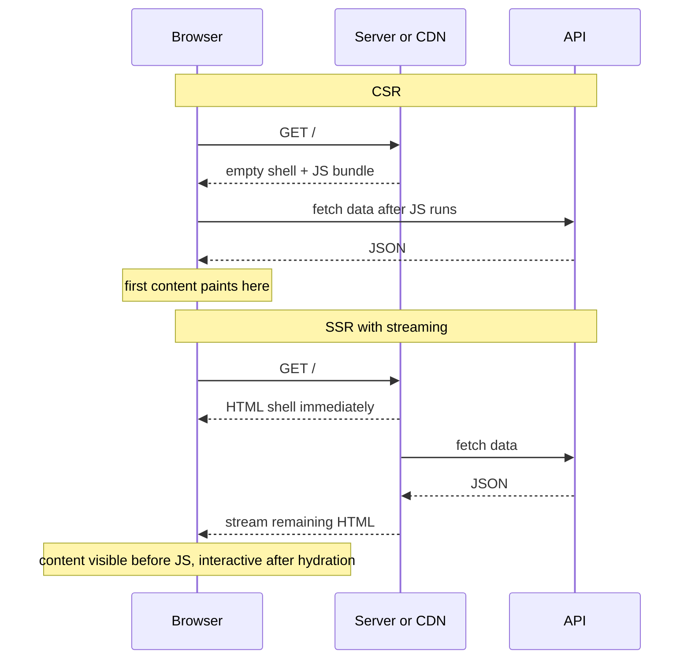
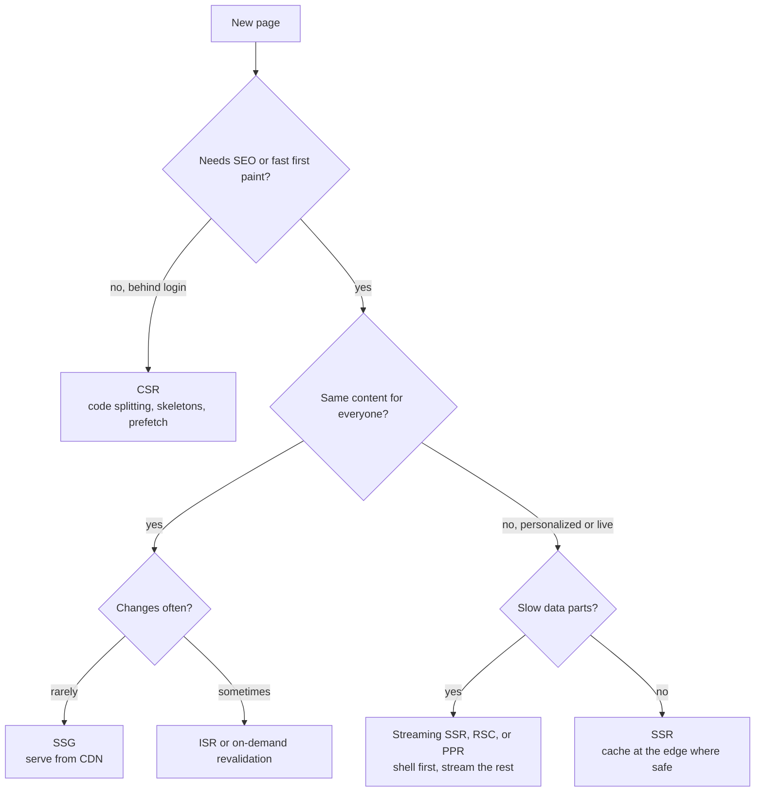
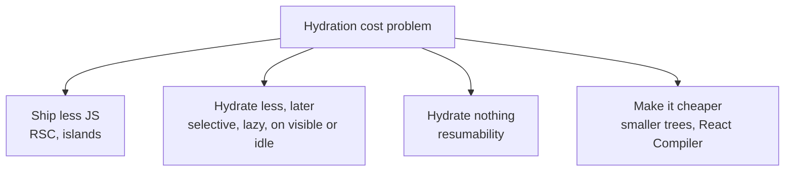

# 📘 Rendering and Delivery

The biggest architectural choice in a frontend design is **where and when HTML is produced**, and the second is **how bytes reach the browser**.
This page covers both: rendering strategies, hydration, CDN and caching, resource hints, and SEO.

## Table of Contents

1. [The Critical Rendering Path](#1-the-critical-rendering-path)
2. [Rendering Strategies](#2-rendering-strategies)
3. [Choosing a Strategy](#3-choosing-a-strategy)
4. [Hydration and Its Alternatives](#4-hydration-and-its-alternatives)
5. [CDN and Edge Delivery](#5-cdn-and-edge-delivery)
6. [HTTP Caching](#6-http-caching)
7. [Resource Hints and Prefetching](#7-resource-hints-and-prefetching)
8. [Routing and Navigation](#8-routing-and-navigation)
9. [SEO and Crawling](#9-seo-and-crawling)
10. [Questions](#10-questions)

---

## 1. The Critical Rendering Path

What the browser does between receiving bytes and showing pixels:



- **CSS is render blocking:** the browser will not paint until the CSSOM for linked stylesheets is built.
- **Synchronous scripts are parser blocking:** use `defer` (run after parsing, in order) or `async` (run when downloaded, any order), or `type="module"` (deferred by default).
- **Fonts and images** are discovered late if they are only referenced from CSS or JavaScript, so they delay LCP.
- **Preload scanner:** the browser scans ahead in raw HTML to start downloads early, but cannot see resources injected by JavaScript.
- **Compositor only changes** (`transform`, `opacity`) skip layout and paint, which is why animations should use them.

Implication: **HTML that already contains the content and critical resource links wins**, because the browser can start work before any JavaScript runs.

---

## 2. Rendering Strategies

| Strategy | HTML produced | Strong for | Costs and risks |
| --- | --- | --- | --- |
| **CSR** (client-side rendering) | In the browser, after JS loads and data arrives | Dashboards and tools behind login | Blank first paint, slow LCP on slow devices, SEO needs care |
| **SSR** (server-side rendering) | On the server per request | Personalized pages that need SEO and fast first paint | Server cost, TTFB depends on data, hydration cost |
| **SSG** (static site generation) | At build time | Docs, blogs, marketing | Rebuild for changes, not for per-user data |
| **ISR** (incremental static regeneration) | Static, regenerated after a time or on demand | Catalogs, articles that change sometimes | Staleness window, cache coordination |
| **Streaming SSR** | Shell first, slow parts streamed as they resolve (Suspense) | Pages with one slow section | Error handling per boundary, buffering by proxies |
| **React Server Components** | Server components render on the server, output is a serialized tree, only client components ship JS | Less client JS, data access next to the UI | Boundary rules, serialization limits, caching semantics |
| **Islands** | Static HTML with small interactive islands | Content sites with some widgets | Cross-island state is awkward |
| **Partial prerendering** | Static shell from the CDN, dynamic holes streamed | Mixed static and personalized pages | Framework-specific |
| **Edge rendering** | SSR at locations near the user | Low latency personalization | Runtime limits, data far from the edge |

### 2.1 Timelines



The key difference: with CSR the network chain is **HTML, then JS, then data**, with SSR or SSG the content is already in the first response.

### 2.2 React Server Components in One Page

- Components are **server by default** and can read databases and secrets, because their code never ships to the browser.
- The server sends an **RSC payload** (a serialized component tree with placeholders for client components) that the client merges, and it also renders HTML for the first load.
- **Client components** (`'use client'`) handle state, effects, and browser APIs, and are still pre-rendered to HTML on the server.
- Props crossing the boundary must be **serializable** (no functions), and a server component can be passed as `children` into a client component.
- Result: less JavaScript, fewer client-side waterfalls, and data fetching colocated with UI.
- Deeper treatment: [Next.js Rendering and Server Components](/docs/nextjs/rendering-and-server-components).

### 2.3 Streaming and Suspense

- The server sends the **shell** (layout, navigation, skeletons) immediately, and each Suspense boundary streams in when its data is ready.
- Out of order streaming means a fast widget never waits for a slow one.
- Put boundaries around **independent, slow, or personalized** parts, not around everything.
- Reverse proxies and some CDNs buffer responses, so verify that streaming survives your delivery path.

---

## 3. Choosing a Strategy



| Page type | Typical choice | Why |
| --- | --- | --- |
| Marketing, landing | SSG | Fast, cheap, SEO |
| Blog, docs | SSG or ISR | Content changes rarely, CDN served |
| Product detail | ISR or PPR with a personalized hole | SEO plus fresh price and stock |
| Search results | SSR or streaming | Query dependent, SEO optional |
| Feed (logged in) | CSR or RSC shell with client list | Personalized, infinite scroll |
| Dashboard | CSR with prefetch | Behind login, interactive |
| Checkout and account | SSR or CSR, no caching of private data | Private, security sensitive |

Mix strategies per route.
Say so in the interview: "marketing and product pages are static or ISR, the app shell after login is CSR".

---

## 4. Hydration and Its Alternatives

**Hydration** attaches event handlers and state to server-rendered HTML by running the components again in the browser.

Costs:

- The page **looks ready but is not interactive** until hydration finishes (a source of poor INP and rage clicks).
- The framework downloads and executes **all the component code** even for parts that never change.
- The server and client output must match, or you get **hydration mismatches** (dates, random ids, `window` checks).



| Technique | Idea |
| --- | --- |
| **Server Components** | Non-interactive parts never hydrate because they never ship |
| **Selective hydration** | React hydrates Suspense boundaries independently and prioritizes the one the user interacts with |
| **Islands** | Only marked components hydrate, with directives such as on load, on visible, or on idle |
| **Lazy hydration** | Delay hydration of below the fold or rarely used widgets until visible or interacted with |
| **Resumability** (Qwik) | Serialize listeners and state into HTML, so the client resumes without re-executing components, and loads code on interaction |
| **Progressive enhancement** | Forms and links work as HTML first, JavaScript improves them |

Interview line: "hydration is the tax SSR pays for interactivity, so I reduce the amount of JavaScript that has to hydrate rather than hiding the cost".

---

## 5. CDN and Edge Delivery

A **CDN** caches content at points of presence close to users.

- **Static assets** (JS, CSS, images, fonts) are cached for a long time, versioned by content hash.
- **HTML** can be cached too (SSG, ISR, `stale-while-revalidate`) when it does not contain private data.
- **Edge functions** run logic near the user: redirects, A/B bucketing, geolocation, auth checks, header rewriting, and sometimes rendering.
- **Image CDN** resizes and converts per request (width, format, quality), so the client asks for a size through `srcset` and `sizes`.
- **Origin shield** and tiered caching reduce load on the origin when many edge locations miss at once.


Cautions:

- **Never cache personalized HTML** under a shared key.
  Use `Cache-Control: private` or `no-store`, or vary correctly (`Vary: Cookie` kills hit rate, so prefer separating personalized data into a client fetch or a streamed hole).
- **Purge by tag or key** after publishing instead of waiting for TTL when freshness matters.
- **Cache keys** should ignore irrelevant query strings (tracking parameters) so they do not fragment the cache.
- **Data far from the edge** makes edge rendering slower, not faster, because every request crosses the world to the database.

---

## 6. HTTP Caching

### 6.1 Headers

| Header | Meaning |
| --- | --- |
| `Cache-Control: max-age=N` | Fresh for N seconds in browser and shared caches |
| `s-maxage=N` | Like `max-age` but only for shared caches such as a CDN |
| `immutable` | The body will never change, skip revalidation on reload |
| `no-cache` | Cache it, but revalidate before every use |
| `no-store` | Do not store at all (sensitive data) |
| `private` / `public` | Only the browser may cache / shared caches may too |
| `stale-while-revalidate=N` | Serve stale for N seconds while refreshing in the background |
| `stale-if-error=N` | Serve stale if the origin fails |
| `ETag` + `If-None-Match` | Validator for cheap `304 Not Modified` responses |
| `Vary` | Which request headers change the response (`Accept-Encoding`, `Accept`) |

### 6.2 Strategy by Resource

| Resource | Policy | Reason |
| --- | --- | --- |
| Hashed JS, CSS, fonts, images (`app.3f9a1c.js`) | `public, max-age=31536000, immutable` | The URL changes when content changes, so cache forever |
| HTML document | `no-cache` or short `s-maxage` with `stale-while-revalidate` | Must point to the newest hashed assets |
| API GET, public and stable | `public, max-age=60, stale-while-revalidate=300` | Absorb bursts |
| API GET, user data | `private, no-cache` plus `ETag` | Never shared, cheap revalidation |
| Auth and payment responses | `no-store` | Sensitive |
| Unhashed images in `public/` | Moderate `max-age` or revalidate | URL does not change with content |

```js
// runnable
// Pick a Cache-Control value from a file path. Hashed assets cache forever, HTML always revalidates.
function cacheControl(path) {
  if (/\.[0-9a-f]{8,}\.(js|css|woff2|avif|webp|png|jpg|svg)$/.test(path)) {
    return 'public, max-age=31536000, immutable';
  }
  if (path.endsWith('.html') || path === '/') {
    return 'public, max-age=0, s-maxage=60, stale-while-revalidate=300';
  }
  if (path.startsWith('/api/me')) return 'private, no-cache';
  if (path.startsWith('/api/')) return 'public, max-age=30, stale-while-revalidate=120';
  return 'public, max-age=3600';
}

for (const p of ['/assets/app.3f9a1c7d.js', '/index.html', '/api/me', '/api/products', '/logo.png']) {
  console.log(p.padEnd(26), cacheControl(p));
}
```

### 6.3 Deployments and Cache Busting

- **Content-hashed filenames** make deploys atomic: new HTML references new URLs, old URLs keep working.
- **Keep old assets for a while** after a deploy, because users with an open tab still request the previous chunk names (otherwise they hit 404s and chunk load errors).
- Handle **chunk load failure** in the router: catch the dynamic import error and reload once.
- **Version skew** between a cached client and a newer API needs tolerant APIs (additive changes) or a version header that triggers a refresh prompt.

---

## 7. Resource Hints and Prefetching

| Hint | Use |
| --- | --- |
| `<link rel="preconnect" href="https://cdn.example.com">` | Open DNS, TCP, and TLS early for a critical third-party origin |
| `<link rel="dns-prefetch">` | Cheaper DNS only, for less critical origins |
| `<link rel="preload" as="image" href="hero.avif" fetchpriority="high">` | Fetch a known critical resource now (the LCP image, key font with `crossorigin`) |
| `<link rel="modulepreload">` | Preload an ES module and its dependencies |
| `<link rel="prefetch">` | Low priority fetch of a resource likely needed on the next navigation |
| `fetchpriority="high"` or `"low"` | Adjust priority of images and scripts |
| `loading="lazy"` | Defer offscreen images and iframes (never on the LCP image) |
| `103 Early Hints` | Server sends preload hints before the final response is ready |
| **Speculation Rules** | Declarative prefetch or **prerender** of likely next pages, near instant navigations in supporting browsers |

```html
<script type="speculationrules">
{
  "prerender": [{ "where": { "href_matches": "/products/*" }, "eagerness": "moderate" }]
}
</script>
```

Guidelines:

- Preload **only what is needed within the first seconds**, because over-preloading steals bandwidth from other critical resources.
- Prefetch on **intent**: hover, focus, or in-viewport links, and respect `Save-Data` and slow connections.
- Prerendering runs the page early, so avoid side effects (analytics, mutations) before the page is actually activated.

---

## 8. Routing and Navigation

- **Client-side routing** swaps views without a full reload.
  Keep URLs real (History API), support deep links, and restore scroll.
- **Route-level code splitting**: each route is a separate chunk, loaded on navigation and prefetched on intent.
- **Data loading at the route** (loaders) starts fetches in parallel with the code chunk, avoiding the "render, then fetch" waterfall.
- **Layouts persist** across navigations, keeping state such as a sidebar or a video player.
- **Transitions:** keep the old UI visible while the next route loads (`useTransition`, `startTransition`), and use the View Transitions API for animated route changes where supported.
- **Error and not found boundaries** per route so a failing section does not blank the app.
- **Focus management:** move focus to the main heading or announce the route change for screen readers after a client navigation.


---

## 9. SEO and Crawling

Search engines can execute JavaScript, but **rendering is deferred and less reliable than HTML that is already complete**.

- Serve **meaningful HTML** (SSR or SSG) for pages that must rank.
- Provide `title`, `meta description`, canonical URL, Open Graph and Twitter tags, structured data (`JSON-LD`), and a `sitemap.xml`.
- Use **real links** (`a href`), not click handlers, so crawlers can discover pages.
- Return correct **status codes** (404 for missing, 301 for moved) instead of a 200 "not found" page rendered on the client.
- Avoid content that appears only after interaction or infinite scroll without paginated URLs.
- Core Web Vitals are a ranking signal, and mobile first indexing means the mobile page is the one that counts.
- **Dynamic rendering** (serving a prerendered version to bots) is a workaround, not a long-term strategy.

---

## 10. Questions

**Q: Explain CSR, SSR, SSG, and ISR.**
CSR builds HTML in the browser, SSR builds it on the server per request, SSG builds it once at build time, and ISR is SSG that regenerates in the background after a time or on demand.
Choose by SEO need, personalization, and how often content changes.

**Q: Is RSC the same as SSR?**
No.
SSR produces HTML for the first load and everything then hydrates, RSC decides which components never ship JavaScript at all and streams a serialized tree.
They are used together.

**Q: What is hydration and why is it expensive?**
It re-runs components in the browser to attach handlers to server HTML.
It costs main thread time and delays interactivity, so reduce shipped JavaScript with Server Components, islands, or lazy hydration.

**Q: How would you cache a single page application on a CDN?**
Hashed assets for a year with `immutable`, the HTML document with `no-cache` or short TTL so it always references the newest hashes, API responses by their sensitivity, and keep old assets after deploys.

**Q: How do you make navigations feel instant?**
Prefetch route code and data on hover or visibility, use speculation rules where supported, keep the previous view during transitions, and render skeletons that match layout.

**Q: Your SSR page has a slow TTFB because of one slow API. What do you do?**
Stream the shell and wrap the slow part in a Suspense boundary, cache the slow call, parallelize independent fetches, and move heavy personalization to a client fetch if it is below the fold.

**Q: How do you keep users from seeing stale HTML after a deploy?**
Keep HTML on a short or revalidated cache, use hashed assets so references are atomic, and purge the CDN on deploy.

**Q: What are the risks of caching HTML at the CDN?**
Leaking personalized content between users, stale pricing or stock, and cache fragmentation from query strings.
Cache only public content or separate private parts into non-cached requests.

Next: [Performance Engineering](/docs/frontend-system-design/performance-engineering).
