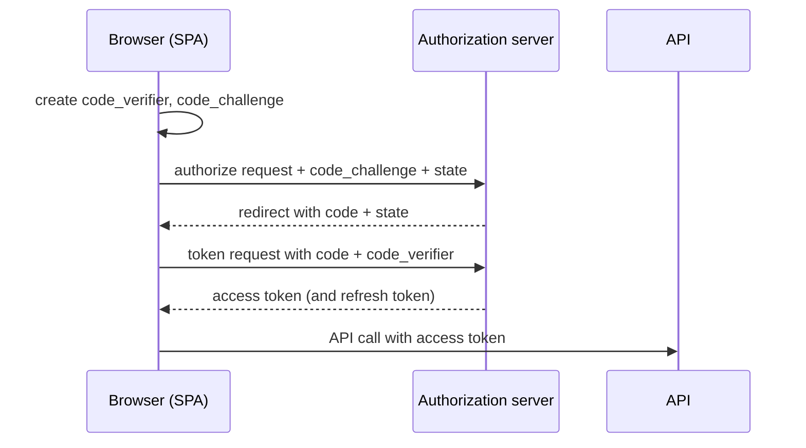
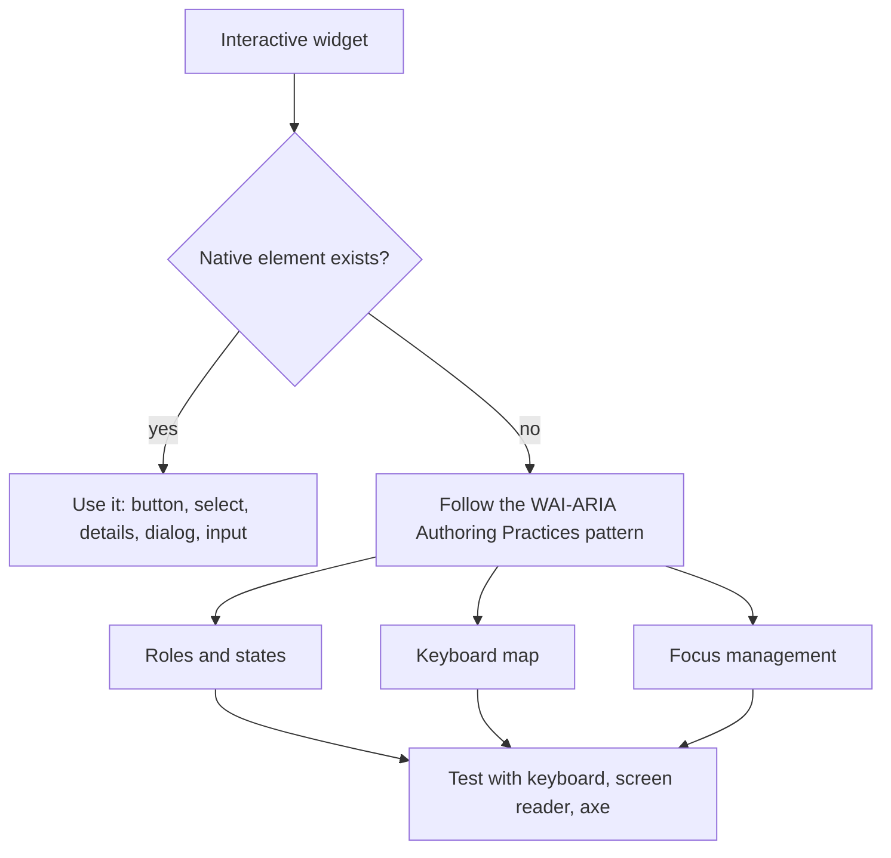

# 📘 Security, Accessibility, and i18n

These three topics are the "non-functional requirements" that separate a demo from a product.
Interviewers listen for them in the **Optimizations** step of RADIO, and a design that handles them unprompted reads as senior.

## Table of Contents

1. [Browser Security Model](#1-browser-security-model)
2. [XSS and Content Security Policy](#2-xss-and-content-security-policy)
3. [CSRF, Cookies, and Tokens](#3-csrf-cookies-and-tokens)
4. [Authentication Flows](#4-authentication-flows)
5. [Other Frontend Threats](#5-other-frontend-threats)
6. [Accessibility Foundations](#6-accessibility-foundations)
7. [Accessible Patterns](#7-accessible-patterns)
8. [Internationalization and Localization](#8-internationalization-and-localization)
9. [Privacy and Consent](#9-privacy-and-consent)
10. [Questions](#10-questions)

---

## 1. Browser Security Model

| Concept | What it means |
| --- | --- |
| **Origin** | Scheme + host + port. Scripts from one origin cannot read data from another by default |
| **Same-origin policy (SOP)** | Blocks reading cross-origin responses, DOM, and storage. It does **not** block sending requests |
| **CORS** | A server opt in (`Access-Control-Allow-Origin`) that lets specific origins read its responses. Preflight `OPTIONS` for non-simple requests |
| **Site vs origin** | A site is the registrable domain (`example.com`), same-site requests share cookies rules (`SameSite`) |
| **Sandboxing** | `iframe sandbox`, CSP `sandbox`, and process isolation limit damage from untrusted content |
| **Cross-origin isolation** | `COOP` and `COEP` headers isolate the page, enabling `SharedArrayBuffer` and mitigating Spectre style leaks |

CORS facts that come up often:

- CORS protects **reads in the browser**, not the server, so it is not an authentication mechanism, and `curl` ignores it.
- With credentials (`Access-Control-Allow-Credentials: true`), the allowed origin must be **explicit**, never `*`, and never blindly reflect the request `Origin`.
- "Simple" cross-origin requests (basic `GET` and `POST` form content types) are sent without preflight, which is why CSRF defenses exist.

---

## 2. XSS and Content Security Policy

**Cross-site scripting (XSS)** runs attacker controlled script in your origin, so it can read tokens, call your APIs as the user, and rewrite the page.

| Type | Source |
| --- | --- |
| **Stored** | Malicious input saved on the server and shown to others (comments, profile fields) |
| **Reflected** | Input echoed from the URL or form into the response |
| **DOM-based** | Client code writes untrusted data into dangerous sinks (`innerHTML`, `document.write`, `eval`, `href="javascript:"`, `setTimeout(string)`) |

### 2.1 Defenses

1. **Escape output by context.** Frameworks escape text by default, so avoid `dangerouslySetInnerHTML`, `v-html`, and `innerHTML`.
2. **Sanitize** any HTML you must render (DOMPurify), with an allowlist, on the client or server, and rendering Markdown through a safe pipeline.
3. **Validate URLs** before putting them in `href` or `src` (allow only `http`, `https`, `mailto`).
4. **Content Security Policy** as defense in depth.
5. **Trusted Types** make dangerous sinks accept only values created by an approved policy.
6. Do not build HTML with string concatenation.

### 2.2 Content Security Policy

CSP tells the browser which sources of script, style, images, and frames are allowed.

```http
Content-Security-Policy:
  default-src 'self';
  script-src 'self' 'nonce-r4nd0m' 'strict-dynamic';
  style-src 'self' 'unsafe-inline';
  img-src 'self' data: https://images.example.com;
  connect-src 'self' https://api.example.com wss://rt.example.com;
  frame-ancestors 'none';
  base-uri 'self';
  object-src 'none';
  require-trusted-types-for 'script';
```

| Directive | Purpose |
| --- | --- |
| `script-src` with **nonce** or **hash** and `strict-dynamic` | Allow only scripts you mark, block injected inline scripts |
| `connect-src` | Where `fetch`, XHR, WebSocket, and EventSource may connect |
| `frame-ancestors` | Who may embed you (clickjacking defense, replaces `X-Frame-Options`) |
| `base-uri`, `object-src` | Close common injection routes |
| `report-to` / `report-uri` | Collect violations, start with `Content-Security-Policy-Report-Only` |

A nonce must be **fresh per response**, which means HTML cannot be cached identically for everyone, a trade-off to mention when combining strict CSP with static pages (hash based CSP works with static output).

---

## 3. CSRF, Cookies, and Tokens

**CSRF** makes a logged-in user's browser send an unwanted request, because the browser attaches cookies automatically.

| Defense | Detail |
| --- | --- |
| **`SameSite` cookies** | `Lax` (default in modern browsers) blocks cross-site `POST` cookies, `Strict` blocks all cross-site, `None; Secure` allows cross-site (needed for embedded or third party flows) |
| **CSRF tokens** | Per session or per request token sent in a header or hidden field, the attacker cannot read it |
| **Origin and `Sec-Fetch-Site` checks** | Server rejects state-changing requests from unexpected origins |
| **Custom header requirement** | A custom header triggers a CORS preflight that attackers cannot pass |
| **Re-auth for sensitive actions** | Step up for payment, password, email change |

### 3.1 Where to Store Tokens

| Storage | XSS exposure | CSRF exposure | Notes |
| --- | --- | --- | --- |
| **`HttpOnly; Secure; SameSite` cookie** | Script cannot read it (but injected script can still make requests as the user) | Needs SameSite and CSRF defenses | Preferred for session tokens |
| **`localStorage` or `sessionStorage`** | Any injected script reads it | Not sent automatically | Easy to steal, avoid for long lived tokens |
| **In-memory variable** | Harder to steal persistently, lost on reload | None | Pair with a refresh token in an HttpOnly cookie |

A common robust pattern: **short lived access token in memory, rotating refresh token in an `HttpOnly`, `Secure`, `SameSite=Strict` cookie scoped to the refresh path**, with reuse detection.
A **BFF** (backend for frontend) that holds tokens server side and gives the browser only a session cookie is even simpler for the browser.

---

## 4. Authentication Flows



| Topic | Guidance |
| --- | --- |
| **OAuth 2.0 / OIDC for SPAs** | Authorization Code flow **with PKCE**. The implicit flow is deprecated. Validate `state` and `nonce` |
| **Public clients** | A browser cannot keep a client secret, so no secrets in the bundle |
| **Sessions vs JWT** | Server sessions are easy to revoke. JWTs are stateless but hard to revoke, keep them short lived |
| **Passkeys (WebAuthn)** | Phishing resistant, public key credentials, replace passwords with platform or security key sign in |
| **MFA** | Time based codes, push, or passkeys, with recovery flows |
| **Token refresh** | Single flight refresh, rotate refresh tokens, handle expiry mid request |
| **Logout** | Clear client state, revoke on the server, broadcast to other tabs |
| **Route guards** | UI checks are for experience only, **the server enforces authorization on every request** |
| **Permissions in UI** | Hide or disable features by role from a server provided permission set, never trust client side role checks |

---

## 5. Other Frontend Threats

| Threat | Defense |
| --- | --- |
| **Clickjacking** | `frame-ancestors` in CSP (or `X-Frame-Options`), confirm dangerous actions |
| **Open redirect** | Validate redirect targets against an allowlist, use relative paths |
| **Supply chain** (malicious or compromised npm packages) | Lockfiles, pinned versions, `npm audit` and tools such as Socket, provenance, minimal dependencies, review install scripts (`ignore-scripts`), private registry |
| **Third-party scripts** | Subresource Integrity for static files, CSP allowlist, load in sandboxed iframes, fewer tags |
| **Sensitive data exposure** | No secrets in the bundle or source maps served publicly, no PII in URLs, logs, or analytics, clear caches on logout |
| **Prototype pollution** | Validate merged JSON, use `Object.create(null)` or `Map`, update vulnerable libraries |
| **`postMessage` abuse** | Always check `event.origin` and use an explicit target origin, never `*` for sensitive data |
| **Insecure deep links and WebViews** | Validate parameters, restrict navigation, disable unneeded JavaScript bridges |
| **Mixed content and HTTPS** | HTTPS only, HSTS, secure cookies, `upgrade-insecure-requests` |
| **Denial of service on the client** | ReDoS in regexes, unbounded input rendering, huge JSON, limit sizes |
| **Uploads** | Validate type and size, scan server side, serve from a separate origin, never trust file names or MIME |
| **Browser extensions and storage** | Assume users may have hostile or buggy extensions, keep high-risk operations server side |

---

## 6. Accessibility Foundations

Accessibility (a11y) means people with disabilities can perceive, operate, and understand the product.
It also improves SEO, keyboard power use, and usability in bright sun or one handed.
The standard is **WCAG** (2.2 AA is the usual legal and contractual target), organized by **POUR**: Perceivable, Operable, Understandable, Robust.

### 6.1 Core Practices

| Area | Practice |
| --- | --- |
| **Semantics first** | Use `button`, `a`, `nav`, `main`, `header`, `h1` to `h6`, `ul`, `label`, `table` before reaching for ARIA. Native elements bring role, keyboard, and focus for free |
| **Keyboard** | Everything operable by keyboard, logical tab order, visible focus indicator, no keyboard traps, skip link to main content |
| **Focus management** | Move focus into a modal on open and return it on close, move focus to the heading after a route change, never remove the outline without replacement |
| **Names and labels** | Every control has an accessible name (visible `label`, `aria-label`, `aria-labelledby`), images have meaningful `alt` or empty `alt` when decorative |
| **Color and contrast** | 4.5:1 text contrast (3:1 for large text and UI components), do not use color alone to convey state |
| **Motion** | Respect `prefers-reduced-motion`, avoid flashing, provide pause for auto-playing content |
| **Zoom and reflow** | Support 200 percent zoom and reflow at 320 px width, use relative units, no fixed heights that clip text |
| **Target size** | At least 24 px (WCAG 2.2 minimum), aim for 44 px on touch |
| **Forms** | Labels, hints, error messages linked with `aria-describedby`, `aria-invalid`, an error summary that receives focus, `autocomplete` tokens |
| **Dynamic content** | Announce updates with live regions (`aria-live="polite"` for status, `assertive` or `role="alert"` for urgent errors) |
| **Media** | Captions, transcripts, audio descriptions |
| **Language** | `lang` on the `html` element and on foreign phrases |

### 6.2 ARIA Rules

1. Use native HTML if it exists.
2. Do not change native semantics without a reason (`div role="button"` needs keyboard handling you would get for free from `button`).
3. All interactive ARIA controls must be keyboard operable.
4. Do not hide focusable elements (`aria-hidden="true"` on something focusable is a bug).
5. Interactive elements need an accessible name.

**"No ARIA is better than bad ARIA"**: wrong roles make the experience worse for screen reader users.

### 6.3 Testing

- **Automated** (axe, Lighthouse, eslint-plugin-jsx-a11y, `jest-axe`, Playwright with axe) catches roughly a third of issues.
- **Manual keyboard pass:** can you reach and operate everything, is focus always visible?
- **Screen reader pass** (VoiceOver, NVDA, TalkBack) on key flows.
- **Zoom, high contrast, and reduced motion** modes.
- Add a11y checks to **component tests and CI**, and to the design system's definition of done.

---

## 7. Accessible Patterns

### 7.1 Modal Dialog

- Use the native `dialog` element with `showModal()` (focus trap, `Esc`, backdrop, inert background) or the equivalent library primitive.
- `aria-labelledby` points to the title, focus goes to the first meaningful control or the dialog itself, and returns to the trigger on close.
- Background content is inert (`inert` attribute), and page scroll is locked.

### 7.2 Combobox (Typeahead)

- Input has `role="combobox"`, `aria-expanded`, `aria-controls` the listbox, `aria-autocomplete`, and `aria-activedescendant` for the highlighted option.
- Options have `role="option"` and `aria-selected`, arrow keys move the highlight, `Enter` selects, `Esc` closes, and a live region announces result counts.
- Focus stays in the input so typing continues.

### 7.3 Tabs, Menus, and Disclosure

| Pattern | Roles and keys |
| --- | --- |
| **Tabs** | `tablist`, `tab`, `tabpanel`, arrow keys move between tabs, `Home` and `End`, only the active tab is in the tab order (roving `tabindex`) |
| **Menu button** | `button` with `aria-haspopup` and `aria-expanded`, `menu` and `menuitem`, arrows navigate, `Esc` closes and returns focus |
| **Disclosure / accordion** | `button` with `aria-expanded` and `aria-controls`, toggles a region |
| **Tooltip** | Appears on focus and hover, `aria-describedby`, dismissible with `Esc`, not the only way to get essential info |
| **Toast** | `role="status"` or `alert`, stays long enough to read, pause on hover, not the only record of an important result |
| **Data table** | Real `table` with `th scope`, `caption`, sortable headers as buttons with `aria-sort`, `aria-rowcount` when virtualized |
| **Carousel** | Pause control, previous and next buttons, labeled slides, no auto-advance without a stop |
| **Drag and drop** | Keyboard alternative (move up and down controls), announcements on pick up and drop |



---

## 8. Internationalization and Localization

**i18n** is designing so the product can support many languages and regions.
**l10n** is the actual localization work for each locale.

| Concern | Practice |
| --- | --- |
| **Externalize strings** | No hard-coded text, keys or message ids with translator context and screenshots |
| **Message format** | ICU MessageFormat for plurals, gender, and select: `{count, plural, one {# item} other {# items}}` (languages like Arabic and Polish have more plural forms than English) |
| **No string concatenation** | Word order differs by language, use whole messages with placeholders |
| **Dates, numbers, currency** | `Intl.DateTimeFormat`, `Intl.NumberFormat`, `Intl.RelativeTimeFormat`, `Intl.ListFormat`, `Intl.PluralRules`, never hand format |
| **Time zones** | Store UTC, show in the user's zone, be explicit about zone in scheduling UI, use `Temporal` or a library for arithmetic |
| **Text direction (RTL)** | `dir="rtl"`, logical CSS properties (`margin-inline-start`, `padding-block`), mirror icons that imply direction, test with Arabic and Hebrew |
| **Text expansion** | German and Finnish can be 30 to 40 percent longer, avoid fixed widths and truncation of critical text |
| **Fonts and scripts** | Fallbacks per script (CJK, Arabic, Devanagari), subsetting per locale |
| **Sorting and search** | `Intl.Collator`, locale aware case folding (the Turkish dotless i problem) |
| **Locale detection** | URL segment (`/fr/`), user preference, `Accept-Language` as a hint, allow switching, remember the choice |
| **Loading translations** | Split bundles per locale, load on demand, server render the right locale, fall back to a default |
| **SEO** | `hreflang` links, locale in the URL, translated metadata |
| **Images and culture** | Text in images is hard to translate, consider culturally appropriate imagery, names and addresses vary in format |
| **Pseudo-localization** | Generate fake long accented text in development to find truncation and hard-coded strings |

```js
// runnable
// Intl does the hard parts: plural categories, currency, and relative time.
const pr = new Intl.PluralRules('en');
const msgs = { one: (n) => `${n} item`, other: (n) => `${n} items` };
const items = (n) => msgs[pr.select(n)](n);
console.log(items(1), '|', items(5));

const price = 1234567.891;
console.log(new Intl.NumberFormat('en-US', { style: 'currency', currency: 'USD' }).format(price));
console.log(new Intl.NumberFormat('de-DE', { style: 'currency', currency: 'EUR' }).format(price));
console.log(new Intl.NumberFormat('en-IN', { style: 'currency', currency: 'INR' }).format(price));

const rtf = new Intl.RelativeTimeFormat('en', { numeric: 'auto' });
console.log(rtf.format(-1, 'day'), '|', rtf.format(3, 'hour'));
console.log(new Intl.PluralRules('ar').select(3), new Intl.PluralRules('pl').select(5));
```

---

## 9. Privacy and Consent

- **Consent management:** record consent, gate analytics and ad scripts until consent (GDPR, ePrivacy), honor Global Privacy Control, and make withdrawal as easy as consent.
- **Data minimization:** collect only what you need, truncate IPs, avoid PII in analytics events.
- **Third-party cookies** are restricted in many browsers and partitioned storage limits cross-site tracking, so design embeds and auth flows that do not rely on them (Storage Access API, first party redirects).
- **Right to erase and export:** UI flows that call privacy endpoints.
- **Children and sensitive categories** have stricter rules.
- **Logs and RUM** must not capture secrets or personal data (mask inputs in session replay).

---

## 10. Questions

**Q: How do you prevent XSS in a React app?**
React escapes text, so avoid `dangerouslySetInnerHTML` or sanitize with DOMPurify, validate URLs, never build HTML strings, and add a strict CSP with nonces or hashes plus Trusted Types as defense in depth.

**Q: Where should you store an access token?**
Prefer an `HttpOnly`, `Secure`, `SameSite` cookie so scripts cannot read it, with CSRF protection.
If you must hold a token in JavaScript, keep it short lived in memory and refresh via an `HttpOnly` cookie.
`localStorage` is readable by any injected script.

**Q: What is CSRF and how do you stop it?**
An attacker site triggers a state changing request that the browser sends with the user's cookies.
Use `SameSite` cookies, CSRF tokens or custom headers, and server side `Origin` and `Sec-Fetch-Site` checks.

**Q: Does CORS protect my API?**
No, it only controls whether browser scripts on other origins can read responses.
Servers must still authenticate and authorize every request, and avoid reflecting origins with credentials.

**Q: What does PKCE do?**
It binds the authorization code to a secret the client created (`code_verifier`), so a stolen code cannot be exchanged by an attacker, which makes the code flow safe for public clients like SPAs.

**Q: What are the first things you check for accessibility?**
Semantic HTML, keyboard operability and focus visibility, accessible names, color contrast, form labels and errors, focus management in dialogs and route changes, and screen reader announcements for dynamic updates.

**Q: Why is `div onClick` a bad button?**
It has no role, is not focusable, and does not respond to Enter and Space, so keyboard and assistive technology users cannot use it.
A native `button` provides all of that.

**Q: How do you support right-to-left languages?**
Set `dir`, use logical properties instead of left and right, mirror directional icons, test with real RTL content, and make sure layout and text expansion do not break.

**Q: How do you handle plurals and dates across locales?**
ICU message format with plural rules per locale and the `Intl` APIs for dates, numbers, and currency, never string concatenation or manual formatting.

**Q: How do you protect against supply chain attacks?**
Lockfiles and pinned versions, minimal dependencies, automated audit and review of updates, disabling install scripts where possible, provenance checks, and Subresource Integrity plus CSP for third party scripts.

Next: [Testing, Observability, and Release](/docs/frontend-system-design/testing-observability-and-release).
