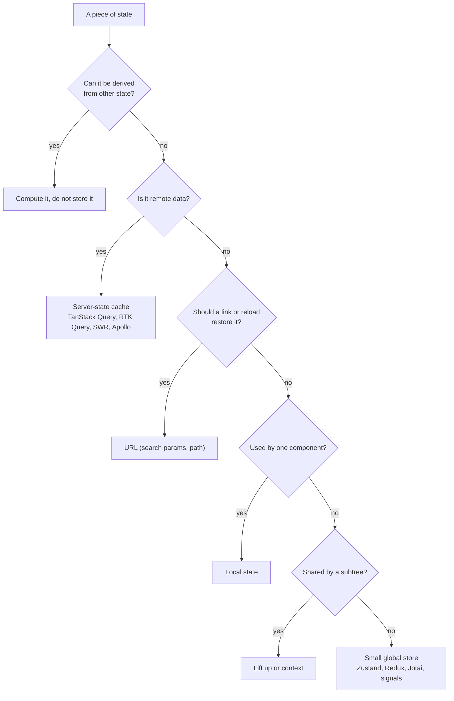
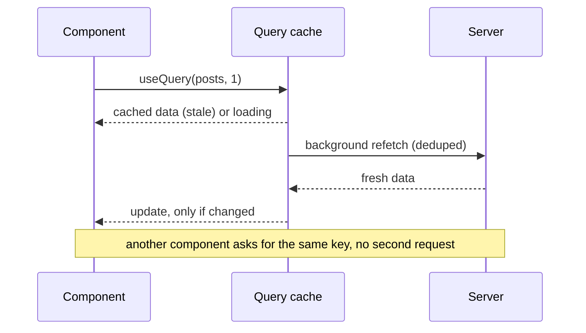
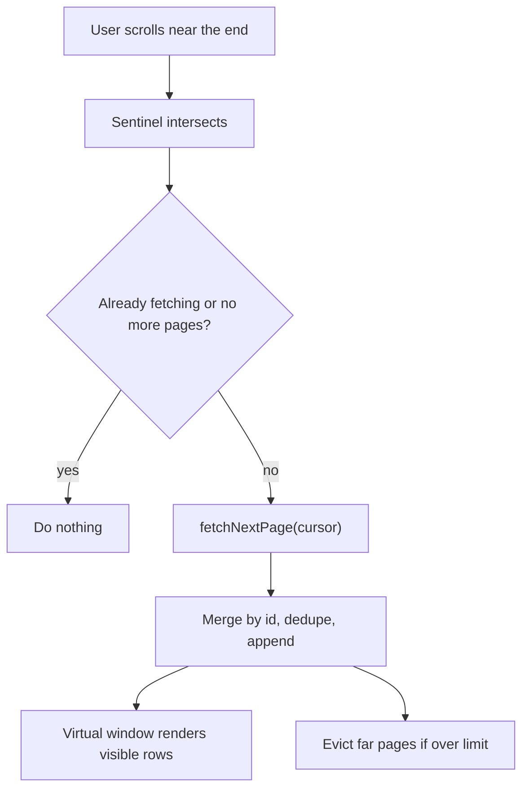
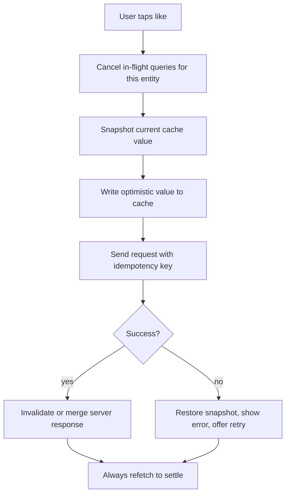
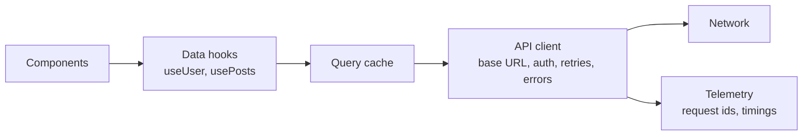
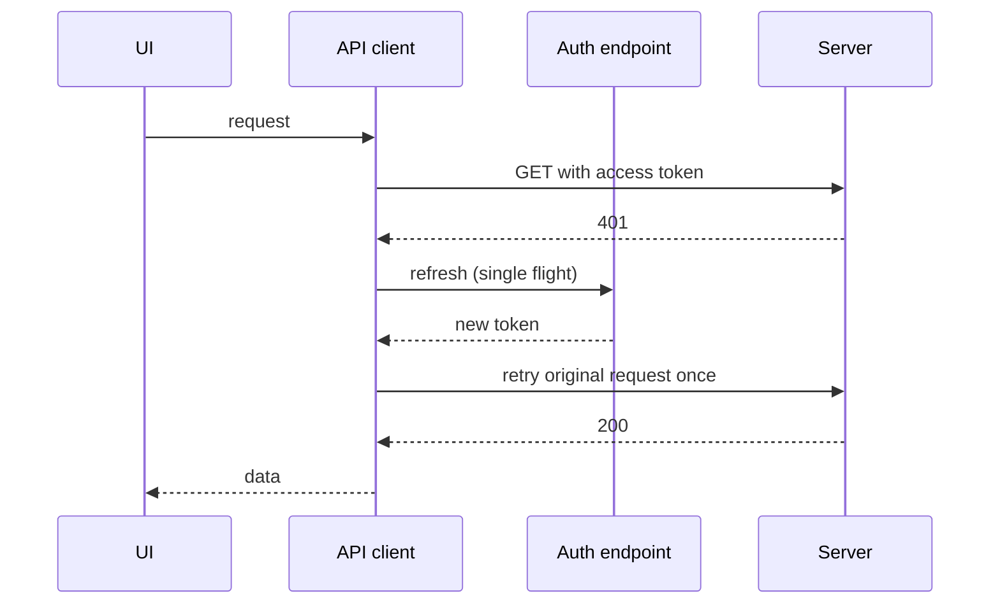

# 📘 State and Data Management

Most frontend bugs and most design interview follow-ups are about **state**: who owns it, how it is fetched and cached, how it is updated, and how it stays consistent across the screen.
This page gives you a vocabulary and a decision process.
Related deep dives: [Redux](/docs/redux/redux), [RTK Query](/docs/redux/rtk-rq), and [React Core Concepts](/docs/react/react-core-concepts).

## Table of Contents

1. [Kinds of State](#1-kinds-of-state)
2. [Where Should State Live?](#2-where-should-state-live)
3. [Server State and Query Caches](#3-server-state-and-query-caches)
4. [Normalization](#4-normalization)
5. [Pagination and Infinite Lists](#5-pagination-and-infinite-lists)
6. [Mutations and Optimistic Updates](#6-mutations-and-optimistic-updates)
7. [Race Conditions and Ordering](#7-race-conditions-and-ordering)
8. [Client State Tools](#8-client-state-tools)
9. [Forms](#9-forms)
10. [Persistence and Cross-Tab Sync](#10-persistence-and-cross-tab-sync)
11. [Fetching Architecture](#11-fetching-architecture)
12. [Questions](#12-questions)

---

## 1. Kinds of State

| Kind | Examples | Owner | Needs |
| --- | --- | --- | --- |
| **Server state** | Users, posts, orders, search results | The backend (the client holds a cache) | Caching, deduplication, refetching, invalidation, retries, pagination |
| **Client (UI) state** | Open modal, selected tab, hover, draft text | The client | Simple local state |
| **URL state** | Page, filters, sort, selected item, search query | The URL | Shareable links, back button, SSR visibility |
| **Form state** | Field values, errors, touched, dirty | The form | Validation, submit lifecycle |
| **Derived state** | Filtered list, totals, `isValid` | Computed | Never stored, compute from sources |
| **Persistent client state** | Theme, tokens (cookie), offline drafts | Storage | Versioning, migration, size limits |
| **Real-time state** | Presence, live prices | A stream | Merge and ordering rules |

The most common mistake is putting **server state in a global client store by hand**, which forces you to rebuild caching, loading flags, and invalidation yourself.
Treat remote data as a **cache of the server**, not as state you own.

---

## 2. Where Should State Live?



Principles:

- **Colocate** state with the component that uses it, and lift only when needed.
- **Single source of truth:** never copy server data into local state to edit it, except for an explicit form draft.
- **Make impossible states impossible:** use a status union or a state machine instead of several booleans (`isLoading && isError`).
- **The URL is state:** filters and pagination belong there.
- **Split contexts** by update frequency, otherwise one change re-renders every consumer.

```ts
// Prefer a discriminated union over parallel booleans.
type Load<T> =
  | { status: 'idle' }
  | { status: 'loading' }
  | { status: 'success'; data: T }
  | { status: 'error'; error: Error };
```

---

## 3. Server State and Query Caches

A query cache stores results **keyed by the query** (for example `['posts', { page: 2, filter: 'open' }]`) and manages their lifecycle.

### 3.1 Core Behaviors

| Behavior | Meaning |
| --- | --- |
| **Cache key** | Identity of the data, includes all inputs that change the result |
| **Stale time** | How long data counts as fresh (no refetch) |
| **Cache (GC) time** | How long unused data stays in memory before eviction |
| **Stale-while-revalidate** | Show cached data immediately and refetch in the background, then update |
| **Deduplication** | Concurrent requests for the same key share one network call |
| **Refetch triggers** | Mount, window focus, reconnect, interval, invalidation |
| **Retries** | Backoff for transient failures, never retry non-idempotent or 4xx errors blindly |
| **Invalidation** | Mark data stale after a mutation so active views refetch |
| **Prefetching** | Fill the cache before the user navigates |
| **Placeholder and initial data** | Render from a list item while the detail loads |
| **Structural sharing** | Keep unchanged references so memoization still works after refetch |



### 3.2 A Minimal Cache to Show You Understand It

```js
// runnable
// A tiny query cache: dedupes in-flight requests, serves stale data, revalidates in the background.
function createCache(fetcher, { staleMs = 50 } = {}) {
  const entries = new Map(); // key -> { data, at, promise }

  async function get(key, onUpdate) {
    const hit = entries.get(key);
    const fresh = hit && Date.now() - hit.at < staleMs;
    if (fresh) return hit.data;

    if (hit?.promise) return hit.promise;            // dedupe in-flight request

    const promise = fetcher(key).then((data) => {
      entries.set(key, { data, at: Date.now() });    // clears the in-flight marker
      onUpdate?.(data);
      return data;
    });
    entries.set(key, { ...(hit ?? {}), promise });
    // stale-while-revalidate: return stale data now, update later through onUpdate
    return hit?.data !== undefined ? hit.data : promise;
  }

  const invalidate = (key) => { const e = entries.get(key); if (e) e.at = 0; };
  return { get, invalidate };
}

let calls = 0;
const cache = createCache(async (key) => { calls += 1; await new Promise((r) => setTimeout(r, 20)); return `${key}#${calls}`; });

(async () => {
  const [a, b] = await Promise.all([cache.get('posts'), cache.get('posts')]);
  console.log('deduped:', a === b, 'network calls:', calls);
  cache.invalidate('posts');
  const stale = await cache.get('posts', (fresh) => console.log('revalidated to', fresh));
  console.log('served stale immediately:', stale);
  await new Promise((r) => setTimeout(r, 40));
})();
```

### 3.3 Choosing a Tool

| Tool | Notes |
| --- | --- |
| **TanStack Query** | Framework agnostic hooks, key based cache, rich options, devtools |
| **RTK Query** | Part of Redux Toolkit, tag based invalidation, codegen from OpenAPI, great when Redux is already present |
| **SWR** | Small, stale-while-revalidate focused |
| **Apollo Client / urql / Relay** | GraphQL clients, normalized caches (Apollo, Relay), fragments colocated with components (Relay) |
| **Framework loaders** (Next.js, Remix, React Router) | Fetch at the route, with server rendering and mutation actions |
| **Server Components** | Fetch on the server, cache with the framework, send no data fetching code to the client |

---

## 4. Normalization

Two cache shapes:

| Shape | How | Pros | Cons |
| --- | --- | --- | --- |
| **Document (query keyed)** | Store each response under its query key | Simple, predictable | The same entity lives in several places, so an update must touch all or invalidate |
| **Normalized (entity keyed)** | Store entities by `type:id`, queries hold lists of ids | One update fixes every view, consistent UI | Complexity, needs ids and `__typename`, merge rules, eviction |

```ts
// Normalized store sketch
type Store = {
  entities: {
    posts: Record<string, Post>;
    users: Record<string, User>;
  };
  lists: {
    'feed:home': { ids: string[]; nextCursor: string | null };
    'user:42:posts': { ids: string[]; nextCursor: string | null };
  };
};
// Liking a post changes entities.posts[id] once, and every list that references the id updates.
```

When to normalize: the same entity appears in many views and edits must propagate instantly (likes, follows, read states, collaborative boards).
When not to: simple read mostly apps, where **invalidate and refetch** is cheaper than maintaining normalization.

---

## 5. Pagination and Infinite Lists

| Strategy | Request | Good for | Problem |
| --- | --- | --- | --- |
| **Offset** | `?page=3&size=20` | Tables with jump to page | Inserts and deletes shift items, so duplicates or gaps appear, and deep offsets are slow in the database |
| **Cursor (keyset)** | `?after=abc&limit=20` | Feeds, timelines, infinite scroll | No random page access |
| **Time or id based** | `?before=timestamp` | Chat history, logs | Needs a stable sort key |
| **Bidirectional** | `before` and `after` cursors | Chat, logs that grow at both ends | More cache logic |

Client design for infinite lists:

- **Infinite query** stores `pages[]` plus `pageParams[]`, and `fetchNextPage` is triggered by an `IntersectionObserver` sentinel placed a few items before the end.
- **Prefetch the next page** when the user is near the end so scrolling never waits.
- **Dedupe items** by id when merging pages (new items can shift older ones in).
- **Bound memory:** drop pages far from the viewport (`maxPages`) or keep ids only and refetch on return.
- **Scroll restoration:** keep the cache and the scroll offset (or anchor item id) when navigating away and back.
- **Refresh and live inserts:** new items go behind a "new posts" button, never above the viewport.
- **Empty, end of list, and error rows** are part of the list design, with a retry button for a failed page.
- **Accessibility:** infinite scroll is hard for keyboard and screen reader users, so offer a "load more" button or a paginated mode and keep the footer reachable.



---

## 6. Mutations and Optimistic Updates

### 6.1 Mutation Lifecycle

1. **Validate** on the client (cheap checks), submit with an **idempotency key**.
2. Show **pending** state on the control (disable, spinner), not a blocking overlay.
3. On success: **invalidate or update** affected queries.
4. On failure: show an inline error with a retry, keep the user's input.

### 6.2 Optimistic Updates

Update the UI as if the request succeeded, and roll back if it fails.



| Use optimistic updates for | Avoid for |
| --- | --- |
| Likes, toggles, reordering, checking off a todo, sending a chat message | Payments, destructive actions, anything with server side rules that often reject |

Details that interviewers like:

- **Cancel in-flight refetches** for the same data before writing the optimistic value, or a stale response will overwrite it.
- **Per-item pending state** so rapid taps are queued or collapsed (last intent wins).
- **Order of mutations** matters: queue mutations per entity to avoid out-of-order writes.
- **Temporary ids** for created items, replaced by server ids on success (and keep a stable React key so the row does not remount).
- **Rollback must restore exactly**, which is why you snapshot, and show a visible failure instead of silently reverting.

```js
// runnable
// Optimistic like with rollback and a settling step.
function createLikeStore(api) {
  let post = { id: 1, liked: false, likes: 10 };
  const listeners = new Set();
  const emit = () => listeners.forEach((l) => l({ ...post }));

  async function toggle() {
    const snapshot = { ...post };                          // 1. snapshot
    post = { ...post, liked: !post.liked, likes: post.likes + (post.liked ? -1 : 1) }; // 2. optimistic
    emit();
    try {
      post = await api({ id: post.id, liked: post.liked });  // 3. reconcile with server truth
    } catch (e) {
      post = snapshot;                                       // 4. rollback
    }
    emit();
  }
  return { toggle, subscribe: (l) => listeners.add(l) };
}

const ok = createLikeStore(async ({ id, liked }) => ({ id, liked, likes: liked ? 11 : 10 }));
ok.subscribe((p) => console.log('ok   ->', p));
const bad = createLikeStore(async () => { throw new Error('500'); });
bad.subscribe((p) => console.log('fail ->', p));
ok.toggle().then(() => bad.toggle());
```

---

## 7. Race Conditions and Ordering

| Race | Example | Fix |
| --- | --- | --- |
| **Out-of-order responses** | Typing "ab" then "abc", the "ab" response arrives last | Cancel with `AbortController`, or ignore responses that are not for the latest request id |
| **Stale write over fresh** | Background refetch overwrites an optimistic update | Cancel queries before the optimistic write |
| **Double submit** | User clicks twice | Disable while pending, idempotency key |
| **Navigation during fetch** | Response arrives after unmount | Abort in cleanup, query libraries handle this |
| **Tab disagreement** | Two tabs edit the same record | Version or `ETag` with `If-Match`, conflict UI, `BroadcastChannel` sync |
| **Effect double run** | Strict mode runs effects twice in development | Make fetches idempotent and abortable |

```js
// Latest request wins, and old requests are aborted.
let controller;
async function search(query) {
  controller?.abort();
  controller = new AbortController();
  try {
    const res = await fetch(`/api/search?q=${encodeURIComponent(query)}`, { signal: controller.signal });
    return await res.json();
  } catch (e) {
    if (e.name === 'AbortError') return null;   // superseded, ignore
    throw e;
  }
}
```

---

## 8. Client State Tools

| Tool | Model | Good for |
| --- | --- | --- |
| **`useState` / `useReducer`** | Local, explicit | Most component state |
| **Context** | Dependency injection, low frequency values | Theme, locale, current user, services |
| **Redux Toolkit** | Single store, actions, reducers, devtools, middleware | Large apps needing predictability, time travel, strict patterns |
| **Zustand** | Small stores with selectors | Light global UI state |
| **Jotai / Recoil style atoms** | Fine grained derived state | Many independent pieces with derivations |
| **Signals** (Preact, Solid, Angular, Vue refs) | Fine grained reactivity, update only the reading nodes | Performance sensitive UI |
| **State machines** (XState) | Explicit states and transitions | Wizards, media players, complex async flows |
| **URL (router)** | Shareable state | Filters, tabs, pagination |

Design advice:

- Start with local state, lift as needed, and add a global store only for truly app-wide UI state.
- Use **selectors** and equality checks so components subscribe to slices.
- Keep stores **serializable** where possible (easier devtools, persistence, SSR hydration).
- Keep side effects in one place (thunks, listeners, sagas, or query mutations), not scattered in components.
- Avoid **derived data in the store**, use selectors or memoized computations.

---

## 9. Forms

| Concern | Approach |
| --- | --- |
| **Controlled vs uncontrolled** | Uncontrolled inputs with refs or `FormData` perform better for large forms, controlled inputs give instant validation and formatting |
| **Validation** | Schema shared by client and server (Zod, Valibot, Yup), validate on blur and on submit, show errors with `aria-describedby` |
| **Server errors** | Map `fieldErrors` from the API to fields, show form level errors in an alert region |
| **Submit lifecycle** | Disable submit while pending, prevent double submit, keep input on failure |
| **Dirty tracking** | Warn on navigation with unsaved changes (`beforeunload` and router guards) |
| **Drafts** | Autosave to local storage or the server with debounce, restore on return |
| **Multi-step** | One state machine, persist per step, validate per step, allow back navigation, URL per step |
| **File upload** | Presigned URL straight to object storage, chunked and resumable upload, progress, cancel, retry |
| **Progressive enhancement** | A real `form` with `action` works without JavaScript, and JS upgrades it |
| **Accessibility** | Labels tied to inputs, error summary with focus, correct `autocomplete` and `inputmode` |

---

## 10. Persistence and Cross-Tab Sync

| Storage | Capacity | Sync API | Notes |
| --- | --- | --- | --- |
| **Cookies** | about 4 KB | Sent with requests | Session tokens as `HttpOnly; Secure; SameSite` |
| **`localStorage`** | about 5 MB | Synchronous | Small settings, blocks the main thread, readable by any script on the origin |
| **`sessionStorage`** | about 5 MB | Synchronous | Per tab, cleared on close |
| **IndexedDB** | Large (quota based) | Async | Structured data, offline stores, blobs (use a wrapper such as idb or Dexie) |
| **Cache Storage** | Large | Async | Request and response pairs for service workers |
| **Origin Private File System** | Large | Async | Files, SQLite in WASM |
| **In-memory** | RAM | Sync | Fast, lost on reload |

- **Version and migrate** stored data (`schemaVersion`), because old shapes survive in users' browsers for years.
- **Never store secrets** or sensitive personal data in script readable storage.
- Storage can be **cleared or unavailable** (private mode, quota), so wrap access in try and catch and degrade.
- **Cross-tab sync:** the `storage` event, `BroadcastChannel`, or a `SharedWorker` that owns the connection and cache.
- **Hydration mismatch:** do not read storage during the first render on the server rendered path, read it in an effect.

```js
// Sync a small piece of state across tabs.
const channel = new BroadcastChannel('app-state');
channel.onmessage = (event) => store.setState(event.data);   // other tabs update
store.subscribe((state) => channel.postMessage(state));       // this tab announces changes
```

---

## 11. Fetching Architecture



- **One API client** adds auth headers, handles 401 (refresh once, then log out), maps errors to a typed shape, retries idempotent calls, and attaches a request id.
- **Domain hooks** hide cache keys and endpoints from components.
- **Avoid waterfalls:** fetch independent data in parallel at the route (loaders or `Promise.all`), prefetch known next requests, and avoid fetching inside deeply nested children after parents render.
- **Request coalescing and batching:** GraphQL batching, `DataLoader`, or a batch endpoint to cut round trips.
- **Backend for frontend (BFF):** one endpoint per screen that aggregates services and returns exactly the needed fields.
- **Type safety:** generate clients from OpenAPI or GraphQL schemas so contracts do not drift.
- **Resilience:** timeouts, circuit breaker behavior (stop hammering a failing endpoint), skeletons, and partial rendering when one widget fails.
- **Rate limits and 429:** read `Retry-After`, back off with jitter.



Single flight matters: when ten requests fail with 401 together, only one refresh call should run and the rest wait for it.

---

## 12. Questions

**Q: What is the difference between server state and client state?**
Server state is remote data you do not own and that can change without you, so you cache and revalidate it.
Client state is owned by the UI and is synchronous and local.
Mixing them in one store causes duplicate caching logic and stale data bugs.

**Q: Explain stale-while-revalidate.**
Return the cached value immediately for speed, refetch in the background, and update the UI if the data changed.
It trades a short staleness window for instant rendering.

**Q: How do optimistic updates work and what can go wrong?**
Apply the change locally, send the request, and roll back on failure.
Risks are overwriting by a stale refetch (cancel first), out of order mutations (queue per entity), and irreversible actions (do not use it for those).

**Q: Cursor vs offset pagination?**
Offset allows jumping to a page but breaks when data shifts and is slow deep into big tables.
Cursor pagination is stable and fast for feeds but has no random access.

**Q: How do you keep two views of the same entity consistent?**
Normalize entities by id so one write updates all views, or invalidate every affected query after a mutation.
Choose normalization only when instant cross-view consistency is worth the complexity.

**Q: How do you prevent a stale search response overwriting a newer one?**
Abort the previous request with `AbortController` or tag requests with an id and ignore any that is not the latest.

**Q: Where should filters and sort order live?**
In the URL, so they survive reloads, can be shared, work with the back button, and can be read by the server for rendering.

**Q: Redux or React Query?**
They solve different problems.
Use a query library for server state, and Redux, Zustand, or context for the small remaining client state.
If Redux Toolkit is already in the app, RTK Query covers the server state part.

**Q: How do you handle token refresh without duplicate calls?**
A single flight refresh: the first 401 starts a refresh promise, other requests wait on that same promise, then each retries once with the new token.

**Q: How do you persist a draft safely?**
Debounce writes to IndexedDB or local storage with a schema version, restore it on load and tell the user, clear it on successful submit, and never store secrets.

Next: [Real-Time, Offline, and Sync](/docs/frontend-system-design/real-time-offline-and-sync).
