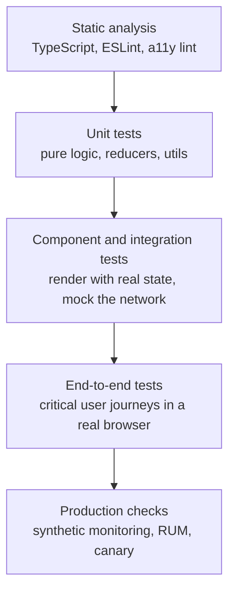
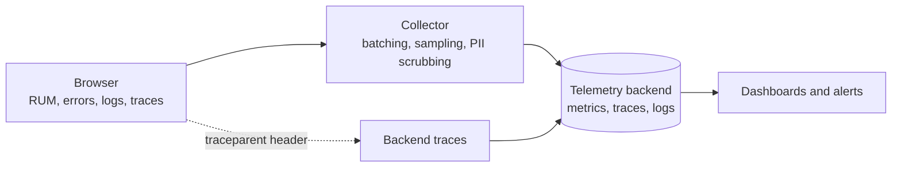
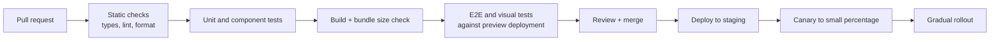
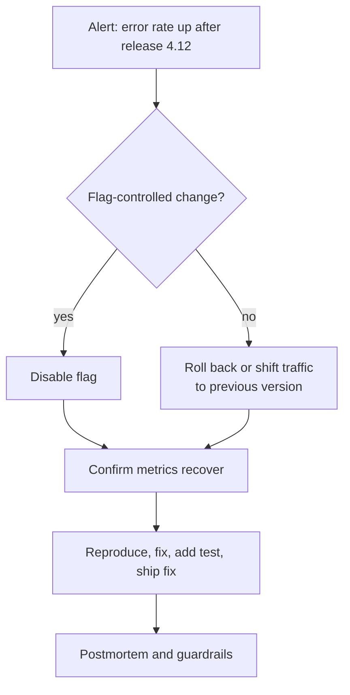

# 📘 Testing, Observability, and Release

A frontend ships to devices you do not control, cannot SSH into, and cannot roll back instantly (cached bundles live on in open tabs).
So the design must say **how you know it works before release, how you know it works after release, and how you undo a bad release**.

## Table of Contents

1. [Testing Strategy](#1-testing-strategy)
2. [Test Types in Detail](#2-test-types-in-detail)
3. [Making Tests Reliable](#3-making-tests-reliable)
4. [Observability](#4-observability)
5. [Error Tracking](#5-error-tracking)
6. [Analytics](#6-analytics)
7. [CI/CD Pipeline](#7-cicd-pipeline)
8. [Progressive Delivery](#8-progressive-delivery)
9. [Frontend Versioning and Skew](#9-frontend-versioning-and-skew)
10. [Incident Response](#10-incident-response)
11. [Questions](#11-questions)

---

## 1. Testing Strategy

Two popular shapes:

| Model | Idea |
| --- | --- |
| **Pyramid** | Many unit tests, fewer integration tests, few end-to-end tests (fast and cheap at the bottom) |
| **Trophy** | Static analysis at the base, a few unit tests, **mostly integration (component) tests**, a thin layer of end-to-end tests. "Write tests, not too many, mostly integration" |



Principle: **test behavior the user can observe, not implementation details**.
Query by role and label, click and type like a user, and assert on visible output, so refactors do not break tests.

---

## 2. Test Types in Detail

| Type | What it checks | Tools | Notes |
| --- | --- | --- | --- |
| **Static** | Types, lint, formatting, import rules | TypeScript, ESLint, Prettier or Biome | Cheapest and runs on every save |
| **Unit** | Pure functions, reducers, selectors, formatters, hooks with logic | Vitest, Jest | Fast, deterministic |
| **Component** | Rendering, interaction, states (loading, error, empty), accessibility | Testing Library, Storybook interaction tests, Vitest browser mode | Mock the network with MSW |
| **Integration** | Several components plus state and routing together | Testing Library, MSW | Highest confidence per cost |
| **Contract** | Frontend and API agree on shapes | Pact, OpenAPI or GraphQL schema checks, generated types | Catches backend drift before E2E |
| **End-to-end** | Real browser, real or staged backend, critical journeys (sign in, checkout) | Playwright, Cypress | Slow and flakier, keep few and valuable |
| **Visual regression** | Pixel or DOM snapshots per component or page | Chromatic, Percy, Playwright screenshots | Great for design systems, control fonts and animations |
| **Accessibility** | Violations and keyboard flows | axe, Playwright with axe, Storybook a11y addon | Automated finds some issues, add manual checks |
| **Performance** | Bundle size, Lighthouse CI, Web Vitals in CI | size-limit, Lighthouse CI, WebPageTest | Budgets as gates |
| **Cross-browser and device** | Compatibility | Playwright (Chromium, Firefox, WebKit), BrowserStack | Test the browsers your analytics show |
| **Security** | Dependency audit, CSP, secret scanning | `npm audit`, Snyk, Dependabot, ZAP | Automated in CI |
| **Mutation or property based** | Test quality, invariants | Stryker, fast-check | Useful for critical logic |

### 2.1 What to Test Where

- **Business rules and data transforms:** unit tests.
- **A form with validation and a server error:** component test with MSW returning a 422.
- **A feature's flow across components:** integration test.
- **Sign in, purchase, and other revenue paths:** E2E.
- **Design system components:** Storybook stories as tests, visual and a11y checks.
- **Server Components and framework routing:** E2E or framework specific test utilities, because unit rendering does not reflect server behavior.

```js
// runnable
// Testing behavior, not implementation: a tiny cart reducer with a table of cases.
function cartReducer(state, action) {
  switch (action.type) {
    case 'add': {
      const existing = state.items.find((i) => i.id === action.id);
      const items = existing
        ? state.items.map((i) => (i.id === action.id ? { ...i, qty: i.qty + 1 } : i))
        : [...state.items, { id: action.id, qty: 1, price: action.price }];
      return { ...state, items };
    }
    case 'remove':
      return { ...state, items: state.items.filter((i) => i.id !== action.id) };
    default:
      return state;
  }
}
const total = (s) => s.items.reduce((sum, i) => sum + i.qty * i.price, 0);

const cases = [
  { name: 'adds a new item', actions: [{ type: 'add', id: 'a', price: 10 }], total: 10 },
  { name: 'increments quantity', actions: [{ type: 'add', id: 'a', price: 10 }, { type: 'add', id: 'a', price: 10 }], total: 20 },
  { name: 'removes an item', actions: [{ type: 'add', id: 'a', price: 10 }, { type: 'remove', id: 'a' }], total: 0 },
];
for (const c of cases) {
  const result = c.actions.reduce(cartReducer, { items: [] });
  console.log(total(result) === c.total ? 'pass' : 'FAIL', '-', c.name);
}
```

---

## 3. Making Tests Reliable

Flaky tests destroy trust, and people stop reading red builds.

| Cause | Fix |
| --- | --- |
| **Timing and animations** | Wait for conditions (`findBy`, `expect.poll`, auto-waiting locators) instead of fixed sleeps, disable animations in test mode |
| **Shared state between tests** | Isolate per test: fresh browser context, fresh data, no order dependence |
| **Real network and third parties** | Mock at the network boundary (MSW) for component tests, stub third parties in E2E |
| **Test data** | Create through API fixtures or seeding, unique ids per test, clean up |
| **Time and randomness** | Fake timers and fixed clock, seeded random |
| **Environment drift** | Pinned browsers (Playwright installs matching builds), containers, same Node version |
| **Resource contention** | Parallelize with sharding, but isolate databases per worker |
| **Selectors** | Role and label queries, `data-testid` only as a fallback, never CSS classes or DOM position |

Operational habits: quarantine and fix a flaky test within days, track flake rate, retry only in CI with reporting (retries hide problems), and run E2E against a production-like build rather than the dev server.

---

## 4. Observability

You need to see what real users experience.



### 4.1 What to Collect

| Signal | Examples | Why |
| --- | --- | --- |
| **Web Vitals** | LCP, INP, CLS, TTFB, FCP by route, device, country, release | Experience and regression detection |
| **Navigation and resource timing** | Route transition durations, slow assets, chunk load failures | Find delivery problems |
| **API client metrics** | Request duration, status code, retries, per endpoint | Spot backend and network issues from the user's side |
| **Errors** | Exceptions, unhandled rejections, failed chunk loads, console errors, CSP violations | Reliability |
| **Business events** | Funnel steps, conversion, search usage | Product health |
| **Long tasks and long animation frames** | Which scripts block interactions | INP debugging |
| **Resource usage** | JS heap (where available), device memory, connection type | Segment problems by capability |

### 4.2 Practical Concerns

- **Sampling:** sample high volume signals (for example 10 percent of sessions), always capture errors.
- **Batching and `sendBeacon`:** send on `visibilitychange` (hidden) rather than `unload`, so data is not lost and bfcache is preserved.
- **Correlation:** generate a request id or W3C `traceparent` in the client and send it to the backend so one trace spans browser and server, and include it in error reports and support tickets.
- **Release tagging:** every event carries the build version and feature flag state, so regressions map to a deploy or experiment.
- **Privacy:** scrub PII, mask inputs in session replay, honor consent.
- **Cost control:** cap payload size, drop noisy events, aggregate before sending.
- **Tools:** OpenTelemetry for the web, Sentry, Datadog RUM, New Relic, Grafana Faro, and the `web-vitals` library.

---

## 5. Error Tracking

| Practice | Detail |
| --- | --- |
| **Global handlers** | `window.onerror`, `unhandledrejection`, error boundaries, framework hooks |
| **Source maps** | Upload to the error tracker at build time, **do not serve publicly** if source exposure matters, keep maps matched to the release |
| **Context** | Release, route, user id (hashed), device, browser, feature flags, last user actions (breadcrumbs), network state |
| **Grouping and dedupe** | Fingerprint by stack trace, collapse noise (extension errors, `ResizeObserver loop` warnings, cross-origin "Script error") |
| **Ownership and alerts** | Route errors to code owners, alert on new issues and on rate spikes per release, not on every event |
| **Handled vs unhandled** | Log handled errors with severity, do not swallow errors silently |
| **User feedback** | A "report a problem" link that attaches the error id |
| **Session replay** | Powerful for reproduction, apply masking and consent |

---

## 6. Analytics

- **Event schema:** `name`, `properties`, `user or anonymous id`, `session id`, `timestamp`, `schema version`, validated at build time (typed event helpers).
- **Naming convention** agreed with data teams (`object_action`, for example `checkout_started`).
- **Batching and offline queue** so events survive navigation and network loss.
- **Exposure events** for experiments, logged when the variant is actually shown.
- **Consent and privacy** gates, server side collection where possible.
- **Avoid blocking** the main thread with tag managers, load analytics after critical content.
- **Deduplication:** idempotent event ids, since retries and double renders create duplicates.
- **Data quality tests:** verify key events fire in E2E tests.

---

## 7. CI/CD Pipeline



| Stage | Practice |
| --- | --- |
| **Fast feedback** | Under about 10 minutes for the required checks, run only affected packages, cache dependencies and builds |
| **Preview deployments** | A unique URL per pull request for design review, QA, and E2E |
| **Quality gates** | Types, lint, tests, bundle budgets, Lighthouse CI, accessibility checks, dependency audit, secret scan |
| **Immutable artifacts** | Build once, promote the same artifact through environments, configuration injected at deploy or runtime |
| **Source maps** | Uploaded to error tracking, not public |
| **Trunk-based development** | Short lived branches, small pull requests, flags for unfinished work |
| **Deploy** | Upload hashed assets first, then switch HTML (atomic), keep old assets for a while |
| **Auto rollback** | Rollback on error rate or Web Vitals regression thresholds |

---

## 8. Progressive Delivery

| Technique | How it works | Frontend specifics |
| --- | --- | --- |
| **Feature flags** | Ship dark, turn on gradually | Evaluate server side to avoid flicker, see [Architecture and Scalability](/docs/frontend-system-design/architecture-and-scalability) |
| **Canary release** | Route a small percentage of traffic to the new version | Cookie or header based bucketing at the CDN or edge so a user stays on one version |
| **Blue-green** | Two environments, switch traffic | Fast rollback by switching back |
| **Ring deployment** | Staff, then beta users, then everyone | Good for desktop and installed apps |
| **Dark launch** | Run new code paths and compare results without showing them | Verify a new API or renderer |
| **A/B experiments** | Randomized comparison with metrics | Stable assignment, guardrail metrics (errors, latency) |
| **Kill switch** | Remote disable of a feature or third party | Must work even if the main bundle is broken, so read it early |

Rollback specifics for web:

- Because **users keep old tabs and cached HTML**, a rollback does not immediately change what everyone runs.
- Keep **backward compatible APIs** (expand then contract), so the old and new clients both work during rollout.
- A **version check** (the app polls a version file or reads a response header) can prompt "new version available, reload" or force a refresh for a critical fix.
- Service workers need an update path, or a stuck old worker keeps serving a broken shell: ship a **killing service worker** that unregisters itself if necessary.

---

## 9. Frontend Versioning and Skew

**Version skew** happens when the client and server (or old and new assets) are different versions.

| Skew | Symptom | Prevention |
| --- | --- | --- |
| **Old HTML, new assets deleted** | 404 for old chunk names, "ChunkLoadError" | Keep previous assets for days, hashed names |
| **New HTML, old cached assets** | Mismatched module graph | Content hashing, immutable URLs |
| **Old client, new API** | Missing fields, validation errors | Additive API changes, tolerant readers, API versioning |
| **New client, old API during rollout** | Calls to endpoints that do not exist yet | Deploy backend first, then frontend, gate with flags |
| **Long lived tabs** | Weeks old app calls changed APIs | Version header, forced refresh prompt, API deprecation windows |

Rule: **deploy the backend first with backward compatibility, then the frontend, then remove old paths later**.

---

## 10. Incident Response

1. **Detect:** alert fires from RUM or error tracking (error rate, vitals regression, drop in conversion).
2. **Triage:** which release, route, browser, or flag? Compare to the previous version.
3. **Mitigate first:** turn off the flag, roll back, or shift traffic, then investigate.
4. **Communicate:** status page, support notes with the error id.
5. **Fix forward** with a test that reproduces the bug.
6. **Postmortem:** blameless, with action items (missing alert, test, rollout guard).



---

## 11. Questions

**Q: What is your frontend testing strategy?**
Static analysis everywhere, unit tests for logic, mostly component and integration tests that exercise behavior with a mocked network, a thin layer of Playwright E2E for critical journeys, visual and accessibility checks for the design system, and performance budgets in CI.

**Q: Why are E2E tests flaky and how do you reduce it?**
Timing, shared state, real network, and unstable selectors.
Use auto waiting, isolated contexts and data, mocks for third parties, role based selectors, and a production-like build.

**Q: How do you test components that fetch data?**
Render with a provider, mock the network at the boundary with MSW, assert loading, success, empty, and error states, and avoid mocking the data hooks themselves.

**Q: What do you monitor after a release?**
Error rate by release, Web Vitals by route, API failure rates seen from the client, key conversion events, and chunk load failures, with automated rollback thresholds.

**Q: How do you roll back a frontend?**
Redeploy or switch to the previous artifact, disable the flag, and keep assets and APIs backward compatible so open tabs keep working.
Account for cached HTML and service workers.

**Q: What is version skew and how do you handle it?**
Mismatch between client assets and the server or between HTML and chunks.
Use hashed immutable assets with old versions retained, additive API changes, a version check that prompts reload, and deploy backend first.

**Q: How do you connect a frontend error to a backend log?**
Generate a request or trace id on the client (W3C `traceparent`), send it as a header, log it on the server, and attach it to error reports and support tickets.

**Q: How do you stop performance regressions?**
Bundle size limits and Lighthouse CI in pull requests, RUM dashboards and alerts per route, canary rollouts that compare vitals between versions, and route ownership.

**Q: What is a canary release for a web app?**
Send a small percentage of users, bucketed by a cookie or header at the edge, to the new version while monitoring errors and vitals, then increase gradually or roll back.

**Q: Unit tests pass but production breaks. Why?**
Mocks that diverge from the real API (use contract tests), environment differences, untested integration paths, cache and skew issues, and device or browser specifics.
Add integration tests, contract checks, and production monitoring.

Next: [UI Component Designs](/docs/frontend-system-design/ui-component-designs).
