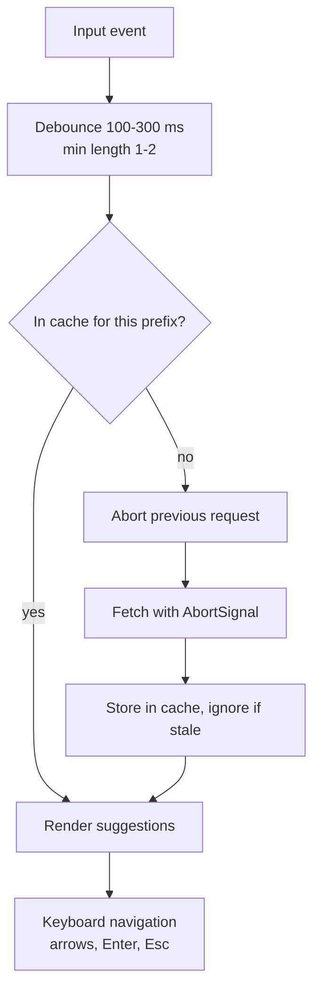
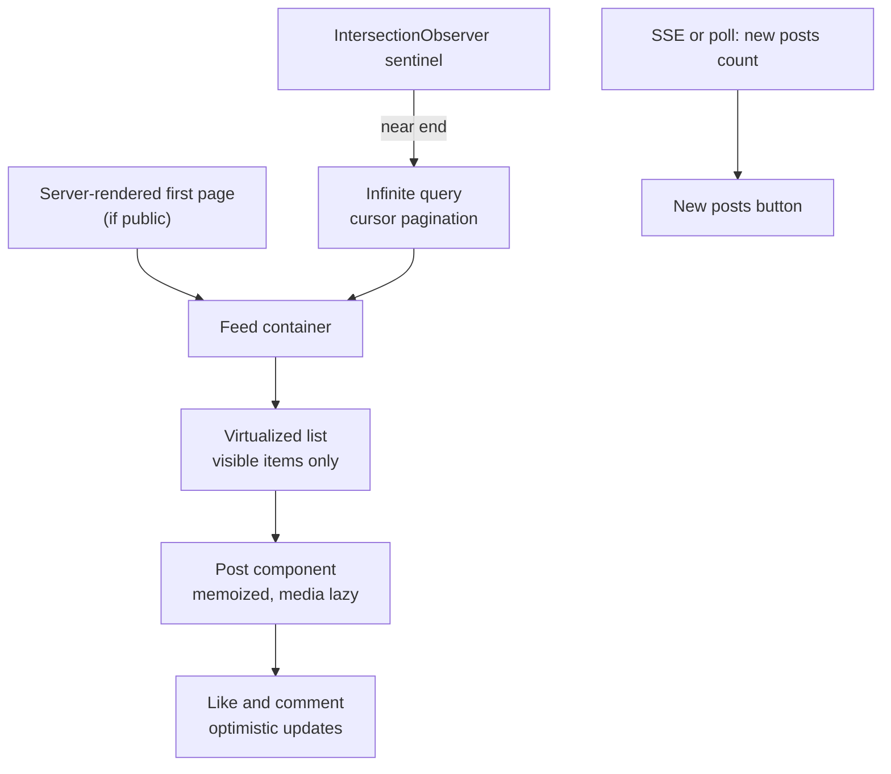
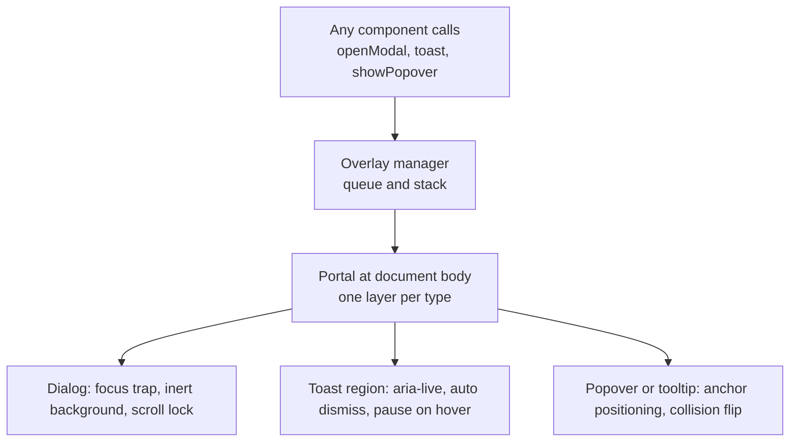
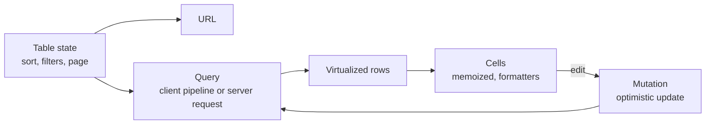
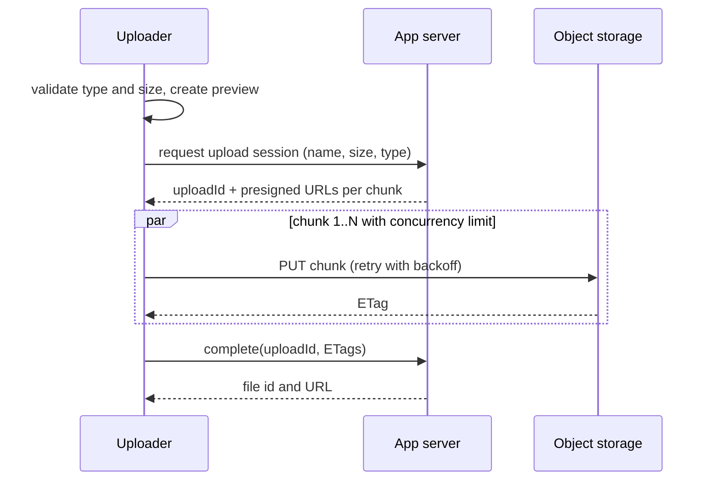

# 📘 UI Component Designs

These are the "design a component" prompts: **autocomplete, feed, carousel, modal system, table, uploader, comments, date picker**.
They look small, but the follow ups go deep on state, accessibility, performance, and API design.
Each section uses the same structure: requirements, architecture, data and state, interface, optimizations, and edge cases.
Application scale prompts (chat, docs, e-commerce, dashboards) are in [Application Designs](/docs/frontend-system-design/application-designs).

## Table of Contents

1. [A Template for Component Design](#1-a-template-for-component-design)
2. [Typeahead and Autocomplete](#2-typeahead-and-autocomplete)
3. [News Feed with Infinite Scroll](#3-news-feed-with-infinite-scroll)
4. [Image Carousel](#4-image-carousel)
5. [Modal, Toast, and Overlay Manager](#5-modal-toast-and-overlay-manager)
6. [Data Table](#6-data-table)
7. [File Uploader](#7-file-uploader)
8. [Nested Comments](#8-nested-comments)
9. [Date Picker](#9-date-picker)
10. [Questions](#10-questions)

---

## 1. A Template for Component Design

1. **Requirements:** features, devices, accessibility, performance targets, what is out of scope.
2. **Architecture:** parts of the component, who owns state, controlled vs uncontrolled.
3. **Data and state:** a state model (preferably a small state machine), cache, derived values.
4. **Interface:** props, events, slots, imperative handle, server contract.
5. **Optimizations:** rendering cost, network, bundle, memory.
6. **Accessibility and i18n:** roles, keyboard map, focus, announcements, RTL.
7. **Edge cases:** loading, empty, error, offline, race conditions, very large data, rapid input.


---

## 2. Typeahead and Autocomplete

**Requirements:** a search input with suggestions, fast, keyboard and screen reader friendly, reusable, handles slow networks and many results.



**State model:** `idle`, `typing`, `loading`, `results`, `empty`, `error`, with `highlightedIndex` and `isOpen`.

| Concern | Decision |
| --- | --- |
| **Request rate** | Debounce, start at 1 or 2 characters, optionally throttle for long typing |
| **Race conditions** | Abort the previous request, only render results whose query matches the current input |
| **Caching** | Map from normalized prefix to results, and reuse a longer cached prefix result to filter locally when the server returns the full set |
| **Prefetching and recents** | Show recent searches on focus, prefetch popular prefixes |
| **Ranking and highlight** | Server ranks, client highlights the matched substring after escaping user input (avoid XSS) |
| **Server side** | Trie or prefix index, cache hot prefixes, return 5 to 10 items (see the typeahead service in [Classic Designs](/docs/system-design/hld/classic-designs)) |
| **API** | `value` and `onChange` for the text, `onSelect(item)`, `fetchSuggestions(query, signal)` as a pluggable data source, `renderOption`, `getOptionLabel` |
| **Selection modes** | Free text (search box) vs selection required (combobox, with validation) |
| **Mobile** | Large tap targets, avoid keyboard covering the list, `inputmode` and `enterkeyhint` |
| **Accessibility** | ARIA combobox pattern: `role="combobox"`, `aria-expanded`, `aria-controls`, `aria-activedescendant`, options with `role="option"`, live region announcing "5 results" |
| **IME composition** | Do not fire searches during `compositionstart` to `compositionend` (Chinese, Japanese, Korean input) |

```js
// runnable
// Prefix cache that answers a longer query from a cached shorter one, and ignores stale responses.
function createTypeahead(fetchList) {
  const cache = new Map();                          // query -> { items, complete }
  let latest = 0;
  return async function search(query) {
    const id = ++latest;
    if (cache.has(query)) return { query, items: cache.get(query).items, from: 'cache' };
    // reuse a cached shorter prefix when the server returned the complete match set for it
    for (let n = query.length - 1; n > 0; n -= 1) {
      const hit = cache.get(query.slice(0, n));
      if (hit?.complete) return { query, items: hit.items.filter((s) => s.startsWith(query)), from: 'prefix' };
    }
    const items = await fetchList(query);
    if (id !== latest) return null;                 // a newer search superseded this one
    cache.set(query, { items, complete: true });    // here the fake server always returns every match
    return { query, items, from: 'network' };
  };
}

const words = ['apple', 'apricot', 'banana', 'blueberry', 'avocado'];
const delay = (ms) => new Promise((r) => setTimeout(r, ms));
const search = createTypeahead(async (q) => { await delay(q.length === 1 ? 50 : 10); return words.filter((w) => w.startsWith(q)); });

(async () => {
  const slow = search('a');                          // slow response for "a"
  const fast = search('ap');                         // faster response for "ap"
  console.log('a  ->', await slow);                  // null: stale, dropped
  console.log('ap ->', await fast);
  console.log('ap again ->', (await search('ap')).from);
  console.log('apr ->', await search('apr'));        // answered locally from the cached "ap" result
})();
```

---

## 3. News Feed with Infinite Scroll

**Requirements:** an endless list of posts with text, images, and video, likes and comments, new post indicator, smooth scrolling on low-end phones, SEO for the first screen if public.



| Concern | Decision |
| --- | --- |
| **Pagination** | Cursor based, page size 10 to 20, prefetch the next page before the sentinel is reached |
| **First load** | Server render or stream the first page for LCP, hydrate the list lazily |
| **DOM size** | Virtualize with measured heights, keep overscan small, reserve image space with aspect ratio |
| **Media** | Lazy load images, blur placeholders, responsive `srcset`, autoplay muted video only when mostly in view and pause when out (IntersectionObserver), one video playing at a time |
| **Data model** | Normalize posts, users, and comments by id, the feed holds ordered ids, so a like updates everywhere |
| **Updates** | Optimistic likes with rollback and idempotency, comments appended locally |
| **New content** | Show a "N new posts" button, never insert above the viewport, jump to top on click |
| **Scroll restoration** | Keep the infinite query cache and scroll anchor (item id plus offset) when going to a post and back |
| **Memory** | Drop or collapse pages far from the viewport, cap total retained items |
| **Ranking** | Server side, the client logs impressions (item visible for 1 second or more) and dwell time for ranking |
| **Failure handling** | Per page error row with retry, skeletons on first load, offline shows cached feed with a banner |
| **Accessibility** | `role="feed"` with `role="article"` items and `aria-posinset` and `aria-setsize`, keyboard shortcuts to move between posts, "load more" button alternative, announce loaded batch |
| **Performance** | Memoize post rows, stable props, avoid inline objects, `content-visibility: auto`, batch state updates, defer comments until opened |

---

## 4. Image Carousel

**Requirements:** swipe and click navigation, thumbnails and dots, optional autoplay, fast on mobile, accessible, works with many images.

**State:** `index`, `isDragging`, `isPaused`, derived `canPrev` and `canNext` (or wrap around).

| Concern | Decision |
| --- | --- |
| **Layout** | CSS scroll snapping (`scroll-snap-type: x mandatory`) gives native swipe and momentum with little JavaScript, or a transform based track for custom animation |
| **Loading** | Load the current slide eagerly, **neighbors** (`index +/- 1`) with low priority, the rest lazily, the first slide image as LCP with `fetchpriority="high"` |
| **Infinite loop** | Clone first and last slides or compute modulo indexes, reset position without animation at the edge |
| **Gestures** | Pointer events, velocity based snap, ignore vertical scroll gestures (`touch-action: pan-y`) |
| **Autoplay** | Off by default or pause on hover, focus, and `prefers-reduced-motion`, with a visible pause button (a WCAG requirement) |
| **Responsive images** | `srcset` and `sizes`, correct aspect ratio to avoid layout shift |
| **Zoom and fullscreen** | Lightbox with focus trap, pinch zoom, preloaded higher resolution version |
| **API** | `images`, `index` and `onIndexChange` (controlled), `loop`, `autoplay`, `renderSlide`, `onSlideView` for analytics |
| **Accessibility** | Container `role="region"` with `aria-roledescription="carousel"`, slides `role="group"` with `aria-label="3 of 10"`, previous and next buttons with names, inactive slides `aria-hidden` and not focusable, live region only when not auto-playing |
| **Memory** | Do not keep all full size images decoded, use `decoding="async"`, unload far slides if there are hundreds |

```js
// runnable
// Index math for a looping carousel and which slides to load.
const wrap = (i, n) => ((i % n) + n) % n;
const next = (i, n) => wrap(i + 1, n);
const prev = (i, n) => wrap(i - 1, n);
function slidesToLoad(index, n, radius = 1) {
  const out = [];
  for (let d = -radius; d <= radius; d += 1) out.push(wrap(index + d, n));
  return [...new Set(out)];
}
console.log(next(9, 10), prev(0, 10), slidesToLoad(0, 10), slidesToLoad(5, 3));
```

---

## 5. Modal, Toast, and Overlay Manager

**Requirements:** show dialogs, toasts, popovers, tooltips, and drawers from anywhere in the app, stacked correctly, accessible, without z-index wars.



| Concern | Decision |
| --- | --- |
| **Rendering** | Portals to `body` to escape `overflow` and stacking contexts, or the browser **top layer** (`dialog.showModal()`, the Popover API) which fixes z-index problems |
| **Stack and queue** | A manager keeps a stack of open dialogs (Esc closes the top one) and a queue for toasts with a maximum visible count |
| **API** | Imperative (`toast.success('Saved')`, `confirm({...})` returning a Promise) plus declarative (`<Dialog open onOpenChange>`) |
| **Focus** | On open move focus into the dialog, trap Tab, on close return focus to the trigger, make the background `inert` |
| **Scroll lock** | Prevent body scroll without layout shift (compensate scrollbar width), restore on close |
| **Dismissal** | Esc, backdrop click (configurable for destructive forms), explicit close button, route change |
| **Toast behavior** | Auto dismiss 4 to 6 seconds, pause on hover and focus, dedupe identical messages, persistent errors need a manual close, actions like Undo, `role="status"` or `role="alert"` |
| **Positioning (popovers)** | Anchor to a trigger, flip and shift on collision, update on scroll and resize (Floating UI, CSS anchor positioning), arrow, delay and hover intent |
| **Animation** | Enter and exit transitions, `prefers-reduced-motion`, unmount after exit finishes |
| **Mobile** | Bottom sheets, safe areas, swipe to dismiss, avoid being covered by the keyboard |
| **SSR** | Render portals only on the client or after mount |

```js
// runnable
// Toast queue: max visible, dedupe by key, auto dismiss.
function createToaster({ max = 3, ttl = 40 } = {}) {
  let visible = [];
  const queue = [];
  const log = (label) => console.log(label.padEnd(10), visible.map((t) => t.msg).join(' | '));
  function show(msg, key = msg) {
    if ([...visible, ...queue].some((t) => t.key === key)) return;       // dedupe
    const toast = { msg, key };
    if (visible.length < max) {
      visible.push(toast);
      setTimeout(() => dismiss(toast), ttl);
    } else queue.push(toast);
  }
  function dismiss(toast) {
    visible = visible.filter((t) => t !== toast);
    const nxt = queue.shift();
    if (nxt) { visible.push(nxt); setTimeout(() => dismiss(nxt), ttl); }
    log('dismissed');
  }
  return { show, snapshot: () => log('visible') };
}

const toaster = createToaster();
['Saved', 'Saved', 'Uploaded', 'Synced', 'Error 1', 'Error 2'].forEach((m) => toaster.show(m));
toaster.snapshot();
```

---

## 6. Data Table

**Requirements:** sortable, filterable, paginated or virtualized table of thousands to millions of rows, column resize and reorder, row selection, sticky header, keyboard navigation, export.

| Concern | Decision |
| --- | --- |
| **Where data operations run** | **Client side** for up to a few thousand rows (fast, simple). **Server side** sorting, filtering, and pagination for large data, the table sends `{ sort, filters, cursor }` and renders the slice |
| **Rendering** | Virtualize rows (and columns if very wide), fixed row height when possible, memoized cells, sticky header and first column with `position: sticky` |
| **State** | A table state object (`sorting`, `filters`, `pagination`, `selection`, `columnVisibility`, `columnOrder`, `columnSizing`) in the URL or a store, rows derived through a pipeline (filter, sort, paginate) |
| **Headless approach** | Use a headless engine (TanStack Table) for logic and render your own markup |
| **Sorting and filtering** | Stable multi-column sort, debounced filter inputs, keep sort and filters in the URL |
| **Selection** | Row checkbox, shift click range, select all on page vs select all matching (needs a server side "all" token), selection survives paging |
| **Editing** | Inline cell edit with optimistic update and validation, per cell pending and error state |
| **Column resize and reorder** | Pointer events with `requestAnimationFrame`, persist per user, avoid layout thrash by using CSS variables for widths |
| **Large exports** | Server generated file with a link, not building a million rows in the browser |
| **Accessibility** | Native `table`, `th scope`, `caption`, `aria-sort` on headers (buttons), `aria-rowcount` and `aria-rowindex` when virtualized, for editable grids follow the ARIA grid pattern with arrow key navigation |
| **Responsive** | Horizontal scroll with pinned columns, or switch to a card layout on small screens |
| **States** | Loading skeleton rows, empty state with a clear filters action, error with retry, stale indicator during refetch |



---

## 7. File Uploader

**Requirements:** pick or drag files, show progress, handle large files and poor networks, cancel, retry, resume, validate, preview.



| Concern | Decision |
| --- | --- |
| **Direct to storage** | Presigned URLs so bytes do not pass through your servers |
| **Large files** | Chunked (multipart) upload, 5 to 16 MB chunks, upload 3 to 4 chunks in parallel, **resumable** by asking the server which parts exist (tus protocol or S3 multipart) |
| **Progress** | `XMLHttpRequest.upload.onprogress` or a stream with byte counting (`fetch` upload streaming support varies), aggregate across chunks, throttle UI updates |
| **Validation** | Type by content (magic bytes) and extension, size limits, count limits, image dimensions, and again on the server |
| **Cancel and retry** | `AbortController` per chunk, retry with backoff, a failed chunk does not restart the file |
| **Previews** | `URL.createObjectURL` for local previews (revoke when done), client side image resize or compression before upload, thumbnails generated by the server |
| **Heavy work** | Hashing (for dedupe) and compression in a Web Worker |
| **State** | Per file: `queued`, `uploading(progress)`, `paused`, `processing`, `done`, `error`, a queue with concurrency limit across files |
| **Drag and drop** | Drop zone with visual states, plus a real `input type="file"` for keyboard and screen reader users |
| **Security** | Virus scan, content type enforcement, serve uploads from a separate origin, never trust client reported type |
| **Mobile** | Camera capture (`capture` attribute), background uploads are limited, resume when returning |
| **Accessibility** | Progress with `role="progressbar"` and values, status announcements, error messages tied to files |

```js
// runnable
// Run chunk uploads with a concurrency limit and retry with backoff.
async function uploadChunks(chunks, send, { concurrency = 3, retries = 2 } = {}) {
  const results = new Array(chunks.length);
  let next = 0, attemptsTotal = 0;
  async function worker() {
    while (next < chunks.length) {
      const i = next++;
      for (let attempt = 0; ; attempt += 1) {
        try { attemptsTotal += 1; results[i] = await send(chunks[i], i); break; }
        catch (e) { if (attempt >= retries) throw e; await new Promise((r) => setTimeout(r, 5 * 2 ** attempt)); }
      }
    }
  }
  await Promise.all(Array.from({ length: concurrency }, worker));
  return { results, attemptsTotal };
}

let failedOnce = false;
const send = async (chunk, i) => {
  if (i === 2 && !failedOnce) { failedOnce = true; throw new Error('network'); }   // chunk 2 fails once
  return `etag-${i}`;
};
uploadChunks([...Array(6).keys()], send).then(({ results, attemptsTotal }) => console.log(results.join(','), '| attempts:', attemptsTotal));
```

---

## 8. Nested Comments

**Requirements:** threaded replies to arbitrary depth, collapse and expand, lazy loading of replies, optimistic posting, sorting (top, new), real-time additions.

| Concern | Decision |
| --- | --- |
| **Data model** | The API returns a **flat list** with `parentId` (or materialized path), the client builds a tree and indexes by id, and stores `childIds` per comment |
| **Loading** | Load top level comments with a few replies each, "load N more replies" fetches children by `parentId` with a cursor, avoid loading the whole thread |
| **Rendering** | Recursive component, but **cap visual indentation** (for example 4 levels, then continue the thread flat or link to a "continue thread" page) so mobile stays readable |
| **Virtualization** | Flatten the visible tree to a list of rows with a depth, then virtualize that list |
| **Collapse** | A `collapsed` set of ids, collapsing hides descendants, show the hidden count |
| **Optimistic posting** | Insert a temporary comment with a client id under its parent, replace with the server id on success, show failed state with retry |
| **Editing and deleting** | Soft delete keeps the thread structure (`[deleted]`), edits show an "edited" label |
| **Real-time** | New comments arrive over SSE or WebSocket, add them under their parents without moving the reader's position, show a "new replies" pill |
| **Sorting** | Server sorts, client keeps the order per sibling group, resort on change without losing collapse state |
| **Composer** | One shared composer that moves under the reply target, saves drafts per target, supports mentions with the typeahead component |
| **Safety** | Sanitize rendered Markdown, rate limit, report and hide flows |
| **Accessibility** | Nested lists or `role="tree"` semantics only when keyboard behavior is implemented, headings per thread, announce new replies, collapse buttons with `aria-expanded` |

```js
// runnable
// Build a comment tree from a flat list, then flatten to visible rows with depth (respecting collapse).
function buildTree(flat) {
  const byId = new Map(flat.map((c) => [c.id, { ...c, children: [] }]));
  const roots = [];
  for (const c of byId.values()) (c.parentId ? byId.get(c.parentId)?.children : roots)?.push(c);
  return roots;
}
function flatten(nodes, collapsed = new Set(), depth = 0, out = []) {
  for (const n of nodes) {
    out.push({ id: n.id, depth, hidden: collapsed.has(n.id) ? countDescendants(n) : 0 });
    if (!collapsed.has(n.id)) flatten(n.children, collapsed, depth + 1, out);
  }
  return out;
}
const countDescendants = (n) => n.children.reduce((s, c) => s + 1 + countDescendants(c), 0);

const flat = [
  { id: 1, parentId: null }, { id: 2, parentId: 1 }, { id: 3, parentId: 2 },
  { id: 4, parentId: 1 }, { id: 5, parentId: null },
];
const tree = buildTree(flat);
console.log(flatten(tree).map((r) => `${'  '.repeat(r.depth)}#${r.id}`).join('\n'));
console.log(JSON.stringify(flatten(tree, new Set([1]))));
```

---

## 9. Date Picker

**Requirements:** pick a date or a range, keyboard and screen reader accessible, localized, min and max dates, disabled dates, time zones, works on mobile.

| Concern | Decision |
| --- | --- |
| **Data model** | Store dates as plain calendar dates (`YYYY-MM-DD`) when time does not matter, and as UTC instants plus a time zone when it does. Never use local `Date` parsing of date-only strings (off by one day bugs). Use `Temporal` or a date library |
| **Calendar grid** | Compute weeks for a month, locale dependent first day of week (`new Intl.Locale(locale).getWeekInfo()`, with a fallback where unsupported), leading and trailing days from adjacent months |
| **Navigation** | Month and year views, quick jumps, `PageUp` and `PageDown` for months, `Shift` plus those for years |
| **Keyboard** | Arrow keys move by day and week, `Home` and `End` for week bounds, `Enter` selects, `Esc` closes (ARIA grid pattern) |
| **Ranges** | Two clicks or drag, hover preview, validate start before end, allow keyboard range entry |
| **Constraints** | `min`, `max`, `isDateDisabled(date)`, blackout dates from the server (availability), fetch availability per visible month |
| **Typing** | Parse typed input by locale with forgiving formats, show the expected format, validate on blur |
| **Native vs custom** | Native `input type="date"` is accessible and mobile friendly but limited in styling and ranges, custom gives control at higher cost, offer native on touch devices |
| **Time zones and DST** | Show the zone for time pickers, handle days with 23 or 25 hours, store UTC |
| **i18n** | Localized month and weekday names with `Intl.DateTimeFormat`, other calendar systems when required, RTL layout |
| **Performance** | Render a single month (or three), memoize day cells, lazy load the heavy calendar on first open |

---

## 10. Questions

**Q: How do you start a component design interview?**
Clarify usage and constraints, list states and edge cases, decide controlled vs uncontrolled, sketch the API, then go through performance and accessibility.

**Q: How do you avoid showing outdated typeahead results?**
Debounce input, abort previous requests, and ignore any response whose query is not the current one.

**Q: How do you render a feed of 100,000 items?**
Cursor pagination, a virtualized list with measured or reserved heights, cache management that drops far pages, and preserving scroll position on navigation.

**Q: How do you keep modals accessible?**
Use the native `dialog` or a headless primitive, trap focus, make the background inert, label the dialog, close on `Esc`, and return focus to the trigger.

**Q: Client side or server side for table sorting and filtering?**
Client side when the whole data set is small enough to load (a few thousand rows).
Server side with cursor pagination when it is large, and keep the table state in the URL either way.

**Q: How do you upload a 5 GB file reliably?**
Chunked multipart upload to presigned URLs, parallel chunks with a concurrency limit, retries per chunk, resume by listing uploaded parts, progress aggregation, and a worker for hashing.

**Q: How do you show threaded comments on mobile?**
Cap indentation depth, collapse long threads with "continue thread", lazy load replies, and virtualize the flattened visible list.

**Q: What bugs do date pickers commonly have?**
Parsing date-only strings as UTC and displaying a different day, DST gaps and overlaps, locale first day of week, time zone confusion between the user and the event, and missing keyboard support.

**Q: Imperative or declarative API for toasts and modals?**
Offer both: a declarative component for controlled cases and an imperative function (returning a Promise for confirmations) for convenience, backed by one manager that handles stacking, focus, and queueing.

Next: [Application Designs](/docs/frontend-system-design/application-designs).
